# DOCUMENTO MAESTRO DE PRODUCTO Y REQUERIMIENTOS — MVP

## Aplicación móvil de diario de vida, cuidados y crecimiento de mascotas

**Nombre de trabajo del producto:** *PetLife* (nombre provisional — ver DP-001)
**Versión del documento:** 1.0
**Fecha:** 13 de septiembre de 2026
**Estado:** Borrador aprobable para inicio de diseño y arquitectura
**Audiencia:** Product Management, Arquitectura de Software, Arquitectura Móvil, UX, Seguridad, QA, Backend, Frontend, Marketing de producto, y herramientas de desarrollo asistidas por IA.

---

## CONTROL DEL DOCUMENTO

| Elemento | Detalle |
|---|---|
| Autoría | Equipo senior de Producto y Tecnología (PM, BA, Software Architect, Mobile Architect, UX Architect, Security Architect, QA Lead, Tech Lead) |
| Alcance | MVP para lanzamiento a mercado en iOS y Android |
| Fuera de alcance | Arquitectura detallada (SAD), modelo físico de datos, diseño visual final, plan de sprints |
| Documentos derivados esperados | SAD, Modelo de datos, Design System, Backlog refinado, Plan de pruebas, DPIA/Registro de tratamiento |
| Idioma del documento | Español |
| Idiomas del producto en MVP | Español e inglés (ver DP-004) |

---

## CONVENCIONES Y TAXONOMÍA DEL DOCUMENTO

Para evitar ambigüedad, todo enunciado de este documento pertenece a una de estas cinco categorías. Se marcan explícitamente cuando no resulta evidente por el contexto.

| Marca | Categoría | Significado |
|---|---|---|
| **[REQ]** | Requisito | Obligatorio. Su incumplimiento invalida la entrega. Verificable mediante criterio de aceptación o prueba. |
| **[REC]** | Recomendación | Propuesta del equipo. Puede descartarse con justificación explícita y registro de la decisión. |
| **[DEC]** | Decisión | Decisión ya tomada en este documento. Cambiarla requiere control de cambios. |
| **[SUP]** | Supuesto | Se asume cierto sin evidencia confirmada. Si se invalida, impacta el alcance. |
| **[RSG]** | Riesgo | Evento incierto con impacto negativo potencial. Tiene mitigación asociada. |
| **[DP-xxx]** | Decisión pendiente | Falta una decisión de negocio. Documentada en el Anexo A con alternativas, recomendación e impacto. |

**Terminología de prioridad:** MUST / SHOULD / COULD / WON'T (MoSCoW). En requerimientos, adicionalmente: P0 (bloqueante de lanzamiento), P1 (necesario para validar hipótesis), P2 (mejora de experiencia).

**Nomenclatura de identificadores:**

| Prefijo | Objeto |
|---|---|
| `RF-<MÓDULO>-nnn` | Requerimiento funcional |
| `RNF-<ÁREA>-nnn` | Requerimiento no funcional |
| `RN-nnn` | Regla de negocio |
| `FL-nnn` | Flujo funcional |
| `UC-nnn` | Caso de uso |
| `US-<ÉPICA>-nnn` | Historia de usuario |
| `CA-<US>-nn` | Criterio de aceptación |
| `EPIC-nn` | Épica |
| `KPI-nn` | Indicador |
| `H-n` | Hipótesis |
| `DP-nnn` | Decisión pendiente |

---

## ÍNDICE

**1. RESUMEN EJECUTIVO**  
&nbsp;&nbsp;&nbsp;&nbsp;1.1 Qué se va a construir  
&nbsp;&nbsp;&nbsp;&nbsp;1.2 Qué NO se va a construir  
&nbsp;&nbsp;&nbsp;&nbsp;1.3 Alcance funcional del MVP (doce módulos)  
&nbsp;&nbsp;&nbsp;&nbsp;1.4 Decisiones técnicas principales  
&nbsp;&nbsp;&nbsp;&nbsp;1.5 Criterio de éxito del MVP  
**2. VISIÓN DEL PRODUCTO**  
&nbsp;&nbsp;&nbsp;&nbsp;2.1 Declaración de visión  
&nbsp;&nbsp;&nbsp;&nbsp;2.2 Horizonte temporal  
&nbsp;&nbsp;&nbsp;&nbsp;2.3 Posicionamiento  
&nbsp;&nbsp;&nbsp;&nbsp;2.4 Principio de diseño rector  
**3. PROBLEMA**  
&nbsp;&nbsp;&nbsp;&nbsp;3.1 Problemas del propietario  
&nbsp;&nbsp;&nbsp;&nbsp;3.2 Problema de negocio  
&nbsp;&nbsp;&nbsp;&nbsp;3.3 Anti-problema: qué NO estamos resolviendo en el MVP  
**4. PROPUESTA DE VALOR**  
&nbsp;&nbsp;&nbsp;&nbsp;4.1 Declaración central  
&nbsp;&nbsp;&nbsp;&nbsp;4.2 Desglose por dimensión  
&nbsp;&nbsp;&nbsp;&nbsp;4.3 Qué hace diferente al producto (defendibilidad del MVP)  
&nbsp;&nbsp;&nbsp;&nbsp;4.4 Elevator pitch de una frase  
**5. HIPÓTESIS DEL MVP**  
&nbsp;&nbsp;&nbsp;&nbsp;5.1 Hipótesis de riesgo transversal (no funcional)  
**6. USUARIOS**  
&nbsp;&nbsp;&nbsp;&nbsp;6.1 Segmentación primaria del MVP  
&nbsp;&nbsp;&nbsp;&nbsp;6.2 Personas  
&nbsp;&nbsp;&nbsp;&nbsp;6.3 Anti-persona (usuario para el que NO diseñamos en el MVP)  
&nbsp;&nbsp;&nbsp;&nbsp;6.4 Contexto de uso  
**7. ACTORES DEL MVP**  
&nbsp;&nbsp;&nbsp;&nbsp;7.1 Catálogo de actores  
&nbsp;&nbsp;&nbsp;&nbsp;7.2 Actores explícitamente NO incluidos  
&nbsp;&nbsp;&nbsp;&nbsp;7.3 Diagrama de contexto de actores  
**8. ALCANCE**  
&nbsp;&nbsp;&nbsp;&nbsp;8.1 Alcance de plataformas  
&nbsp;&nbsp;&nbsp;&nbsp;8.2 Alcance geográfico y legal  
&nbsp;&nbsp;&nbsp;&nbsp;8.3 Alcance lingüístico  
&nbsp;&nbsp;&nbsp;&nbsp;8.4 Alcance de datos  
&nbsp;&nbsp;&nbsp;&nbsp;8.5 Límites duros del MVP  
**9. DEFINICIÓN DEL MVP**  
&nbsp;&nbsp;&nbsp;&nbsp;9.1 Criterio de inclusión  
&nbsp;&nbsp;&nbsp;&nbsp;9.2 Mapa funcional del MVP  
&nbsp;&nbsp;&nbsp;&nbsp;9.3 Lo que hace "suficientemente bueno" al MVP  
**10. OUT OF SCOPE DEL MVP**  
&nbsp;&nbsp;&nbsp;&nbsp;10.1 Catálogo de exclusiones  
&nbsp;&nbsp;&nbsp;&nbsp;10.2 Regla de gobierno del alcance  
**11. FUNCIONALIDADES POR MÓDULO**  
&nbsp;&nbsp;&nbsp;&nbsp;11.13 Dependencias entre módulos  
**12. FUNCIONALIDADES POR ROL**  
&nbsp;&nbsp;&nbsp;&nbsp;12.1 Rol: Propietario (A-01)  
&nbsp;&nbsp;&nbsp;&nbsp;12.2 Rol: Visitante público (A-02)  
&nbsp;&nbsp;&nbsp;&nbsp;12.3 Rol: Administrador de plataforma (A-03)  
&nbsp;&nbsp;&nbsp;&nbsp;12.4 Rol: Soporte read-only (A-04)  
&nbsp;&nbsp;&nbsp;&nbsp;12.5 Principio de acceso administrativo a datos personales  
&nbsp;&nbsp;&nbsp;&nbsp;12.6 Rol: Sistema (A-05)  
**13. MATRIZ DE ROLES Y PERMISOS**  
&nbsp;&nbsp;&nbsp;&nbsp;13.1 Reglas transversales de autorización  
**14. REGLAS DE NEGOCIO**  
&nbsp;&nbsp;&nbsp;&nbsp;14.1 Cuenta e identidad  
&nbsp;&nbsp;&nbsp;&nbsp;14.2 Mascota, edad y etapa  
&nbsp;&nbsp;&nbsp;&nbsp;14.3 Timeline, hitos y multimedia  
&nbsp;&nbsp;&nbsp;&nbsp;14.4 Recordatorios  
&nbsp;&nbsp;&nbsp;&nbsp;14.5 Gamificación  
&nbsp;&nbsp;&nbsp;&nbsp;14.6 Perfil compartible y privacidad  
&nbsp;&nbsp;&nbsp;&nbsp;14.7 Administración y auditoría  
&nbsp;&nbsp;&nbsp;&nbsp;14.8 Recomendaciones  
&nbsp;&nbsp;&nbsp;&nbsp;14.9 Suscripción  
**15. REQUERIMIENTOS FUNCIONALES**  
&nbsp;&nbsp;&nbsp;&nbsp;15.1 Identidad y acceso — `RF-AUTH`  
&nbsp;&nbsp;&nbsp;&nbsp;15.2 Perfil de usuario — `RF-USER`  
&nbsp;&nbsp;&nbsp;&nbsp;15.3 Gestión de mascotas — `RF-PET`  
&nbsp;&nbsp;&nbsp;&nbsp;15.4 Timeline — `RF-TIMELINE`  
&nbsp;&nbsp;&nbsp;&nbsp;15.5 Álbum — `RF-ALBUM`  
&nbsp;&nbsp;&nbsp;&nbsp;15.6 Recomendaciones — `RF-RECOMMENDATION`  
&nbsp;&nbsp;&nbsp;&nbsp;15.7 Recordatorios — `RF-REMINDER`  
&nbsp;&nbsp;&nbsp;&nbsp;15.8 Gamificación — `RF-GAME`  
&nbsp;&nbsp;&nbsp;&nbsp;15.9 Perfil compartible — `RF-SHARE`  
&nbsp;&nbsp;&nbsp;&nbsp;15.10 Administración — `RF-ADMIN`  
&nbsp;&nbsp;&nbsp;&nbsp;15.11 Suscripción — `RF-SUB`  
&nbsp;&nbsp;&nbsp;&nbsp;15.12 Analítica y plataforma — `RF-CORE`  
**16. REQUERIMIENTOS NO FUNCIONALES**  
&nbsp;&nbsp;&nbsp;&nbsp;16.1 Seguridad — `RNF-SEC`  
&nbsp;&nbsp;&nbsp;&nbsp;16.2 Privacidad y protección de datos — `RNF-PRIV`  
&nbsp;&nbsp;&nbsp;&nbsp;16.3 Rendimiento — `RNF-PERF`  
&nbsp;&nbsp;&nbsp;&nbsp;16.4 Disponibilidad, escalabilidad y continuidad — `RNF-AVAIL`, `RNF-SCAL`, `RNF-BKP`  
&nbsp;&nbsp;&nbsp;&nbsp;16.5 Observabilidad — `RNF-OBS`  
&nbsp;&nbsp;&nbsp;&nbsp;16.6 Compatibilidad y accesibilidad — `RNF-COMP`, `RNF-A11Y`  
&nbsp;&nbsp;&nbsp;&nbsp;16.7 Mantenibilidad — `RNF-MAINT`  
&nbsp;&nbsp;&nbsp;&nbsp;16.8 Consumo de recursos del dispositivo — `RNF-RES`  
**17. SEGURIDAD**  
&nbsp;&nbsp;&nbsp;&nbsp;17.1 Principios rectores y su aplicación concreta  
&nbsp;&nbsp;&nbsp;&nbsp;17.2 Superficies de ataque identificadas  
&nbsp;&nbsp;&nbsp;&nbsp;17.3 Modelo de autenticación  
&nbsp;&nbsp;&nbsp;&nbsp;17.4 Ciclo de vida de la sesión  
&nbsp;&nbsp;&nbsp;&nbsp;17.5 Registro de sesión  
&nbsp;&nbsp;&nbsp;&nbsp;17.6 Múltiples dispositivos, sesiones robadas y dispositivos perdidos  
&nbsp;&nbsp;&nbsp;&nbsp;17.7 Detección de sesiones sospechosas  
&nbsp;&nbsp;&nbsp;&nbsp;17.8 Catálogo de amenazas y controles  
&nbsp;&nbsp;&nbsp;&nbsp;17.9 Seguridad de API (§25 del encargo)  
&nbsp;&nbsp;&nbsp;&nbsp;17.10 Gestión de archivos y multimedia (§27 del encargo)  
&nbsp;&nbsp;&nbsp;&nbsp;17.11 Seguridad móvil (§26 del encargo)  
**18. PRIVACIDAD**  
&nbsp;&nbsp;&nbsp;&nbsp;18.1 Marco aplicable  
&nbsp;&nbsp;&nbsp;&nbsp;18.2 Datos tratados y base jurídica  
&nbsp;&nbsp;&nbsp;&nbsp;18.3 Consentimiento  
&nbsp;&nbsp;&nbsp;&nbsp;18.4 Contenido que puede afectar a terceros  
&nbsp;&nbsp;&nbsp;&nbsp;18.5 Derechos del interesado  
&nbsp;&nbsp;&nbsp;&nbsp;18.6 Política de retención  
&nbsp;&nbsp;&nbsp;&nbsp;18.7 Minimización — decisiones explícitas de no recoger  
&nbsp;&nbsp;&nbsp;&nbsp;18.8 Menores  
**19. FLUJOS FUNCIONALES**  
**20. CASOS DE USO**  
**21. HISTORIAS DE USUARIO**  
**22. CRITERIOS DE ACEPTACIÓN**  
**23. NAVEGACIÓN**  
&nbsp;&nbsp;&nbsp;&nbsp;23.1 Arquitectura de navegación  
&nbsp;&nbsp;&nbsp;&nbsp;23.2 Destinos y su contenido  
&nbsp;&nbsp;&nbsp;&nbsp;23.3 Reglas de navegación  
**24. EXPERIENCIA MÓVIL**  
&nbsp;&nbsp;&nbsp;&nbsp;24.1 Diferencias iOS / Android a documentar y respetar  
&nbsp;&nbsp;&nbsp;&nbsp;24.2 Permisos solicitados  
&nbsp;&nbsp;&nbsp;&nbsp;24.3 Modo offline — alcance del MVP  
&nbsp;&nbsp;&nbsp;&nbsp;24.4 Multimedia  
&nbsp;&nbsp;&nbsp;&nbsp;24.5 Otros comportamientos requeridos  
&nbsp;&nbsp;&nbsp;&nbsp;24.6 Matriz mínima de dispositivos de prueba  
**25. ESTADOS Y ERRORES DE LA APLICACIÓN**  
**26. GAMIFICACIÓN**  
&nbsp;&nbsp;&nbsp;&nbsp;26.1 Filosofía  
&nbsp;&nbsp;&nbsp;&nbsp;26.2 Modelo de XP  
&nbsp;&nbsp;&nbsp;&nbsp;26.3 Niveles  
&nbsp;&nbsp;&nbsp;&nbsp;26.4 Catálogo inicial de insignias  
&nbsp;&nbsp;&nbsp;&nbsp;26.5 Prevención de abuso  
&nbsp;&nbsp;&nbsp;&nbsp;26.6 Cómo se medirá si funciona  
**27. RECOMENDACIONES — DISEÑO DEL MOTOR**  
&nbsp;&nbsp;&nbsp;&nbsp;27.1 Arquitectura conceptual  
&nbsp;&nbsp;&nbsp;&nbsp;27.2 Estructura de una regla  
&nbsp;&nbsp;&nbsp;&nbsp;27.3 Tabla de etapas de vida (RN-012)  
&nbsp;&nbsp;&nbsp;&nbsp;27.4 Ejemplos de reglas (ilustrativas, pendientes de validación veterinaria)  
&nbsp;&nbsp;&nbsp;&nbsp;27.5 Priorización y presentación  
&nbsp;&nbsp;&nbsp;&nbsp;27.6 Responsabilidad sanitaria  
**28. RECORDATORIOS — DISEÑO DETALLADO**  
&nbsp;&nbsp;&nbsp;&nbsp;28.1 Arquitectura de notificación  
&nbsp;&nbsp;&nbsp;&nbsp;28.2 Máquina de estados  
&nbsp;&nbsp;&nbsp;&nbsp;28.3 Recurrencia  
&nbsp;&nbsp;&nbsp;&nbsp;28.4 Casos límite que deben resolverse explícitamente  
**29. ADMINISTRACIÓN**  
&nbsp;&nbsp;&nbsp;&nbsp;29.1 Alcance deliberadamente pequeño  
&nbsp;&nbsp;&nbsp;&nbsp;29.2 Funcionalidades  
&nbsp;&nbsp;&nbsp;&nbsp;29.3 Qué NO puede hacer el administrador  
&nbsp;&nbsp;&nbsp;&nbsp;29.4 Indicadores operativos del panel  
**30. ANALÍTICA DE PRODUCTO**  
&nbsp;&nbsp;&nbsp;&nbsp;30.1 Principios  
&nbsp;&nbsp;&nbsp;&nbsp;30.2 Propiedades comunes a todos los eventos  
&nbsp;&nbsp;&nbsp;&nbsp;30.3 Propiedades de usuario y de mascota  
&nbsp;&nbsp;&nbsp;&nbsp;30.4 Catálogo de eventos  
&nbsp;&nbsp;&nbsp;&nbsp;30.5 Gobernanza  
**31. KPIs DEL MVP**  
&nbsp;&nbsp;&nbsp;&nbsp;31.1 Métricas de vanidad frente a métricas accionables  
&nbsp;&nbsp;&nbsp;&nbsp;31.2 Cuadro de mandos del MVP  
**32. MONETIZACIÓN**  
&nbsp;&nbsp;&nbsp;&nbsp;32.1 Modelo  
&nbsp;&nbsp;&nbsp;&nbsp;32.2 Free frente a Premium  
&nbsp;&nbsp;&nbsp;&nbsp;32.3 Línea roja ética y de producto  
&nbsp;&nbsp;&nbsp;&nbsp;32.4 Estrategia de *paywall*  
&nbsp;&nbsp;&nbsp;&nbsp;32.5 Cumplimiento de las tiendas  
&nbsp;&nbsp;&nbsp;&nbsp;32.6 Unidad económica preliminar  
**33. PRIORIZACIÓN (MoSCoW)**  
**34. BACKLOG DE ALTO NIVEL**  
&nbsp;&nbsp;&nbsp;&nbsp;34.1 Secuencia recomendada de construcción  
**35. PRUEBAS**  
&nbsp;&nbsp;&nbsp;&nbsp;35.1 Estrategia general  
&nbsp;&nbsp;&nbsp;&nbsp;35.2 Cobertura por módulo  
&nbsp;&nbsp;&nbsp;&nbsp;35.3 Flujos críticos con automatización obligatoria  
&nbsp;&nbsp;&nbsp;&nbsp;35.4 Tipos de prueba adicionales  
&nbsp;&nbsp;&nbsp;&nbsp;35.5 Datos de prueba  
**36. DEFINITION OF DONE**  
**37. RECOMENDACIÓN TECNOLÓGICA PRELIMINAR**  
&nbsp;&nbsp;&nbsp;&nbsp;37.1 Criterios de decisión, en orden de prioridad  
&nbsp;&nbsp;&nbsp;&nbsp;37.2 Tecnología móvil  
&nbsp;&nbsp;&nbsp;&nbsp;37.3 Backend  
&nbsp;&nbsp;&nbsp;&nbsp;37.4 Lo que explícitamente NO se va a construir  
&nbsp;&nbsp;&nbsp;&nbsp;37.5 Diagrama de arquitectura preliminar  
**38. RIESGOS**  
**39. CRITERIOS DE LANZAMIENTO**  
&nbsp;&nbsp;&nbsp;&nbsp;39.1 Producto  
&nbsp;&nbsp;&nbsp;&nbsp;39.2 Calidad  
&nbsp;&nbsp;&nbsp;&nbsp;39.3 Seguridad y privacidad  
&nbsp;&nbsp;&nbsp;&nbsp;39.4 Contenido  
&nbsp;&nbsp;&nbsp;&nbsp;39.5 Operación  
&nbsp;&nbsp;&nbsp;&nbsp;39.6 Negocio  
&nbsp;&nbsp;&nbsp;&nbsp;39.7 Estrategia de lanzamiento  
**40. CRITERIOS DE VALIDACIÓN DEL MVP**  
&nbsp;&nbsp;&nbsp;&nbsp;40.1 Principio  
&nbsp;&nbsp;&nbsp;&nbsp;40.2 Condiciones de validación  
&nbsp;&nbsp;&nbsp;&nbsp;40.3 Interpretación de los resultados  
**41. EVOLUCIÓN POST-MVP**  
&nbsp;&nbsp;&nbsp;&nbsp;41.1 Horizonte 2 (6–18 meses), condicionado a la validación  
&nbsp;&nbsp;&nbsp;&nbsp;41.2 Decisiones del MVP que mantienen abierta la evolución  
&nbsp;&nbsp;&nbsp;&nbsp;41.3 Horizonte 3 (18+ meses), solo con tracción demostrada  
**42. MATRIZ DE TRAZABILIDAD**  
**43. CONCLUSIONES**  
&nbsp;&nbsp;&nbsp;&nbsp;43.1 Qué define este MVP  
&nbsp;&nbsp;&nbsp;&nbsp;43.2 Las tres decisiones que más condicionan el resultado  
&nbsp;&nbsp;&nbsp;&nbsp;43.3 Lo que más probablemente saldrá mal  
&nbsp;&nbsp;&nbsp;&nbsp;43.4 Cómo usar este documento  
&nbsp;&nbsp;&nbsp;&nbsp;43.5 Qué significa que el MVP está listo para salir al mercado  

**ANEXO A — DECISIONES PENDIENTES**  

---

# 1. RESUMEN EJECUTIVO

## 1.1 Qué se va a construir

Una aplicación móvil nativa-multiplataforma (iOS y Android) que permite a un propietario de mascota **construir y conservar la historia de vida de su animal** mediante un timeline de hitos con fotografías, y que a cambio de esa información le devuelve **valor útil y recurrente**: recomendaciones contextuales por etapa de vida, recordatorios de cuidados, y un sistema ligero de gamificación que premia la constancia en el registro.

El MVP se apoya en un intercambio de valor explícito:

> El usuario aporta datos estructurados de su mascota (especie, raza, edad, peso, hitos, vacunas) → el sistema devuelve orientación personalizada y memoria emocional acumulada → el usuario vuelve.

## 1.2 Qué NO se va a construir

No es una red social. No es un marketplace. No es un directorio de veterinarias. No es telemedicina. No incorpora IA diagnóstica. Estas capacidades se documentan como evolución post-MVP (§41) y están explícitamente excluidas en §10.

## 1.3 Alcance funcional del MVP (doce módulos)

1. Identidad y acceso (email+contraseña, Google, Apple Sign-In)
2. Perfil de usuario y preferencias
3. Gestión de mascotas (multi-mascota con límite por plan)
4. Perfil de mascota como centro de navegación
5. Timeline de vida (hitos con foto)
6. Álbum automático (vista derivada del timeline, sin almacenamiento propio)
7. Motor de recomendaciones **basado en reglas** (no IA)
8. Recordatorios con notificaciones push locales y remotas
9. Gamificación ligera (XP, niveles, insignias)
10. Perfil compartible con niveles de privacidad
11. Back-office administrativo mínimo
12. Analítica de producto y suscripción Freemium

## 1.4 Decisiones técnicas principales

| Decisión | Elección | Justificación resumida |
|---|---|---|
| **[DEC-01]** Stack móvil | **Flutter** | Una sola base de código, equipo pequeño, paridad visual iOS/Android, ecosistema maduro para cámara/push/pagos, testing integrado. Detalle en §37. |
| **[DEC-02]** Backend | Monolito modular en **NestJS (TypeScript)** desplegado en contenedor gestionado | Simplicidad, tipado compartido con el equipo, un único despliegue, evolución a módulos extraíbles. |
| **[DEC-03]** Base de datos | **PostgreSQL** gestionado | Relacional, transaccional, JSONB para metadatos flexibles, madurez operativa. |
| **[DEC-04]** Multimedia | Object storage S3-compatible + URLs firmadas + CDN | Nunca se sirve binario desde la API. |
| **[DEC-05]** Push | Firebase Cloud Messaging (FCM) + APNs vía FCM | Estándar de facto multiplataforma. |
| **[DEC-06]** Infraestructura | PaaS/contenedor gestionado, región UE | **Sin Kubernetes, sin microservicios en MVP.** |
| **[DEC-07]** Monetización | Freemium con suscripción in-app (StoreKit 2 / Google Play Billing) | Cumplimiento obligatorio de políticas de tienda. |

## 1.5 Criterio de éxito del MVP

El MVP se considerará validado si, sobre una cohorte mínima de 1.000 usuarios registrados orgánicos o de adquisición controlada, se alcanzan simultáneamente: activación ≥ 60 %, retención D7 ≥ 25 %, retención D30 ≥ 12 %, media ≥ 4 hitos por mascota activa a 30 días, y conversión a premium ≥ 2 % de usuarios activados. Definición completa y matizada en §40.

**[SUP-01]** Se asume un equipo de 4–6 personas (1 PM/BA compartido, 2 móviles, 1–2 backend, 1 diseño compartido, QA compartido) y una ventana de construcción de 14–18 semanas hasta *store release*. Cualquier cambio de este supuesto altera la priorización de §33.

---

# 2. VISIÓN DEL PRODUCTO

## 2.1 Declaración de visión

> Convertirnos en el compañero digital de toda la vida de una mascota: el lugar donde su historia se conserva, donde su cuidado se organiza y donde su propietario recibe la orientación adecuada en cada etapa.

## 2.2 Horizonte temporal

| Horizonte | Foco | Estado |
|---|---|---|
| **H1 — MVP (este documento)** | Diario de vida + cuidados + recomendaciones + recordatorios + gamificación ligera | En definición |
| **H2 — 6–18 meses** | Salud estructurada (cartilla de vacunación, peso evolutivo), recap anual, compartir avanzado, contenido editorial, familia multi-cuidador | Post-MVP (§41) |
| **H3 — 18+ meses** | Ecosistema de proveedores (veterinarias, peluquerías, paseadores), marketplace, seguros, IA de apoyo | Visión (§41) |

## 2.3 Posicionamiento

El producto no compite en "gestión clínica" (donde ganan las apps de clínicas veterinarias) ni en "compartir contenido" (donde gana Instagram). Compite en **memoria + cuidado**: el archivo emocional y práctico de una vida animal, que ningún actor actual posee de forma consolidada.

## 2.4 Principio de diseño rector

**La mascota es la protagonista, no el usuario.** Toda la interfaz, la copy, la gamificación y las notificaciones hablan *sobre la mascota* y *para la mascota*. El nivel y el XP pertenecen a la mascota, no al propietario. Esta decisión **[DEC-08]** es deliberada: incrementa el vínculo emocional y evita la competitividad social entre usuarios que llevaría al producto hacia la red social, algo explícitamente descartado.

---

# 3. PROBLEMA

## 3.1 Problemas del propietario

| # | Problema | Evidencia / naturaleza | Impacto |
|---|---|---|---|
| P1 | Los recuerdos de la mascota están dispersos: carrete del móvil, WhatsApp, redes. No hay historia consolidada ni recuperable. | Observable y ampliamente reportado en investigación cualitativa del sector. **[SUP-02]** requiere confirmación en *user research* propio. | Pérdida emocional; oportunidad de producto. |
| P2 | La información de cuidados está fragmentada y es genérica. Buscar "cuándo desparasitar a un cachorro de 3 meses" devuelve resultados contradictorios y no personalizados. | Alta | Ansiedad del propietario, decisiones subóptimas de cuidado. |
| P3 | Los cuidados periódicos se olvidan (desparasitación, refuerzos de vacuna, antiparasitario externo, revisión dental). | Alta | Riesgo real para el animal; coste veterinario posterior. |
| P4 | La cartilla veterinaria en papel se pierde, se moja, se queda en casa. | Alta | Repetición innecesaria de tratamientos. |
| P5 | El propietario primerizo no sabe qué es "normal" en cada etapa (muda de dientes, primer celo, sedentarismo senior). | Alta | Consultas evitables y/o problemas no detectados. |

## 3.2 Problema de negocio

No existe un producto que capture de forma estructurada y longitudinal el ciclo de vida completo de una mascota con consentimiento explícito del propietario. Ese *dataset* y esa relación de confianza recurrente son la base de cualquier monetización futura (suscripción, servicios, seguros, ecommerce). El MVP existe para **construir la relación y validar la disposición a pagar antes de invertir en el ecosistema**.

## 3.3 Anti-problema: qué NO estamos resolviendo en el MVP

- No resolvemos la gestión clínica de un veterinario.
- No resolvemos el descubrimiento y contratación de servicios.
- No resolvemos la socialización entre propietarios.
- No resolvemos el diagnóstico de síntomas.

---

# 4. PROPUESTA DE VALOR

## 4.1 Declaración central

> Ayudamos a los propietarios a construir y conservar la historia de vida de su mascota mientras reciben orientación, recomendaciones y recordatorios adecuados para cada etapa de su crecimiento.

## 4.2 Desglose por dimensión

| Dimensión | Promesa | Funcionalidad que la sostiene | Hipótesis que valida |
|---|---|---|---|
| **Emocional** | "La historia de tu mascota, completa y a salvo." | Timeline + Álbum automático + Perfil de mascota | H-1, H-5 |
| **Utilitaria** | "Saber qué toca hacer, y cuándo." | Recordatorios + Recomendaciones por etapa | H-2, H-3 |
| **Motivacional** | "Cada recuerdo que guardas hace crecer a tu mascota." | XP, niveles, insignias | H-4 |
| **Identitaria** | "Presume de tu mascota sin exponerte." | Perfil compartible con privacidad granular | H-5 |
| **Económica** | "Más espacio, más mascotas, más recuerdos." | Premium Freemium | H-6 |

## 4.3 Qué hace diferente al producto (defendibilidad del MVP)

1. **Dato estructurado, no contenido suelto.** Cada foto está asociada a un hito con categoría, fecha y edad de la mascota. Eso permite recomendaciones y recap; un carrete de fotos no.
2. **Personalización real desde el día 1 sin IA.** Motor de reglas sobre especie + raza + edad + peso + historial → percepción de "esta app me conoce" con coste técnico bajo.
3. **Gamificación ligada al animal, no al ego.** Diferencia frente a redes sociales.

## 4.4 Elevator pitch de una frase

*"Es el álbum, la cartilla y el entrenador personal de tu mascota, en una sola app que crece con ella."*

---

# 5. HIPÓTESIS DEL MVP

Cada hipótesis incluye enunciado, métrica primaria, umbral de validación, umbral de invalidación, ventana de medición e instrumentación requerida. Los eventos analíticos citados se definen en §30.

### H-1 — Los propietarios desean registrar y conservar momentos importantes

| Campo | Valor |
|---|---|
| **Enunciado** | Un propietario, si se le ofrece una herramienta con baja fricción, registrará hitos de la vida de su mascota de forma recurrente y no solo en el onboarding. |
| **Métrica primaria** | % de mascotas con ≥ 4 hitos creados a los 30 días desde la creación de la mascota, **con al menos 1 hito creado después del día 7**. |
| **Métrica secundaria** | Mediana de hitos por mascota activa a D30; % de hitos con fotografía adjunta. |
| **Validación** | ≥ 40 % de mascotas cumplen el criterio primario. |
| **Invalidación** | < 20 % de mascotas cumplen el criterio, o > 70 % de los hitos totales se crean en las primeras 24 h (indica registro de onboarding sin recurrencia). |
| **Ventana** | 30 días por cohorte semanal; evaluación a las 6 semanas de lanzamiento. |
| **Instrumentación** | `milestone_created` (con `days_since_pet_created`, `has_photo`, `category`), `pet_created`. |

### H-2 — Los usuarios encuentran valor en recomendaciones contextuales

| Campo | Valor |
|---|---|
| **Enunciado** | Las recomendaciones generadas por reglas según especie, raza, edad y situación son percibidas como relevantes y accionadas. |
| **Métrica primaria** | Tasa de acción sobre recomendación = (`recommendation_completed` + `recommendation_converted_to_reminder`) / `recommendation_viewed`. |
| **Métrica secundaria** | Tasa de descarte (`recommendation_dismissed`) y motivo; CTR al detalle de recomendación. |
| **Validación** | Tasa de acción ≥ 15 % y tasa de descarte < 40 %. |
| **Invalidación** | Tasa de acción < 5 % o tasa de descarte > 60 % sostenida 3 semanas. |
| **Ventana** | 4 semanas rodantes. |
| **Instrumentación** | `recommendation_viewed`, `recommendation_completed`, `recommendation_dismissed`, `recommendation_converted_to_reminder`. |

### H-3 — Los recordatorios generan recurrencia

| Campo | Valor |
|---|---|
| **Enunciado** | Los usuarios que crean al menos un recordatorio tienen retención significativamente superior a los que no. |
| **Métrica primaria** | Diferencial de retención D30 entre cohorte "con ≥1 recordatorio activo" y cohorte "sin recordatorios". |
| **Métrica secundaria** | Tasa de apertura de notificación (`notification_opened` / `notification_sent`); % de recordatorios completados frente a expirados. |
| **Validación** | Diferencial ≥ +10 puntos porcentuales **y** tasa de apertura de notificación ≥ 12 %. |
| **Invalidación** | Diferencial ≤ +3 pp, o tasa de desactivación de notificaciones > 30 % en 30 días. |
| **Ventana** | 30 días por cohorte. |
| **Nota metodológica** | **[RSG-01]** Correlación ≠ causalidad: quien crea recordatorios ya es un usuario más comprometido. Mitigación: contrastar con *prompt* aleatorizado de creación de recordatorio en onboarding (test A/B ligero) para obtener señal causal. |

### H-4 — La gamificación aumenta la interacción

| Campo | Valor |
|---|---|
| **Enunciado** | Mostrar progreso (XP, nivel, insignias) incrementa el número de hitos y recomendaciones completadas por usuario. |
| **Métrica primaria** | Test A/B: hitos por usuario a D14 en grupo con gamificación visible vs. grupo con gamificación oculta. |
| **Métrica secundaria** | % de usuarios que abren la pantalla de logros; % que completan una insignia concreta tras ver su progreso parcial. |
| **Validación** | Incremento relativo ≥ 15 % en hitos por usuario, con significancia estadística (p < 0,05) o al menos consistencia en 3 cohortes semanales. |
| **Invalidación** | Diferencia no significativa o negativa. |
| **Ventana** | 14 días por cohorte; mínimo 3 cohortes. |
| **Nota** | **[REC]** Si el volumen de usuarios no permite significancia estadística, degradar a lectura cualitativa + métrica secundaria, y documentar explícitamente que H-4 queda *no concluyente* en lugar de declararla validada. |

### H-5 — Los usuarios están dispuestos a compartir

| Campo | Valor |
|---|---|
| **Enunciado** | Una parte relevante de los propietarios activará el perfil público de su mascota y lo compartirá fuera de la app. |
| **Métrica primaria** | % de usuarios activados que activan el perfil compartible (`profile_share_enabled`) en 30 días. |
| **Métrica secundaria** | K-factor aproximado: registros atribuidos a `share_link_visit` / usuarios que comparten. |
| **Validación** | ≥ 15 % activan el perfil compartible y K ≥ 0,1. |
| **Invalidación** | < 5 % lo activan (indica que el compartir no es un canal de crecimiento viable y debe despriorizarse post-MVP). |
| **Ventana** | 30 días. |

### H-6 — Existe disposición a pagar

| Campo | Valor |
|---|---|
| **Enunciado** | Un segmento de usuarios pagará una suscripción por más mascotas, más almacenamiento, vídeo, personalización y recap avanzado. |
| **Métrica primaria** | Conversión a suscripción de pago (post-trial) sobre usuarios activados a 30 días. |
| **Métrica secundaria** | % que alcanza el *paywall* (`paywall_viewed`), % que inicia prueba (`trial_started`), retención de suscripción a 30/60 días, motivo de cancelación. |
| **Validación** | ≥ 2 % de conversión de activados y churn mensual < 15 %. |
| **Invalidación** | < 0,5 % de conversión sostenida 8 semanas con *paywall* visible a ≥ 60 % de activados. |
| **Ventana** | 60 días (por trial de 7 días + ciclo de facturación). |
| **[SUP-03]** | Se asume precio de referencia 3,99 €/mes o 29,99 €/año. Ver DP-007. |

## 5.1 Hipótesis de riesgo transversal (no funcional)

### H-0 — El coste de almacenamiento multimedia no destruye la unidad económica

| Campo | Valor |
|---|---|
| **Enunciado** | El coste medio de almacenamiento + CDN por usuario gratuito se mantiene por debajo del umbral que permite un negocio Freemium. |
| **Métrica** | Coste de infraestructura multimedia / usuario activo mensual. |
| **Umbral de alerta** | > 0,15 €/MAU gratuito. |
| **Mitigación preventiva** | Compresión obligatoria en cliente, límite de almacenamiento por plan (RN-030), políticas de retención (§18). |

---

# 6. USUARIOS

## 6.1 Segmentación primaria del MVP

**[DEC-09]** El MVP se optimiza para **propietarios de perro o gato en España y Latinoamérica hispanohablante**, con foco de adquisición en **propietarios de mascota joven (0–24 meses)**, porque concentran mayor densidad de hitos, mayor ansiedad informativa y mayor necesidad de recordatorios (vacunación primaria, desparasitación, socialización). Otras especies se soportan técnicamente pero no se optimizan.

## 6.2 Personas

### Persona 1 — Laura, 29 años. "La primeriza ansiosa" — **segmento prioritario**

| Campo | Detalle |
|---|---|
| Contexto | Adopta su primer cachorro. Vive en piso urbano. Alta actividad en móvil. |
| Objetivos | No equivocarse; hacerlo bien; no olvidar la segunda vacuna; guardar cada momento. |
| Frustraciones | Información contradictoria en internet; olvida fechas; el carrete es un caos. |
| Qué necesita del MVP | Recomendaciones por edad, recordatorios de vacunas, timeline fácil. |
| Disposición a pagar | Media-alta si percibe seguridad y cuidado. |
| Frecuencia esperada | 3–5 sesiones/semana los primeros 3 meses. |

### Persona 2 — Marc, 41 años. "El coleccionista de recuerdos"

| Campo | Detalle |
|---|---|
| Contexto | Dos perros adultos, uno de 9 años. Familia con hijos. |
| Objetivos | Conservar la historia; tener a mano la cartilla; compartir con la familia. |
| Frustraciones | Ha perdido fotos por cambio de móvil; teme olvidar la vida del perro mayor. |
| Qué necesita del MVP | Timeline, álbum, exportación, multi-mascota. |
| Disposición a pagar | Alta por almacenamiento y exportación. |
| Frecuencia esperada | 1–2 sesiones/semana, picos en eventos. |

### Persona 3 — Sofía, 23 años. "La orgullosa social"

| Campo | Detalle |
|---|---|
| Contexto | Gato de 1 año. Muy activa en redes. |
| Objetivos | Presumir de su gato; tener un "perfil bonito"; ganar insignias. |
| Frustraciones | Instagram la obliga a exponerse a ella misma. |
| Qué necesita del MVP | Perfil compartible, gamificación, personalización. |
| Disposición a pagar | Baja-media; paga por personalización estética. |
| Frecuencia esperada | Alta pero irregular. |

### Persona 4 — Administrador de plataforma (interno)

| Campo | Detalle |
|---|---|
| Contexto | Miembro del equipo de operaciones/soporte. |
| Objetivos | Atender reportes, moderar perfiles públicos, mantener catálogos (razas, hitos, reglas, logros). |
| Necesidad | Back-office web mínimo, auditable y con permisos restringidos. |

## 6.3 Anti-persona (usuario para el que NO diseñamos en el MVP)

- **Veterinario o clínica** que quiera gestionar pacientes. No es usuario del MVP.
- **Criador o refugio** con decenas de animales. El límite de mascotas por cuenta (RN-002) lo excluye deliberadamente.
- **Propietario que busca contratar servicios** (paseador, peluquería). Fuera de alcance.

## 6.4 Contexto de uso

| Situación | Implicación de diseño |
|---|---|
| En el sofá, revisando fotos del día | Flujo de creación de hito ≤ 4 toques desde apertura. |
| En la sala de espera del veterinario | Acceso rápido y **legible sin conexión** a vacunas y datos de la mascota. Implica caché offline de lectura (§24). |
| En la calle, tras un paseo | Captura de foto in-app rápida; tolerancia a conectividad intermitente. |
| Al recibir una notificación | *Deep link* directo al recordatorio, no a la home. |

---

# 7. ACTORES DEL MVP

## 7.1 Catálogo de actores

| ID | Actor | Tipo | Descripción | Autenticación |
|---|---|---|---|---|
| **A-01** | **Propietario** | Humano, primario | Usuario final. Crea y gestiona sus mascotas, hitos, recordatorios; consume recomendaciones; gestiona su cuenta y suscripción. Es propietario de sus datos. | Sesión de usuario (OIDC / credenciales propias) |
| **A-02** | **Visitante público** | Humano, secundario | Persona no autenticada que accede a un perfil compartible mediante enlace. Solo lectura de lo que el propietario haya marcado como público. | Ninguna (acceso anónimo restringido) |
| **A-03** | **Administrador de plataforma** | Humano, secundario | Personal interno. Consulta usuarios y mascotas con fines de soporte, modera contenido público reportado, suspende cuentas, gestiona catálogos y reglas. | Sesión administrativa separada + MFA obligatorio |
| **A-04** | **Soporte (read-only)** | Humano, secundario | Subrol del administrador con acceso solo de lectura y sin datos sensibles completos. Justificación: principio de mínimo privilegio; la mayoría de tickets no requieren capacidad de modificación. | Sesión administrativa + MFA |
| **A-05** | **Sistema** | Automático | Procesos no interactivos: motor de recomendaciones, planificador de recordatorios, cálculo de XP/niveles, generación de miniaturas, purga de datos, envío de notificaciones, recálculo de edad. | Identidad de servicio interna |
| **A-06** | **Proveedor de identidad (IdP)** | Externo | Google (OIDC) y Apple (Sign in with Apple). Emite identidad verificada. | mTLS/HTTPS + validación de JWT del IdP |
| **A-07** | **Servicio de notificaciones push** | Externo | FCM/APNs. Entrega notificaciones remotas. | Credenciales de servicio |
| **A-08** | **Almacenamiento de objetos + CDN** | Externo | Persistencia y entrega de imágenes/vídeo. | URLs firmadas de corta duración |
| **A-09** | **Proveedor de correo transaccional** | Externo | Verificación de email, recuperación de contraseña, avisos de seguridad. | API key en gestor de secretos |
| **A-10** | **Plataformas de pago de tienda** | Externo | App Store Server API / Google Play Developer API. Estado de suscripción y notificaciones de servidor. | Credenciales de servicio + verificación de firma |
| **A-11** | **Plataforma de analítica y crash reporting** | Externo | Ingesta de eventos de producto y reportes de fallo. | SDK + API key |

## 7.2 Actores explícitamente NO incluidos

Veterinaria, clínica, paseador, entrenador, peluquería, guardería, refugio, tienda, anunciante, aseguradora, cuidador secundario/familiar compartido. Todos ellos se posponen (§10 y §41).

**[REC]** Aunque el *cuidador secundario* (pareja, familiar que comparte la mascota) es el actor adicional con mayor demanda esperada, se excluye del MVP porque introduce modelo de permisos compartidos, invitaciones, resolución de conflictos de edición y un cambio en el modelo de datos de propiedad. Se diseña el modelo de datos para no impedirlo (ver §41.2).

## 7.3 Diagrama de contexto de actores

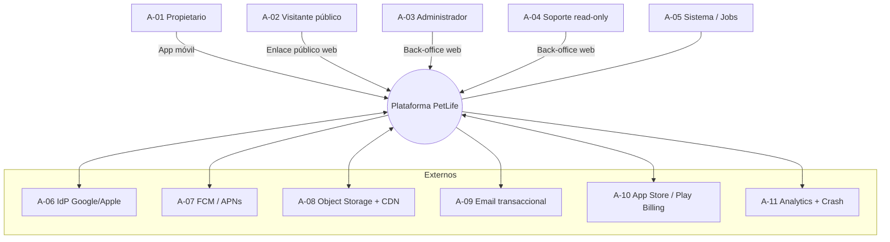

---

# 8. ALCANCE

## 8.1 Alcance de plataformas

| Plataforma | Alcance MVP | Versión mínima | Justificación |
|---|---|---|---|
| iOS | **[REQ]** Sí | iOS 15+ | Cubre >95 % del parque activo; permite StoreKit 2 y APIs modernas de notificación. |
| Android | **[REQ]** Sí | Android 8.0 / API 26+ | Cubre >92 % del parque; API 26 es el mínimo razonable para canales de notificación. |
| Web pública (solo perfil compartible) | **[REQ]** Sí, mínima | — | Página estática server-rendered de solo lectura. No es la app. |
| Back-office administrativo web | **[REQ]** Sí, mínimo | — | Interno. |
| App web completa | **[WON'T]** No | — | Fuera de MVP. |
| Tablet / iPad optimizado | **[COULD]** Compatible pero no optimizado | — | Se soporta *scaling*, no layouts dedicados. |
| Wear OS / watchOS | **[WON'T]** No | — | Fuera de MVP. |

## 8.2 Alcance geográfico y legal

**[DEC-10]** Lanzamiento inicial en **España** (mercado principal, marco GDPR completo) y **México, Colombia, Argentina y Chile** (validación de tracción hispanohablante). Toda la infraestructura de datos se aloja en **región UE**, y el tratamiento se diseña conforme al GDPR como estándar más exigente, aplicándolo también a usuarios de LATAM por simplicidad operativa y por alineación con LGPD/leyes locales.

## 8.3 Alcance lingüístico

**[REQ]** Español (es-ES, con neutralización para LATAM) e inglés (en). Toda cadena de texto debe estar externalizada desde el día 1 — no se admiten literales embebidos en código. **[REC]** No se traduce el contenido de recomendaciones a más idiomas en MVP; el catálogo se mantiene bilingüe y cualquier regla sin traducción no se muestra en ese idioma (fallback explícito, nunca texto mezclado).

## 8.4 Alcance de datos

| Se almacena en MVP | No se almacena en MVP |
|---|---|
| Datos de cuenta (email, nombre, avatar) | Dirección postal, DNI, teléfono |
| Datos de mascota (nombre, especie, raza, sexo, nacimiento, peso, color, esterilización, llegada al hogar, notas) | Historial clínico estructurado, diagnósticos, analíticas, medicación prescrita |
| Hitos con foto, fecha, categoría, etiquetas, privacidad | Vídeo (salvo Premium — ver DP-006), audio |
| Vacunas como hitos de categoría `VACUNA` con campos básicos | Lote de vacuna, veterinario prescriptor, número de colegiado |
| Recordatorios y su estado | Ubicación GPS, geocercas, tracking |
| Eventos de producto seudonimizados | Contactos, carrete completo, identificadores publicitarios (ver §18.7) |

## 8.5 Límites duros del MVP

| Límite | Valor plan Free | Valor plan Premium | Regla |
|---|---|---|---|
| Mascotas por cuenta | 2 | 10 | RN-002 |
| Fotos por hito | 1 | 5 | RN-020 |
| Almacenamiento total | 500 MB | 10 GB | RN-030 |
| Tamaño máximo por imagen (tras compresión cliente) | 8 MB | 8 MB | RN-021 |
| Vídeo por hito | No disponible | 1 vídeo ≤ 30 s / ≤ 50 MB (ver DP-006) | RN-022 |
| Recordatorios activos por mascota | 20 | 100 | RN-040 |
| Hitos por mascota | 500 | 2.000 | RN-023 |
| Perfiles compartibles | 1 activo | Todos | RN-060 |

**[REC]** Todos los límites deben ser **configurables en servidor** (*remote config* o tabla de planes), no constantes compiladas en la app. Permite ajustarlos sin release de tienda durante la fase de validación.

---

# 9. DEFINICIÓN DEL MVP

## 9.1 Criterio de inclusión

Una funcionalidad entra en el MVP si y solo si cumple **al menos una** de estas condiciones y ninguna causa de exclusión:

1. Es necesaria para validar una hipótesis (H-1 a H-6).
2. Es necesaria para que el producto sea usable y confiable (ej.: autenticación, recuperación de contraseña).
3. Es obligatoria por normativa o por políticas de tienda (ej.: eliminación de cuenta, Sign in with Apple, consentimiento).
4. Es necesaria para medir (analítica) o para operar (administración mínima).

**Causas de exclusión:** requiere un actor externo no contemplado; requiere un modelo de datos que no sabemos aún si será correcto; su coste de construcción supera 1 sprint sin validar hipótesis; introduce obligaciones legales adicionales (sanitarias, financieras, de intermediación).

## 9.2 Mapa funcional del MVP

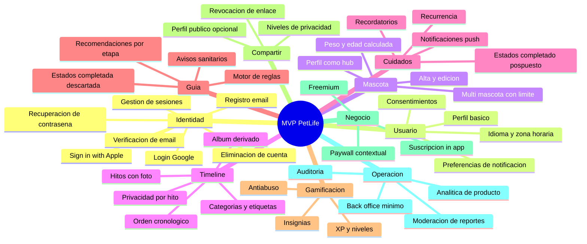

## 9.3 Lo que hace "suficientemente bueno" al MVP

**[DEC-11]** El listón de calidad del MVP no es "funciona", es **"un usuario real lo prefiere a su carrete de fotos"**. Esto implica tres inversiones no negociables aunque sean costosas:

1. **Fricción mínima de creación de hito.** Objetivo de diseño: ≤ 4 interacciones desde el *home* hasta hito guardado, con categoría sugerida automáticamente.
2. **Calidad visual del timeline y del álbum.** Es el producto. Un timeline feo invalida H-1 sin que la hipótesis sea falsa.
3. **Fiabilidad de las notificaciones.** Un recordatorio que no llega destruye la confianza y con ella H-3.

---

# 10. OUT OF SCOPE DEL MVP

Esta sección es **normativa**: ninguna de las siguientes funcionalidades debe construirse, ni "dejarse medio hecha", ni justificarse como "ya que estamos". Cualquier historia de usuario que las implique se rechaza en *refinement*.

## 10.1 Catálogo de exclusiones

| # | Excluido | Por qué se pospone | Cuándo reconsiderar |
|---|---|---|---|
| 1 | **Marketplace** | Requiere oferta, demanda, pagos a terceros, fiscalidad, disputas y soporte. Modelo de negocio distinto al que validamos. Sin base de usuarios no hay marketplace posible (problema del huevo y la gallina). | H3, tras ≥ 50k MAU y validación de H-6 |
| 2 | **Veterinarias como usuarios completos** | Introduce un segundo lado del mercado, roles clínicos, responsabilidad profesional y datos de salud de categoría más sensible. Multiplica el modelo de permisos. | H3 |
| 3 | **Clínicas veterinarias (gestión de pacientes)** | Es un producto B2B distinto (PMS veterinario) con ciclo de venta, integraciones y compliance propios. | H3, solo si hay estrategia B2B explícita |
| 4 | **Paseadores, entrenadores, peluquerías, guarderías** | Servicios de intermediación: verificación de identidad, seguros, reseñas, disputas, pagos. Riesgo legal y operativo alto. | H3 |
| 5 | **Refugios y adopción** | Requiere verificación de entidad, contenido moderado intensivamente y flujos de adopción con responsabilidad legal. | H3 |
| 6 | **Tiendas / ecommerce completo** | Catálogo, inventario, logística, devoluciones, pasarela propia. Además, vender bienes físicos desde la app tiene reglas de tienda distintas. | H3 |
| 7 | **Red social completa (feed, seguidores, comentarios)** | Cambia la naturaleza del producto y obliga a moderación a escala (UGC), sistemas antiacoso, reportes masivos y cumplimiento DSA. Riesgo desproporcionado frente al aprendizaje obtenido. | H2/H3 solo si H-5 se valida con fuerza |
| 8 | **Mensajería privada / chat** | Obliga a moderación, retención de comunicaciones, cifrado, protección de menores y respuesta a requerimientos legales. | H3 |
| 9 | **Streaming / vídeo en vivo** | Coste de infraestructura y moderación en tiempo real desproporcionado. | No previsto |
| 10 | **Seguros de mascotas** | Actividad regulada (mediación de seguros). Requiere licencia o acuerdo con mediador. | H3, vía partner |
| 11 | **Telemedicina veterinaria** | Acto veterinario regulado; responsabilidad profesional; requiere colegiación y, en varios países, prohibición de diagnóstico sin examen presencial previo. | H3, vía partner licenciado |
| 12 | **Wearables / IoT** | Integraciones hardware, BLE, sincronización, soporte de dispositivos. Sin valor para validar H-1..H-6. | H3 |
| 13 | **GPS permanente / tracking** | Dato de ubicación continua = categoría de alto riesgo bajo GDPR, consumo de batería, obligaciones de DPIA reforzada. Contradice la minimización de datos. | No previsto para MVP ni H2 |
| 14 | **IA diagnóstica / reconocimiento de enfermedades** | Riesgo de daño real al animal, posible consideración como producto sanitario, responsabilidad legal y requisitos del AI Act para sistemas de alto riesgo. | Solo como apoyo no diagnóstico y con revisión legal |
| 15 | **Reconocimiento de raza por foto** | Precisión insuficiente para ser confiable; genera desconfianza si falla y no valida ninguna hipótesis. | H2, como conveniencia opcional |
| 16 | **Cuidador secundario / cuentas familiares compartidas** | Modelo de permisos compartidos, invitaciones, conflictos de edición y auditoría multiusuario. | H2 — primera candidata |
| 17 | **Cartilla veterinaria clínica completa** | Requiere modelo clínico estructurado, vacunas por laboratorio/lote y validación profesional. En MVP se cubre parcialmente con hitos de categoría `VACUNA`. | H2 |
| 18 | **Exportación de libro físico / print-on-demand** | Proveedor externo, logística, pagos por bienes físicos. | H2/H3 |
| 19 | **Publicidad de terceros** | Degrada la experiencia emocional del producto y complica el consentimiento GDPR/ATT. La monetización del MVP es suscripción. | No previsto |
| 20 | **Modo offline completo con escritura sincronizada** | Resolución de conflictos, cola de sincronización, *merge* de multimedia. Alto coste. En MVP solo **lectura offline de datos cacheados** y **cola simple de subida de fotos**. | H2 |

## 10.2 Regla de gobierno del alcance

**[REQ]** Cualquier propuesta de incluir un elemento de §10.1 en el MVP debe: (a) identificar qué hipótesis validaría, (b) identificar qué funcionalidad MUST se sacrifica a cambio, y (c) ser aprobada por PM y Tech Lead con registro escrito. Sin las tres condiciones, se rechaza.

---

# 11. FUNCIONALIDADES POR MÓDULO

Notación: **M-nn** módulo. Cada módulo indica propósito, funcionalidades, reglas clave, datos y dependencias. Los requerimientos formales están en §15.

## M-01 — Identidad y acceso (Identity & Access)

**Propósito:** permitir a un propietario crear una cuenta, autenticarse de forma segura, mantener sesión entre dispositivos y eliminar su cuenta.

**Funcionalidades:**

| # | Funcionalidad | Prioridad | Nota |
|---|---|---|---|
| 1 | Registro con email + contraseña | MUST | Requiere verificación de email |
| 2 | Verificación de correo electrónico | MUST | Enlace con token de un solo uso, caducidad 24 h |
| 3 | Inicio de sesión con email + contraseña | MUST | |
| 4 | Login con Google (OIDC) | MUST | Reduce fricción de registro de forma sustancial |
| 5 | Sign in with Apple | MUST en iOS | Ver análisis §11.1.1 |
| 6 | Cierre de sesión (dispositivo actual) | MUST | Revoca refresh token |
| 7 | Cierre de todas las sesiones activas | SHOULD | Lista de dispositivos con última actividad |
| 8 | Recuperación de contraseña | MUST | Resistente a *account enumeration* |
| 9 | Cambio de contraseña autenticado | MUST | Requiere contraseña actual; revoca otras sesiones |
| 10 | Renovación de sesión (refresh token rotativo) | MUST | |
| 11 | Expiración de sesión y cierre por inactividad | MUST | |
| 12 | Eliminación de cuenta | MUST | Obligatorio por políticas de tienda y GDPR |
| 13 | Exportación de datos personales | MUST | Obligatorio GDPR (art. 20) |
| 14 | Vinculación de método de login adicional | COULD | Ej.: usuario de Google que añade contraseña |
| 15 | MFA para usuario final | WON'T | Se implementa solo para administradores |

**Datos principales:** `user` (id, email, email_verified_at, password_hash, status, created_at, deleted_at), `identity_provider_link`, `session` / `refresh_token`, `password_reset_token`, `email_verification_token`.

**Reglas clave:** RN-001, RN-003, RN-004, RN-005, RN-006, RN-007, RN-008.

### 11.1.1 Análisis: ¿Sign in with Apple desde el MVP?

**Conclusión: [DEC-12] SÍ, obligatorio en la build de iOS desde el MVP.**

Razonamiento:

- La *App Store Review Guideline 4.8* exige que, si una app ofrece inicio de sesión con servicios sociales o de terceros (Google, Facebook, etc.) como opción principal o exclusiva, debe ofrecer también una alternativa de inicio de sesión que cumpla requisitos equivalentes de privacidad: limitar la recogida de datos a nombre y correo, permitir ocultar el correo real y no rastrear al usuario con fines publicitarios sin consentimiento.
- Sign in with Apple es la vía de cumplimiento más directa y de menor riesgo. Construir un IdP propio que satisfaga esos criterios es teóricamente posible pero introduce riesgo de rechazo en revisión, y el coste de un rechazo (1–2 semanas de retraso de lanzamiento más *re-review*) supera con creces el coste de integrar Sign in with Apple (estimado 3–5 días con Flutter y un backend OIDC ya construido para Google).
- **[RSG-02]** Riesgo si no se implementa: rechazo en App Review → retraso de lanzamiento → pérdida de ventana de validación. Probabilidad alta, impacto alto.

Consecuencias técnicas a contemplar obligatoriamente:

1. **Private Relay de correo.** Apple puede devolver una dirección `@privaterelay.appleid.com`. El sistema debe tratarla como correo válido y funcional. **[REQ]** El correo transaccional debe poder entregarse a relay, lo que exige registrar los dominios de envío en Apple.
2. **Nombre solo en el primer login.** Apple devuelve nombre y apellidos **únicamente en la primera autorización**. **[REQ]** Deben persistirse en ese momento; no se pueden recuperar después.
3. **Revocación de credencial.** **[REQ]** Debe consumirse la notificación de servidor de Apple (`consent-revoked`, `account-delete`) para invalidar sesiones y tratar la baja del usuario.
4. **Eliminación de cuenta obligatoria.** Las apps que permiten crear cuenta deben permitir eliminarla desde la propia app. Se cubre con la funcionalidad 12.

**[REC]** En Android no se muestra Sign in with Apple salvo que existan datos de que usuarios multiplataforma lo demanden; se evita añadir una opción que la mayoría del parque Android no reconoce.

---

## M-02 — Perfil de usuario y preferencias

**Propósito:** permitir al propietario gestionar su identidad dentro de la app y controlar cómo el producto se comunica con él.

**Funcionalidades:**

| # | Funcionalidad | Prioridad | Detalle |
|---|---|---|---|
| 1 | Ver y editar nombre visible | MUST | 2–60 caracteres |
| 2 | Fotografía de perfil (avatar) | SHOULD | Opcional; mismo pipeline de imagen que hitos |
| 3 | Ver correo electrónico y su estado de verificación | MUST | El cambio de email es COULD (ver DP-009) |
| 4 | Selección de idioma | MUST | Por defecto el del dispositivo; persistido en servidor |
| 5 | Zona horaria | MUST | Detectada automáticamente, editable manualmente |
| 6 | Preferencias de notificación por canal y categoría | MUST | Recordatorios / Recomendaciones / Logros / Producto-marketing, cada una activable por separado |
| 7 | Gestión de consentimientos (analítica, comunicaciones comerciales) | MUST | Requisito GDPR; revocable |
| 8 | Ver plan actual y gestionar suscripción | MUST | Enlace a la gestión de la tienda |
| 9 | Consultar almacenamiento consumido | SHOULD | Indicador de uso frente al límite del plan |
| 10 | Acceso a políticas legales y versión de la app | MUST | |

**Regla de diseño [REQ]:** las **comunicaciones de marketing** y las **notificaciones funcionales** (recordatorios) deben ser preferencias independientes. Desactivar marketing nunca puede desactivar un recordatorio de vacuna.

---

## M-03 — Gestión de mascotas

**Propósito:** registrar y mantener la ficha de cada mascota, que es la entidad raíz de todo el producto.

**Campos de la mascota:**

| Campo | Tipo | Obligatorio | Calculado | Validación / nota |
|---|---|---|---|---|
| `photo` | Imagen | Opcional | No | Si falta, avatar por defecto según especie. Se pide en onboarding pero es *skippable*. |
| `name` | Texto | **Obligatorio** | No | 1–40 caracteres; se permite Unicode y emoji; se normaliza espacios |
| `species` | Enum | **Obligatorio** | No | `DOG`, `CAT`, `OTHER` en MVP. `OTHER` permite texto libre de 40 caracteres |
| `breed` | Ref. catálogo | Opcional | No | Catálogo por especie + opción "Mestizo/Desconocida". Búsqueda con autocompletado |
| `sex` | Enum | Opcional | No | `MALE`, `FEMALE`, `UNKNOWN` |
| `birth_date` | Fecha | Condicional | No | Obligatorio **o** `birth_date_estimated` (ver RN-010). No puede ser futura ni anterior a 40 años |
| `birth_date_is_estimated` | Booleano | Opcional | No | Permite registrar adopciones de edad desconocida |
| `age` | Derivado | — | **Sí** | Calculado por RN-011. Nunca se persiste como valor fijo |
| `life_stage` | Derivado | — | **Sí** | `PUPPY/KITTEN`, `JUNIOR`, `ADULT`, `MATURE`, `SENIOR` según RN-012 |
| `weight_kg` | Decimal | Opcional | No | 0,1–120 kg; 1 decimal; permite histórico de mediciones |
| `color` | Texto/enum | Opcional | No | Catálogo sugerido + texto libre 30 caracteres |
| `is_sterilized` | Enum | Opcional | No | `YES`, `NO`, `UNKNOWN`; con fecha opcional |
| `arrival_date` | Fecha | Opcional | No | ≥ `birth_date` y ≤ hoy. Genera hito automático sugerido "Llegada a casa" |
| `notes` | Texto | Opcional | No | Máx. 500 caracteres. Campo libre no estructurado |
| `microchip_id` | Texto | Opcional | No | **[REC]** Incluir; 15 dígitos; valor práctico alto y coste nulo. Nunca público (RN-062) |
| `status` | Enum | — | Sistema | `ACTIVE`, `ARCHIVED`, `DECEASED` |

**Funcionalidades:** crear, editar, consultar, archivar, eliminar, cambiar foto, registrar peso, marcar como fallecida.

### 11.3.1 Tratamiento del fallecimiento de la mascota — **[REQ]**

Es el escenario emocionalmente más delicado del producto y **no puede resolverse con un simple borrado**.

- **[REQ]** Debe existir el estado `DECEASED` con fecha opcional.
- **[REQ]** Al marcar una mascota como fallecida: se **cancelan y archivan** todos sus recordatorios activos, se **suspenden** todas las recomendaciones pendientes, y se **desactivan** las notificaciones de gamificación asociadas. Recibir "¡Toca la vacuna de Toby!" tras la muerte de Toby es un fallo crítico de producto.
- **[REQ]** El timeline y el álbum se conservan íntegros y siguen siendo accesibles. La mascota no cuenta para el límite de mascotas activas del plan (RN-002).
- **[REC]** Ofrecer, sin insistencia y sin gamificación, la exportación del álbum. No mostrar *paywall* en este flujo. **[REQ] Prohibido** mostrar promociones de suscripción en la pantalla de fallecimiento.

---

## M-04 — Perfil de mascota (hub de navegación)

**Propósito:** ser la pantalla central del producto. Todo lo relevante de una mascota se alcanza desde aquí.

**Composición (de arriba abajo):**

1. **Cabecera identitaria:** foto grande, nombre, especie/raza, edad calculada legible ("1 año y 3 meses"), etapa de vida.
2. **Barra de progreso:** nivel actual de la mascota, XP acumulado, XP restante para el siguiente nivel.
3. **Próximo recordatorio:** el más cercano en el tiempo, con acción rápida de completar o posponer. Si no hay, CTA para crear el primero.
4. **Recomendación destacada:** la de mayor prioridad pendiente para la etapa actual, con acciones *Hecho* / *Ahora no* / *No aplica*.
5. **Timeline resumido:** últimos 3–5 hitos en formato horizontal, con acceso al timeline completo.
6. **Accesos:** Álbum, Todos los recordatorios, Logros/insignias, Compartir perfil, Editar mascota.
7. **Estado vacío deliberado:** si la mascota no tiene hitos, la pantalla se convierte en una invitación clara y única: "Empieza la historia de {nombre}".

**[REC]** Con múltiples mascotas, usar un selector persistente en la cabecera (avatar circular conmutable) en lugar de una pantalla de lista intermedia. Reduce un nivel de navegación para el caso de uso más frecuente.

---

## M-05 — Timeline de vida

**Propósito:** el corazón del producto. Registro cronológico de los acontecimientos de la vida de la mascota.

**Estructura de un hito (`milestone`):**

| Campo | Obligatorio | Detalle |
|---|---|---|
| `pet_id` | Sí | Pertenencia |
| `category` | Sí | Catálogo administrable (ver abajo) |
| `title` | Sí | 1–80 caracteres. Se autocompleta con el nombre de la categoría, editable |
| `description` | No | Máx. 1.000 caracteres |
| `event_date` | Sí | No futura (RN-024); ≥ `birth_date` de la mascota |
| `pet_age_at_event` | Calculado | Derivado de `event_date` − `birth_date` |
| `photos[]` | No | 0–1 (Free) / 0–5 (Premium) |
| `video` | No | Solo Premium; ver DP-006 |
| `visibility` | Sí | `PRIVATE` (defecto) / `SHARED` (visible en perfil público) |
| `tags[]` | No | Máx. 5 etiquetas, 20 caracteres cada una |
| `metadata` | No | JSONB: campos extra por categoría (ej. `vaccine_name` para `VACUNA`, `weight_kg` para `PESO`) |

**Catálogo inicial de categorías (administrable):**

`LLEGADA_A_CASA`, `VACUNA`, `DESPARASITACION`, `VETERINARIO`, `PRIMER_BAÑO`, `MUDA_DE_DIENTES`, `PRIMER_PASEO`, `PARQUE`, `VIAJE`, `MAR_PLAYA`, `CUMPLEAÑOS`, `AMISTAD`, `ENTRENAMIENTO`, `TRAVESURA`, `PESO`, `ESTERILIZACION`, `CAMBIO_ALIMENTACION`, `PELUQUERIA`, `LOGRO_PERSONAL`, `OTRO` (personalizado, con título libre).

**Funcionalidades:**

| Operación | Regla |
|---|---|
| **Crear** | Solo el propietario de la mascota. Valida fecha, tamaño de imagen, límites de plan. Otorga XP (RN-050). |
| **Editar** | Solo el propietario. Editable: título, descripción, fecha, fotos, etiquetas, visibilidad, categoría. **No** otorga XP adicional (RN-053, antiabuso). |
| **Eliminar** | Solo el propietario. *Soft delete* con ventana de recuperación de 30 días (RN-025). **Descuenta el XP otorgado** si la eliminación ocurre en < 24 h desde su creación (RN-053). |
| **Consultar** | Propietario siempre; visitante público solo si `visibility = SHARED` y el perfil público está activo. |
| **Ordenar** | Por `event_date` descendente por defecto; conmutable a ascendente ("desde el principio"). |
| **Filtrar** | Por categoría, por año, por etiqueta, por "solo con foto". |
| **Agrupar** | Por año y, dentro del primer año, por mes (la infancia concentra los hitos). |

**Estados vacíos definidos:**

| Situación | Comportamiento |
|---|---|
| Sin hitos | Ilustración + copy personalizado con el nombre de la mascota + CTA único "Añadir primer recuerdo" + 3 sugerencias de hito según etapa de vida |
| Filtro sin resultados | Mensaje específico del filtro + acción "Limpiar filtros". **Nunca** el estado vacío genérico |
| Error de carga | Mensaje + botón reintentar + mostrar caché local si existe (§25) |

**Manejo de errores:** subida fallida de foto (se guarda el hito sin foto y se reintenta en segundo plano, marcando la foto como pendiente); pérdida de conexión durante el guardado (cola local, RN-026); imagen corrupta o formato no permitido (rechazo con mensaje explícito y sugerencia de formato).

---

## M-06 — Álbum automático

**Propósito:** ofrecer una vista visual y emocional de los recuerdos **sin duplicar el modelo de datos**.

### 11.6.1 Relación Timeline ↔ Álbum — **[DEC-13]**

> **El álbum NO es un módulo con almacenamiento propio. Es una proyección de solo lectura de las fotografías contenidas en los hitos del timeline.**

Consecuencias normativas:

- **[REQ]** No existe una entidad `album` con sus propias fotos. No se puede "añadir una foto al álbum": toda foto entra al sistema a través de un hito.
- **[REQ]** Eliminar un hito elimina sus fotos del álbum, automáticamente y sin acción adicional.
- **[REQ]** Editar la fecha de un hito reordena el álbum, automáticamente.
- **[REQ]** La visibilidad de la foto en el perfil público la determina la `visibility` del hito que la contiene. No hay una segunda configuración de privacidad para el álbum (evita estados contradictorios).

Motivo de esta decisión: un álbum independiente crearía duplicidad de almacenamiento, dos fuentes de verdad para la privacidad, dos flujos de borrado y una experiencia confusa ("¿por qué esta foto está en el álbum pero no en el timeline?"). El coste de esa complejidad no aporta ningún aprendizaje sobre las hipótesis.

### 11.6.2 Modos de visualización del álbum

| Modo | Agrupación | Uso |
|---|---|---|
| **Cuadrícula** (defecto) | Todas las fotos, orden cronológico descendente | Exploración rápida |
| **Por años** | "2024", "2025", "2026" con contador de fotos | Navegación longitudinal |
| **Por edad** | "Cachorro (0–6 meses)", "Junior", "Adulto"… usando `pet_age_at_event` | Diferenciador emocional del producto |
| **Por categoría** | Vacunas, Viajes, Cumpleaños… | Búsqueda de un recuerdo concreto |
| **Visor** | Foto a pantalla completa con el contexto del hito (título, fecha, edad de la mascota en ese momento) | El "momento emocional" del producto |

**[REC]** El modo *Por edad* debe ser prominente: es el que ningún carrete de fotos puede ofrecer y es la justificación visual de por qué el usuario introduce la fecha de nacimiento.

---

## M-07 — Motor de recomendaciones / Ruta de crecimiento

**Propósito:** devolver valor útil al usuario a cambio de los datos que aporta, sin IA y sin prometer criterio clínico.

**Naturaleza: [DEC-14] motor determinista basado en reglas evaluadas en backend.** No hay modelo de ML en el MVP. Detalle completo en §27.

**Entradas del motor:** especie, raza (y su grupo/tamaño), edad exacta y etapa de vida, sexo, estado de esterilización, peso y su evolución, hitos registrados (especialmente de categorías `VACUNA`, `DESPARASITACION`, `VETERINARIO`, `PESO`), recordatorios existentes, país del usuario, y estado previo de la propia recomendación.

**Salida:** lista priorizada de recomendaciones con estado por mascota.

**Estados de una recomendación:** `PENDING` → `COMPLETED` | `DISMISSED` | `SNOOZED` | `EXPIRED` | `NOT_APPLICABLE`.

**[REQ] Aviso sanitario obligatorio.** Toda recomendación de categoría `SALUD`, `VACUNACION`, `PARASITOS`, `NUTRICION` o `DENTAL` debe mostrar, de forma visible y no colapsada en la primera visualización, una advertencia equivalente a: *"Esta información es orientativa y general. No sustituye la valoración de un veterinario. Consulta siempre con un profesional para el caso concreto de tu mascota."* **[REQ] Prohibido** el uso de lenguaje diagnóstico ("tu mascota tiene", "padece", "debes medicar con"). Solo lenguaje orientativo ("suele recomendarse", "es habitual que a esta edad", "consulta con tu veterinario sobre").

---

## M-08 — Recordatorios

**Propósito:** generar recurrencia útil y proteger el bienestar del animal. Detalle completo en §28.

**Categorías iniciales:** `VACUNA`, `DESPARASITACION`, `MEDICAMENTO`, `ALIMENTACION`, `PASEO`, `BAÑO`, `VETERINARIO`, `DENTAL`, `OTROS`.

**Campos:** mascota, título, categoría, fecha, hora, recurrencia (`NONE`, `DAILY`, `WEEKLY`, `MONTHLY`, `YEARLY`, `CUSTOM_DAYS`), fin de recurrencia (fecha o nº de repeticiones), canal de notificación, antelación del aviso, estado, notas.

**Estados:** `SCHEDULED` → `NOTIFIED` → `COMPLETED` | `SNOOZED` | `SKIPPED` | `EXPIRED` | `CANCELLED`.

**Funcionalidades:** crear, editar, eliminar, completar (con opción de generar hito automáticamente), posponer, cancelar serie completa o solo una ocurrencia, ver histórico.

**[REC]** Al completar un recordatorio de categoría `VACUNA` o `VETERINARIO`, ofrecer crear el hito correspondiente con un solo toque. Convierte una tarea utilitaria en contenido del timeline: es el mecanismo que une H-3 con H-1.

---

## M-09 — Gamificación

**Propósito:** motivar el registro constante. Detalle completo en §26.

**Elementos:** XP (de la mascota), niveles, insignias, logros. **Sin monedas, sin economía virtual, sin pay-to-win, sin rankings entre usuarios.**

---

## M-10 — Perfil compartible

**Propósito:** crecimiento orgánico y satisfacción identitaria. Detalle en §15 (RF-SHARE) y §17.

**Elementos:** activación opcional por mascota, *slug* público (`petlife.app/p/{slug}`), selección granular de qué se muestra, regeneración y revocación del enlace, opción de enlace no indexable.

---

## M-11 — Administración

**Propósito:** operar el producto con el mínimo esfuerzo posible. Detalle en §29.

---

## M-12 — Suscripciones y monetización

**Propósito:** validar H-6. Detalle en §32.

**Elementos:** plan Free y Premium, *paywall* contextual, compra vía tienda, restauración de compra, verificación de recibo en servidor, notificaciones de servidor de la tienda, degradación al expirar.

---

## 11.13 Dependencias entre módulos

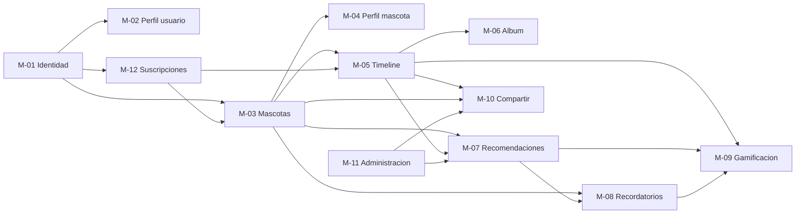

**Lectura crítica de dependencias:** M-05 (Timeline) es el cuello de botella del producto. M-07, M-09 y M-06 dependen de él. **[REC]** M-05 debe construirse y estabilizarse primero; si se retrasa, se retrasa el 70 % del valor del MVP.

---

# 12. FUNCIONALIDADES POR ROL

## 12.1 Rol: Propietario (A-01)

| Aspecto | Detalle |
|---|---|
| **Objetivo** | Construir y conservar la historia de su mascota, y cuidarla mejor con orientación y recordatorios. |
| **Responsabilidades** | Veracidad de los datos que introduce; legalidad del contenido que sube; configuración de la privacidad de su perfil compartible. |
| **Permisos** | CRUD completo sobre sus propias mascotas, hitos, recordatorios y sobre su cuenta. Lectura de recomendaciones y catálogos. Gestión de su suscripción. |
| **Restricciones** | No accede a datos de otros usuarios ni de sus mascotas. No accede al back-office. No modera contenido ajeno. No modifica catálogos ni reglas. No puede superar los límites de su plan. No puede eliminar datos de auditoría. |
| **Pantallas disponibles** | Onboarding, Registro/Login, Verificación de email, Home/Selector de mascota, Perfil de mascota, Alta/Edición de mascota, Timeline, Detalle de hito, Alta/Edición de hito, Álbum, Visor de foto, Lista de recomendaciones, Detalle de recomendación, Lista de recordatorios, Alta/Edición de recordatorio, Logros, Compartir perfil, Ajustes, Perfil de usuario, Sesiones activas, Paywall, Gestión de cuenta (exportar/eliminar), Legales. |
| **Acciones permitidas** | Registrarse, autenticarse, cerrar sesión, cambiar contraseña, cerrar sesiones remotas, crear/editar/archivar/eliminar mascotas, crear/editar/eliminar hitos, subir/eliminar fotos, crear/editar/completar/posponer/eliminar recordatorios, completar/descartar recomendaciones, activar/desactivar y configurar el perfil compartible, suscribirse y restaurar compras, exportar sus datos, eliminar su cuenta, reportar contenido público ajeno. |
| **Acciones prohibidas** | Ver mascotas ajenas fuera de un perfil público; forzar `visibility` de un hito ajeno; asignar XP arbitrario; consultar logs; leer campos privados mediante el endpoint público; consumir la API sin token válido. |

## 12.2 Rol: Visitante público (A-02)

| Aspecto | Detalle |
|---|---|
| **Objetivo** | Ver el perfil público de una mascota compartida por su propietario. |
| **Responsabilidades** | Ninguna contractual. Puede reportar contenido inapropiado. |
| **Permisos** | Lectura estricta de los campos que el propietario haya marcado como públicos, en una mascota con perfil público activo. |
| **Restricciones** | No autenticado. No puede comentar, reaccionar, seguir ni contactar. No accede a la API interna. Sujeto a *rate limit* estricto por IP (RN-063). |
| **Pantallas** | Página web pública del perfil de la mascota; formulario de reporte; CTA de descarga de la app. |
| **Acciones permitidas** | Ver, compartir el enlace, reportar. |
| **Acciones prohibidas** | Enumerar perfiles, descargar en lote, acceder a campos no marcados como públicos, acceder a hitos `PRIVATE`. |

## 12.3 Rol: Administrador de plataforma (A-03)

| Aspecto | Detalle |
|---|---|
| **Objetivo** | Mantener el servicio operativo, seguro y conforme; atender incidencias y moderar el contenido público. |
| **Responsabilidades** | Actuar bajo principio de necesidad; justificar accesos a datos de usuario; mantener catálogos y reglas actualizadas; tratar reportes en plazo. |
| **Permisos** | Lectura de usuarios y mascotas **en modo limitado** (ver 12.5); suspensión/reactivación de cuentas; moderación y despublicación de perfiles compartibles y hitos públicos; CRUD sobre catálogos (razas, categorías de hito, categorías de recordatorio, reglas de recomendación, definiciones de logros); lectura de auditoría; gestión de avisos de mantenimiento y actualización obligatoria. |
| **Restricciones** | **No puede crear ni editar hitos, recordatorios o mascotas de un usuario.** No puede leer contenido `PRIVATE` salvo por reporte formal y con registro de auditoría obligatorio (RN-070). No puede exportar datos personales masivamente. No puede modificar el XP de una mascota salvo revertir un abuso detectado, con justificación. No puede eliminar registros de auditoría. Requiere MFA. |
| **Pantallas** | Login admin, Dashboard operativo, Buscador de usuarios, Ficha de usuario, Buscador de mascotas, Ficha de mascota, Cola de reportes, Detalle de reporte, Catálogos (razas/categorías/logros), Editor de reglas de recomendación, Auditoría, Configuración del sistema (límites de plan, mantenimiento, versión mínima). |
| **Acciones permitidas** | Buscar, consultar, suspender, reactivar, despublicar, moderar, aprobar/rechazar reportes, crear/editar/desactivar reglas y catálogos, consultar auditoría, publicar avisos. |
| **Acciones prohibidas** | Suplantar a un usuario sin mecanismo auditado (ver DP-010); leer contraseñas (imposible por diseño); acceder a la base de datos de producción directamente sin *break-glass* registrado; descargar imágenes privadas sin motivo de moderación registrado. |

## 12.4 Rol: Soporte read-only (A-04)

| Aspecto | Detalle |
|---|---|
| **Objetivo** | Resolver incidencias de usuario de primer nivel. |
| **Permisos** | Lectura de: estado de cuenta, fecha de registro, estado de verificación de email, plan y estado de suscripción, número de mascotas, última actividad, eventos técnicos (errores de subida, notificaciones fallidas). |
| **Restricciones** | Sin acceso a fotografías, descripciones de hitos ni notas. Sin capacidad de modificación alguna. Sin acceso a auditoría completa. |
| **Justificación del rol** | La inmensa mayoría de tickets ("no me llega el email", "no puedo subir foto", "me cobraron dos veces") se resuelven sin ver contenido personal. Separar este rol reduce drásticamente la superficie de exposición de datos. |

## 12.5 Principio de acceso administrativo a datos personales — **[REQ]**

1. El back-office muestra por defecto los datos **seudonimizados o truncados** (ej.: `l***a@gmail.com`).
2. Revelar el dato completo requiere una acción explícita ("Revelar dato") que **exige seleccionar un motivo** y queda registrada en auditoría con administrador, timestamp, recurso y motivo.
3. El acceso a contenido `PRIVATE` (fotos, descripciones) solo es posible desde la ficha de un **reporte activo**, nunca desde la búsqueda general.
4. Toda la auditoría administrativa es **inmutable y append-only** y se revisa periódicamente.

## 12.6 Rol: Sistema (A-05)

| Proceso | Disparador | Acción | Regla |
|---|---|---|---|
| Planificador de notificaciones | Cron cada 5 min | Selecciona recordatorios cuya hora local de disparo ha llegado y encola notificación | RN-041, RN-044 |
| Motor de recomendaciones | Alta/edición de mascota, alta de hito relevante, cambio de etapa de vida, cron diario | Reevalúa reglas y actualiza la lista de recomendaciones de cada mascota | RN-080..RN-085 |
| Cálculo de XP y nivel | Evento de dominio (hito creado, recomendación completada, etc.) | Otorga XP, recalcula nivel, evalúa insignias | RN-050..RN-055 |
| Procesamiento de imagen | Subida confirmada | Valida tipo real, elimina metadatos EXIF sensibles, genera miniaturas | RN-027, RN-028 |
| Recálculo de edad y etapa | Cron diario | Actualiza `life_stage` derivada; dispara transiciones de etapa | RN-011, RN-012 |
| Purga de borrados lógicos | Cron diario | Elimina definitivamente lo que superó la ventana de retención | RN-025, RN-090 |
| Ejecución de eliminación de cuenta | Cron | Ejecuta borrado tras el periodo de gracia | RN-007 |
| Sincronización de suscripciones | Webhook de tienda + cron de reconciliación | Actualiza el plan del usuario | RN-100..RN-103 |
| Degradación por expiración de plan | Cron diario | Aplica RN-104 | RN-104 |
| Detección de abuso | Continuo | Aplica *rate limits* y marca patrones sospechosos | RN-056, RN-063 |

**[REQ]** El actor Sistema **nunca** ejecuta acciones que requieran consentimiento del usuario sin que ese consentimiento exista y esté registrado.

---

# 13. MATRIZ DE ROLES Y PERMISOS

Leyenda: **C** crear · **R** consultar · **U** editar · **D** eliminar · **A** aprobar · **M** moderar · **X** administrar · **—** sin acceso · **(p)** solo sobre recursos propios · **(pub)** solo lo marcado como público · **(aud)** requiere justificación y queda auditado

| # | Funcionalidad | Propietario | Visitante público | Administrador | Soporte RO | Sistema |
|---|---|---|---|---|---|---|
| 1 | Cuenta propia (registro, login, logout) | C R U D (p) | — | — | — | — |
| 2 | Contraseña propia | U (p) | — | — | — | — |
| 3 | Sesiones propias | R D (p) | — | R (aud) | R | C R D |
| 4 | Perfil de usuario | R U (p) | — | R (aud) | R | — |
| 5 | Consentimientos | R U (p) | — | R (aud) | — | R |
| 6 | Preferencias de notificación | R U (p) | — | — | R | R |
| 7 | Eliminación de cuenta | C (p) | — | R (aud) | R | X |
| 8 | Exportación de datos | C R (p) | — | (aud) | — | X |
| 9 | Mascota | C R U D (p) | R (pub) | R (aud), M | R (metadatos) | R U (derivados) |
| 10 | Foto de mascota | C R U D (p) | R (pub) | M (aud) | — | X (procesado) |
| 11 | Peso / mediciones | C R U D (p) | — | R (aud) | — | R |
| 12 | Estado `DECEASED` | U (p) | — | R (aud) | R | X (cascada) |
| 13 | Hito | C R U D (p) | R (pub) | M (aud) | — | R |
| 14 | Foto de hito | C R D (p) | R (pub) | M (aud) | — | X |
| 15 | Visibilidad de hito | U (p) | — | M (despublicar) | — | — |
| 16 | Álbum (vista derivada) | R (p) | R (pub) | — | — | X |
| 17 | Etiquetas de hito | C R U D (p) | R (pub) | M | — | — |
| 18 | Categorías de hito (catálogo) | R | — | C R U D X | R | R |
| 19 | Recordatorio | C R U D (p) | — | R (aud) | R (contador) | C R U |
| 20 | Completar / posponer recordatorio | U (p) | — | — | — | U (expiración) |
| 21 | Notificación push | R (p) | — | R (métricas) | R (entrega) | C X |
| 22 | Recomendación (instancia por mascota) | R U (estado, p) | — | R (aud) | — | C R U X |
| 23 | Reglas de recomendación (catálogo) | — | — | C R U D A X | R | R |
| 24 | Catálogo de razas | R | — | C R U D X | R | R |
| 25 | XP y nivel | R (p) | R (pub, si se comparte) | R, U (aud, solo corrección de abuso) | R | C U X |
| 26 | Insignias / logros (instancia) | R (p) | R (pub) | R | R | C U |
| 27 | Definición de logros (catálogo) | — | — | C R U D X | R | R |
| 28 | Perfil compartible (activar/configurar) | C R U D (p) | — | M (despublicar, aud) | R (estado) | — |
| 29 | Enlace público / slug | C R U D (p) | R | M | — | X (validación unicidad) |
| 30 | Reporte de contenido | C (sobre ajeno) | C | R U A M X | R | R |
| 31 | Suspensión de cuenta | — | — | X (aud) | — | X (automática por abuso) |
| 32 | Auditoría | — | — | R | — | C |
| 33 | Suscripción | C R D (p, vía tienda) | — | R (aud) | R (estado) | U X |
| 34 | Límites de plan (configuración) | R | — | U X | R | R |
| 35 | Aviso de mantenimiento / versión mínima | R | R | C U D X | R | R |
| 36 | Eventos de analítica | — | — | R (agregado) | R (agregado) | C |
| 37 | Back-office (acceso) | — | — | R X | R | — |

## 13.1 Reglas transversales de autorización — **[REQ]**

1. **Toda autorización se evalúa en backend.** La app móvil oculta acciones no permitidas por UX, nunca como control de seguridad.
2. **Autorización a nivel de objeto (BOLA/IDOR).** Cada petición sobre `pet_id`, `milestone_id`, `reminder_id` debe verificar que el recurso pertenece al `user_id` del token. No basta con validar que el token es válido.
3. **Deny by default.** Un endpoint sin política de autorización explícita se considera denegado.
4. **Separación de planos.** El back-office administrativo y la API de la app son superficies separadas, con emisores de token distintos, dominios distintos y políticas distintas. Un token de usuario nunca puede operar endpoints administrativos y viceversa.
5. **Endpoint público segregado.** El perfil compartible se sirve por un endpoint dedicado de solo lectura que **proyecta explícitamente** los campos públicos. Nunca reutiliza el serializador del endpoint privado con un filtro (riesgo de fuga por campo nuevo añadido sin revisar).

---

# 14. REGLAS DE NEGOCIO

Las reglas están **desacopladas de la implementación técnica**: describen *qué* debe cumplirse, no *cómo*.

## 14.1 Cuenta e identidad

| ID | Regla |
|---|---|
| **RN-001** | Una dirección de correo electrónico identifica de forma única a una cuenta activa. La comparación se realiza normalizada (minúsculas, sin espacios). |
| **RN-002** | Un usuario del plan Free puede tener un máximo de **2 mascotas activas** simultáneamente; Premium, **10**. Las mascotas en estado `DECEASED` o `ARCHIVED` no computan para este límite. |
| **RN-003** | Una cuenta sin correo verificado puede iniciar sesión y explorar la app, pero **no puede activar el perfil compartible ni recibir correo transaccional no relacionado con la verificación**. El resto de funcionalidades está disponible. *Justificación: bloquear todo tras la verificación destruye la activación; bloquear solo lo que expone datos públicamente equilibra seguridad y conversión.* |
| **RN-004** | Un enlace de verificación de correo caduca a las **24 horas** y es de un solo uso. Un enlace de restablecimiento de contraseña caduca a los **30 minutos** y es de un solo uso. |
| **RN-005** | El sistema **nunca revela** si un correo existe o no en respuestas de registro, login o recuperación. La respuesta es idéntica en contenido y en tiempo de respuesta. |
| **RN-006** | Un cambio de contraseña, un restablecimiento de contraseña o una revocación de credencial del IdP **invalidan todos los refresh tokens** del usuario excepto, opcionalmente, el de la sesión que realiza el cambio. |
| **RN-007** | La eliminación de cuenta solicitada por el usuario entra en un **periodo de gracia de 14 días** durante el cual la cuenta queda inaccesible pero recuperable mediante login. Transcurrido el plazo, los datos personales se eliminan o anonimizan irreversiblemente según §18.5. El usuario es informado del plazo antes de confirmar. |
| **RN-008** | Una cuenta suspendida por el administrador no puede autenticarse; sus perfiles compartibles quedan despublicados de inmediato; sus datos se conservan durante el proceso. |
| **RN-009** | El identificador de la cuenta (`user_id`) es un UUID v4 (o ULID) no secuencial y no adivinable. Nunca se expone un identificador incremental en API pública. |

## 14.2 Mascota, edad y etapa

| ID | Regla |
|---|---|
| **RN-010** | Para crear una mascota es obligatorio `name`, `species` y **una de estas dos**: `birth_date` exacta, o `birth_date` estimada con `birth_date_is_estimated = true`. Sin fecha de nacimiento no se pueden calcular edad, etapa ni recomendaciones, que son el núcleo del valor. |
| **RN-011** | La edad se calcula siempre en tiempo de consulta como diferencia entre la fecha actual (en la zona horaria del usuario) y `birth_date`. **Nunca se persiste.** Se presenta con granularidad adaptativa: días (< 1 mes), semanas (< 3 meses), meses (< 24 meses), años y meses (≥ 24 meses). |
| **RN-012** | La etapa de vida se deriva de especie, edad y — en perros — tamaño de la raza, según la tabla de §27.3. Si la raza es desconocida, se aplica el perfil de tamaño mediano. |
| **RN-013** | `birth_date` no puede ser futura ni anterior a 40 años desde hoy. `arrival_date` debe ser ≥ `birth_date` y ≤ hoy. |
| **RN-014** | El peso debe estar en el rango 0,1–120 kg. Una variación superior al **15 % respecto de la última medición en menos de 30 días** genera una recomendación informativa de consulta veterinaria, **nunca una alerta alarmista ni un diagnóstico**. |
| **RN-015** | Marcar una mascota como `DECEASED` cancela todos sus recordatorios activos, suspende sus recomendaciones y detiene toda notificación relacionada, de forma inmediata e irreversible sin acción explícita de reactivación. |
| **RN-016** | Una mascota solo puede pertenecer a un usuario en el MVP. No existe copropiedad ni transferencia. |

## 14.3 Timeline, hitos y multimedia

| ID | Regla |
|---|---|
| **RN-020** | Un hito admite 1 fotografía en plan Free y hasta 5 en Premium. |
| **RN-021** | Formatos de imagen aceptados: JPEG, PNG, HEIC/HEIF y WebP. Tamaño máximo tras compresión en cliente: **8 MB**. La app debe redimensionar el lado mayor a un máximo de 2.048 px antes de subir. |
| **RN-022** | El vídeo es exclusivo de Premium, con duración ≤ 30 s y tamaño ≤ 50 MB, en MP4/H.264 o HEVC. Ver DP-006 sobre su inclusión en el MVP. |
| **RN-023** | Máximo de hitos por mascota: 500 (Free) / 2.000 (Premium). Al alcanzarlo se informa y se ofrece el plan superior sin bloquear el resto de la app. |
| **RN-024** | `event_date` de un hito no puede ser futura ni anterior a la `birth_date` de la mascota. Excepción: la categoría `LLEGADA_A_CASA` en adopciones con fecha de nacimiento estimada admite tolerancia, mostrando aviso en lugar de error. |
| **RN-025** | La eliminación de un hito es lógica (*soft delete*) durante **30 días**, tras los cuales se purga junto con sus ficheros asociados. Durante ese periodo el hito no es visible ni computa para límites, pero es recuperable por soporte a petición del usuario. |
| **RN-026** | Si falla la subida de una imagen, el hito se guarda igualmente y la imagen queda en estado `PENDING_UPLOAD` con reintentos automáticos (3 intentos con retroceso exponencial). El usuario ve un indicador claro. Tras el tercer fallo se solicita acción manual. |
| **RN-027** | Toda imagen subida se valida por su **contenido real** (*magic bytes*), no por su extensión ni por el `Content-Type` declarado por el cliente. |
| **RN-028** | Los metadatos EXIF de geolocalización y de identificación de dispositivo se **eliminan obligatoriamente** en servidor antes de persistir la imagen. Se conserva únicamente la fecha de captura, y solo para sugerir la fecha del hito. |
| **RN-029** | Las fotografías nunca se sirven desde una URL pública permanente. Se entregan mediante URL firmada con caducidad ≤ 15 minutos, salvo las marcadas como públicas de un perfil compartible, que se sirven vía CDN con ruta no adivinable y pueden invalidarse. |
| **RN-030** | Almacenamiento total por cuenta: 500 MB (Free) / 10 GB (Premium). Alcanzado el 90 %, se avisa al usuario. Alcanzado el 100 %, se impide subir nueva multimedia pero **nunca** se impide crear hitos sin foto, editar, consultar ni exportar. |
| **RN-031** | La eliminación de una mascota elimina en cascada (lógica) sus hitos, fotos, recordatorios y recomendaciones, y despublica su perfil compartible. |

## 14.4 Recordatorios

| ID | Regla |
|---|---|
| **RN-040** | Máximo de recordatorios activos por mascota: 20 (Free) / 100 (Premium). |
| **RN-041** | La hora de disparo de un recordatorio se interpreta siempre en la **zona horaria configurada por el usuario**, no en UTC ni en la del servidor. |
| **RN-042** | Si el usuario cambia de zona horaria, los recordatorios mantienen su **hora local nominal** (un recordatorio de las 09:00 sigue siendo a las 09:00 en la nueva zona), salvo que el usuario indique lo contrario. *Justificación: el usuario piensa en "por la mañana", no en un instante absoluto.* |
| **RN-043** | Un recordatorio no completado ni pospuesto pasa a `EXPIRED` transcurridas 72 horas desde su disparo. Los recordatorios expirados permanecen visibles en el histórico y **no se reenvían indefinidamente**. |
| **RN-044** | Posponer un recordatorio ofrece opciones fijas (1 h, 3 h, mañana, en una semana) y permite un máximo de **5 posposiciones** por ocurrencia, tras las cuales solo se puede completar o descartar. Evita ciclos infinitos de notificación. |
| **RN-045** | En un recordatorio recurrente, editar una ocurrencia no altera la serie salvo indicación explícita ("Solo esta vez" / "Esta y las siguientes"). |
| **RN-046** | Eliminar un recordatorio recurrente elimina las ocurrencias futuras y conserva el histórico de las pasadas. |
| **RN-047** | Si el usuario tiene denegado el permiso de notificaciones del sistema operativo, los recordatorios se crean y se muestran igualmente **dentro de la app**, con un aviso persistente que ofrece abrir los ajustes del sistema. La funcionalidad nunca queda silenciosamente rota. |
| **RN-048** | No se envían notificaciones entre las 22:00 y las 08:00 hora local del usuario, salvo que el recordatorio esté explícitamente programado en esa franja por el propio usuario (ej.: medicación nocturna). |
| **RN-049** | Completar un recordatorio de categoría `VACUNA`, `DESPARASITACION` o `VETERINARIO` ofrece — no impone — la creación del hito correspondiente con fecha y categoría precargadas. |

## 14.5 Gamificación

| ID | Regla |
|---|---|
| **RN-050** | El XP pertenece a la **mascota**, no al usuario. Cada mascota tiene su propio nivel y progreso. |
| **RN-051** | Tabla de XP: crear mascota +50; completar el perfil de la mascota al 100 % +50; primer hito +30; cada hito adicional +10; hito con fotografía +5 adicionales; completar una recomendación +20; completar un recordatorio +5; registrar una vacuna +25; activar el perfil compartible +15; registrar un peso +5. |
| **RN-052** | Umbrales de nivel: nivel *n* requiere XP acumulado = 100 × *n* × (*n*+1) / 2 (es decir, N1: 100, N2: 300, N3: 600, N4: 1.000, N5: 1.500…). Progresión deliberadamente desacelerada para que el nivel conserve significado a lo largo de años. |
| **RN-053** | **Antiabuso.** Editar un hito no otorga XP. Eliminar un hito dentro de las 24 h desde su creación **revierte** el XP otorgado. Se aplica un tope de **100 XP por mascota y día natural** procedente de creación de hitos. El XP por completar un mismo recordatorio recurrente se limita a 1 vez por ocurrencia. |
| **RN-054** | El XP nunca se compra, se canjea ni se transfiere. No existe moneda virtual. |
| **RN-055** | Las insignias se conceden de forma idempotente: una insignia ya concedida no vuelve a otorgarse ni a notificar. |
| **RN-056** | Si se detecta un patrón de creación y borrado repetido de hitos (> 20 ciclos en 24 h), se suspende la acumulación de XP de esa mascota durante 24 h y se registra el evento para revisión. |
| **RN-057** | Ninguna funcionalidad del producto se desbloquea por nivel. La gamificación es motivacional, nunca condicionante del acceso. |

## 14.6 Perfil compartible y privacidad

| ID | Regla |
|---|---|
| **RN-060** | El perfil compartible está **desactivado por defecto**. Requiere activación explícita del propietario por cada mascota. Plan Free: 1 perfil activo; Premium: todos. |
| **RN-061** | En el perfil público solo se muestran hitos con `visibility = SHARED`. El valor por defecto de todo hito es `PRIVATE`. |
| **RN-062** | **Nunca** se publican, en ningún nivel de privacidad: correo, nombre real o apellidos del propietario, teléfono, dirección, ubicación exacta o aproximada, microchip, notas médicas, contenido de recordatorios, ni ningún identificador de cuenta. |
| **RN-063** | El endpoint público aplica *rate limit* por IP y por *slug*, y devuelve 404 (no 403) para perfiles inexistentes o desactivados, para impedir enumeración. |
| **RN-064** | El *slug* público debe ser único, con longitud mínima de 6 caracteres y **contener un componente aleatorio** salvo que el usuario elija uno personalizado válido. No se permiten *slugs* que sean únicamente el nombre de la mascota si eso permitiera enumeración trivial de nombres comunes. |
| **RN-065** | Desactivar el perfil compartible lo hace inaccesible en menos de 60 segundos, incluyendo invalidación de caché de CDN. Regenerar el enlace invalida el anterior de forma inmediata y permanente. |
| **RN-066** | El propietario puede elegir por perfil entre tres niveles: **Mínimo** (foto, nombre, especie), **Estándar** (añade raza, edad, nivel, insignias) y **Completo** (añade hitos marcados como compartidos y su álbum). El nivel por defecto al activar es **Estándar**. |
| **RN-067** | Todo perfil público incluye una opción de reporte accesible sin autenticación. |
| **RN-068** | Por defecto, las páginas públicas se sirven con `noindex` para motores de búsqueda. El usuario puede permitir la indexación de forma explícita e informada. |

## 14.7 Administración y auditoría

| ID | Regla |
|---|---|
| **RN-070** | Todo acceso administrativo a datos personales identificables o a contenido privado requiere motivo seleccionado y genera un registro de auditoría inmutable. |
| **RN-071** | Un reporte de contenido debe tener una primera respuesta operativa en ≤ 72 h. Si el contenido reportado implica riesgo grave (maltrato animal aparente, contenido sexual, presencia de menores identificables), la despublicación es preventiva e inmediata, con revisión posterior. |
| **RN-072** | La despublicación de un perfil o hito notifica al propietario indicando el motivo genérico y la vía de apelación. |
| **RN-073** | Los registros de auditoría se conservan 12 meses y no son editables ni eliminables por ningún rol de la aplicación. |

## 14.8 Recomendaciones

| ID | Regla |
|---|---|
| **RN-080** | Una recomendación solo se muestra si **todas** sus condiciones se cumplen y ninguna de sus condiciones de exclusión se cumple. |
| **RN-081** | Una recomendación con estado `COMPLETED` no se vuelve a mostrar hasta que transcurra su `repeat_interval`, si lo tiene. |
| **RN-082** | Una recomendación `DISMISSED` no se vuelve a mostrar en 90 días; `NOT_APPLICABLE` no se vuelve a mostrar nunca para esa mascota. |
| **RN-083** | Se muestran como máximo **3 recomendaciones activas** simultáneamente por mascota, ordenadas por prioridad y proximidad temporal. Evita la parálisis y la sensación de deuda. |
| **RN-084** | Toda recomendación de salud incorpora el aviso de no sustitución del criterio veterinario, con lenguaje no diagnóstico. |
| **RN-085** | Las reglas del motor son datos administrables, versionadas y con fecha de vigencia; no se despliegan como código. Cada instancia de recomendación registra la versión de la regla que la generó, para trazabilidad. |
| **RN-086** | Las recomendaciones se localizan por país cuando la pauta difiere (ej.: calendarios de vacunación). Si no existe variante para el país del usuario, se usa la genérica, formulada de manera que siga siendo correcta. |

## 14.9 Suscripción

| ID | Regla |
|---|---|
| **RN-100** | El estado de la suscripción es determinado por el **servidor** tras verificar el recibo/token con Apple o Google. El cliente nunca es la fuente de verdad del derecho de acceso. |
| **RN-101** | La compra se realiza exclusivamente mediante el sistema de pago de la tienda correspondiente para contenido digital. |
| **RN-102** | La restauración de compras debe estar disponible y ser accesible sin autenticación previa dentro de la app. |
| **RN-103** | Un usuario que cambia de plataforma (iOS → Android) mantiene su Premium si la cuenta es la misma, porque el derecho se almacena asociado al `user_id`, no al dispositivo. **[REC]** Documentar que una compra hecha en una tienda solo se gestiona (cancelación, reembolso) en esa tienda. |
| **RN-104** | **Degradación no destructiva.** Al expirar Premium, no se elimina ningún dato del usuario. Si excede los límites del plan Free: las mascotas por encima del límite pasan a solo lectura (no se borran); las fotos adicionales por hito siguen siendo visibles y exportables pero no se pueden añadir nuevas; no se puede subir multimedia hasta bajar del límite de almacenamiento; los perfiles compartibles por encima del límite se despublican tras aviso. **[REQ] Prohibido borrar contenido del usuario por expiración de plan.** |
| **RN-105** | Ninguna funcionalidad relacionada con el **bienestar del animal** (recordatorios de vacuna, desparasitación, medicación; recomendaciones de salud) puede situarse detrás del *paywall*. |

---

# 15. REQUERIMIENTOS FUNCIONALES

**Formato:** cada requerimiento incluye ID, nombre, descripción, prioridad (MoSCoW + P), actor, precondiciones, resultado esperado, reglas relacionadas y criterios de aceptación resumidos (los criterios completos en formato Given/When/Then están en §22, vinculados a las historias de usuario).

**Nota de alcance:** el número de requerimientos no es arbitrario. Se han generado los necesarios para describir el MVP de forma construible; se han omitido deliberadamente requerimientos de funcionalidades listadas en §10.

---

## 15.1 Identidad y acceso — `RF-AUTH`

### RF-AUTH-001 — Registro con correo y contraseña
- **Prioridad:** MUST / P0 · **Actor:** Propietario
- **Descripción:** El sistema debe permitir crear una cuenta proporcionando correo electrónico y contraseña, aceptando previamente los términos y la política de privacidad.
- **Precondiciones:** No existe sesión activa. La app tiene conectividad.
- **Resultado esperado:** Cuenta creada en estado `PENDING_VERIFICATION`, sesión iniciada, correo de verificación enviado, evento `sign_up` registrado.
- **Reglas:** RN-001, RN-003, RN-004, RN-005, RN-009.
- **Criterios de aceptación:**
  - La contraseña debe tener mínimo 10 caracteres y no figurar en listas de contraseñas comprometidas conocidas; se muestra un indicador de robustez.
  - Si el correo ya existe, la respuesta y el tiempo de respuesta son indistinguibles del caso de éxito, y se envía al titular un correo informativo de "alguien intentó registrarse con tu dirección".
  - La aceptación de términos es una acción afirmativa explícita (casilla sin premarcar), registrada con timestamp y versión del documento.

### RF-AUTH-002 — Verificación de correo electrónico
- **Prioridad:** MUST / P0 · **Actor:** Propietario, Sistema
- **Descripción:** El sistema debe enviar un enlace de verificación de un solo uso y marcar la cuenta como verificada al consumirlo.
- **Precondiciones:** Cuenta creada con correo propio (no aplica a Google/Apple, que llegan verificados por el IdP).
- **Resultado esperado:** `email_verified_at` establecido; se desbloquea la activación del perfil compartible.
- **Reglas:** RN-003, RN-004.
- **Criterios:** el enlace caduca a las 24 h; consumido dos veces, el segundo intento muestra un mensaje neutro; se puede reenviar el correo con un límite de 3 envíos por hora.

### RF-AUTH-003 — Inicio de sesión con correo y contraseña
- **Prioridad:** MUST / P0 · **Actor:** Propietario
- **Resultado esperado:** Emisión de access token y refresh token; registro de la sesión con dispositivo, sistema operativo, IP truncada y timestamp; evento `login`.
- **Reglas:** RN-005, RN-006.
- **Criterios:** tras 5 intentos fallidos consecutivos sobre la misma cuenta o desde el mismo origen, se aplican mitigaciones progresivas (retardo creciente, *challenge*, bloqueo temporal de 15 minutos), y se notifica al titular. Los mensajes de error nunca distinguen entre "usuario inexistente" y "contraseña incorrecta".

### RF-AUTH-004 — Inicio de sesión con Google
- **Prioridad:** MUST / P0 · **Actor:** Propietario, IdP
- **Descripción:** Autenticación mediante OIDC con Google, validando el `id_token` en backend.
- **Resultado esperado:** cuenta creada o vinculada; correo marcado como verificado si el IdP lo indica.
- **Criterios:** la validación del token (firma, `iss`, `aud`, `exp`, `nonce`) se realiza **en servidor**; nunca se confía en datos de perfil enviados por el cliente. Si el correo del IdP coincide con una cuenta existente de credenciales propias, se vincula el proveedor tras confirmación explícita del usuario autenticado (nunca automáticamente sin verificación, para evitar *account takeover* por pre-registro).

### RF-AUTH-005 — Sign in with Apple
- **Prioridad:** MUST / P0 (obligatorio en iOS) · **Actor:** Propietario, IdP
- **Resultado esperado:** cuenta creada o vinculada; nombre persistido en el primer consentimiento; correo *private relay* tratado como válido.
- **Reglas:** RN-001, §11.1.1.
- **Criterios:** el sistema debe procesar las notificaciones de servidor de Apple de revocación de consentimiento y de eliminación de cuenta, invalidando sesiones e iniciando el flujo de baja correspondiente.

### RF-AUTH-006 — Cierre de sesión
- **Prioridad:** MUST / P0 · **Actor:** Propietario
- **Resultado esperado:** refresh token revocado en servidor; credenciales eliminadas del almacenamiento seguro del dispositivo; caché local sensible purgada.
- **Criterios:** el cierre de sesión funciona incluso sin conectividad (limpieza local) y encola la revocación en servidor para el siguiente contacto.

### RF-AUTH-007 — Renovación de sesión
- **Prioridad:** MUST / P0 · **Actor:** Sistema
- **Descripción:** Renovación transparente del access token mediante refresh token **rotativo**.
- **Reglas:** RN-006.
- **Criterios:** cada uso de un refresh token emite uno nuevo e invalida el anterior; la reutilización de un refresh token ya consumido se interpreta como robo y **revoca toda la familia de tokens** de esa sesión, notificando al usuario.

### RF-AUTH-008 — Expiración y caducidad de sesión
- **Prioridad:** MUST / P0 · **Actor:** Sistema
- **Criterios:** access token con vida ≤ 15 minutos; refresh token con vida máxima absoluta de 60 días e inactividad máxima de 30 días. Al expirar, la app conduce a la pantalla de login preservando el contexto de navegación previo para restaurarlo tras reautenticar.

### RF-AUTH-009 — Consulta y cierre de sesiones activas
- **Prioridad:** SHOULD / P1 · **Actor:** Propietario
- **Resultado esperado:** lista de dispositivos con tipo, sistema operativo, última actividad y ubicación aproximada por país; acción de cierre individual y "cerrar todas las demás".
- **Criterios:** el cierre remoto surte efecto en ≤ 15 minutos (vida del access token) y de forma inmediata para operaciones sensibles que revalidan sesión.

### RF-AUTH-010 — Recuperación de contraseña
- **Prioridad:** MUST / P0 · **Actor:** Propietario
- **Reglas:** RN-004, RN-005, RN-006.
- **Criterios:** respuesta idéntica exista o no la cuenta; token de 30 minutos, un solo uso; al restablecer se revocan todas las sesiones; si la cuenta solo tiene login social, el correo informa de ello sin confirmar la existencia de la cuenta a un tercero (se envía únicamente al titular real).

### RF-AUTH-011 — Cambio de contraseña autenticado
- **Prioridad:** MUST / P0 · **Actor:** Propietario
- **Criterios:** exige contraseña actual; aplica las mismas políticas de robustez; revoca el resto de sesiones; notifica por correo el cambio.

### RF-AUTH-012 — Eliminación de cuenta
- **Prioridad:** MUST / P0 · **Actor:** Propietario, Sistema
- **Descripción:** El usuario debe poder solicitar la eliminación de su cuenta desde la propia app, con explicación clara de las consecuencias.
- **Reglas:** RN-007, §18.5.
- **Criterios:** requiere reautenticación; informa de qué se elimina, qué se conserva y por cuánto tiempo (obligaciones legales/fiscales); ofrece exportar los datos antes; periodo de gracia de 14 días con recuperación por login; confirmación final por correo.

### RF-AUTH-013 — Exportación de datos personales
- **Prioridad:** MUST / P0 · **Actor:** Propietario, Sistema
- **Descripción:** Generación de un paquete descargable con los datos de la cuenta, mascotas, hitos (incluyendo imágenes) y recordatorios, en formato estructurado legible por máquina (JSON) más los ficheros originales.
- **Criterios:** entrega en ≤ 30 días naturales (objetivo operativo: ≤ 72 h automatizado); enlace de descarga firmado con caducidad de 7 días y un máximo de descargas; el paquete no incluye datos de otros usuarios.

---

## 15.2 Perfil de usuario — `RF-USER`

### RF-USER-001 — Consultar y editar el perfil
- **Prioridad:** MUST / P0 · **Actor:** Propietario
- **Criterios:** nombre visible de 2 a 60 caracteres; el correo se muestra con su estado de verificación; el avatar es opcional y sigue el mismo *pipeline* de validación de imagen que las fotos de hito (RN-027, RN-028).

### RF-USER-002 — Configurar idioma
- **Prioridad:** MUST / P1 · **Actor:** Propietario
- **Criterios:** por defecto, el idioma del dispositivo si está soportado, con recurso a inglés en caso contrario; el cambio se aplica sin reiniciar la app y se persiste en servidor para que el contenido generado en servidor (correos, notificaciones push) use el mismo idioma.

### RF-USER-003 — Configurar zona horaria
- **Prioridad:** MUST / P0 · **Actor:** Propietario, Sistema
- **Reglas:** RN-041, RN-042.
- **Criterios:** detección automática al iniciar sesión y en cada apertura; si se detecta un cambio, se informa y se pide confirmación antes de reprogramar recordatorios; nunca se reprograma silenciosamente.

### RF-USER-004 — Preferencias de notificación
- **Prioridad:** MUST / P0 · **Actor:** Propietario
- **Criterios:** control independiente por categoría (recordatorios, recomendaciones, logros, novedades del producto); muestra el estado del permiso del sistema operativo y ofrece acceso directo a los ajustes si está denegado; desactivar "novedades" nunca afecta a los recordatorios.

### RF-USER-005 — Gestión de consentimientos
- **Prioridad:** MUST / P0 · **Actor:** Propietario
- **Criterios:** estado consultable y revocable en cualquier momento para analítica de producto y comunicaciones comerciales; cada cambio se registra con timestamp y versión de la política; revocar es tan sencillo como otorgar.

### RF-USER-006 — Consultar consumo de almacenamiento
- **Prioridad:** SHOULD / P2 · **Actor:** Propietario
- **Reglas:** RN-030.

---

## 15.3 Gestión de mascotas — `RF-PET`

### RF-PET-001 — Crear mascota
- **Prioridad:** MUST / P0 · **Actor:** Propietario
- **Precondiciones:** sesión válida; el usuario no ha alcanzado el límite de mascotas de su plan.
- **Resultado esperado:** mascota creada; XP inicial otorgado (RN-051); recomendaciones generadas; evento `pet_created`; navegación al perfil de la mascota.
- **Reglas:** RN-002, RN-010, RN-012, RN-013.
- **Criterios:** obligatorios nombre, especie y fecha de nacimiento (exacta o estimada); el resto es opcional y se puede completar después; el formulario debe permitir guardar con los mínimos en una sola pantalla; si se alcanza el límite del plan, se muestra el *paywall* explicando el límite, sin perder los datos introducidos.

### RF-PET-002 — Consultar perfil de mascota
- **Prioridad:** MUST / P0 · **Actor:** Propietario
- **Criterios:** muestra foto, nombre, especie, raza, edad calculada legible, etapa de vida, nivel, XP y progreso al siguiente nivel, próximo recordatorio, recomendación destacada y últimos hitos; carga desde caché local cuando no hay conectividad, indicando que los datos pueden no estar actualizados.

### RF-PET-003 — Editar mascota
- **Prioridad:** MUST / P0 · **Actor:** Propietario
- **Criterios:** cambiar `birth_date` recalcula edad, etapa, edades mostradas en los hitos y reevalúa las recomendaciones; el cambio se confirma explícitamente si afecta a más de 5 hitos; validaciones idénticas a la creación.

### RF-PET-004 — Cambiar fotografía de la mascota
- **Prioridad:** MUST / P1 · **Actor:** Propietario
- **Criterios:** captura con cámara o selección de galería; recorte cuadrado; compresión previa a la subida; la foto anterior se elimina tras confirmar la nueva.

### RF-PET-005 — Registrar peso
- **Prioridad:** SHOULD / P1 · **Actor:** Propietario
- **Reglas:** RN-014.
- **Criterios:** crea un registro con fecha; opcionalmente genera un hito de categoría `PESO`; una variación superior al 15 % en menos de 30 días genera una recomendación informativa, nunca una alerta alarmista.

### RF-PET-006 — Archivar mascota
- **Prioridad:** COULD / P2 · **Actor:** Propietario
- **Criterios:** la mascota deja de aparecer en la navegación principal y de computar para el límite del plan; su contenido se conserva; es reversible.

### RF-PET-007 — Marcar mascota como fallecida
- **Prioridad:** SHOULD / P1 · **Actor:** Propietario
- **Reglas:** RN-015.
- **Criterios:** el flujo es sobrio, sin gamificación y **sin ninguna promoción comercial**; cancela recordatorios y suspende recomendaciones de forma inmediata; conserva íntegramente timeline y álbum; ofrece exportar los recuerdos.

### RF-PET-008 — Eliminar mascota
- **Prioridad:** MUST / P1 · **Actor:** Propietario
- **Reglas:** RN-031, RN-025.
- **Criterios:** requiere confirmación escribiendo el nombre de la mascota; advierte del número de hitos y fotos que se perderán; borrado lógico con ventana de 30 días.

### RF-PET-009 — Cambiar de mascota activa
- **Prioridad:** MUST / P1 · **Actor:** Propietario
- **Criterios:** conmutación desde la cabecera en ≤ 2 toques; la selección persiste entre sesiones.

### RF-PET-010 — Catálogo de razas
- **Prioridad:** MUST / P1 · **Actor:** Propietario, Sistema
- **Criterios:** búsqueda con autocompletado por especie, tolerante a acentos y errores tipográficos; siempre disponible la opción "Mestizo / No lo sé"; cada raza aporta atributos (tamaño, longevidad esperada, predisposiciones generales) que alimentan el motor de reglas.

---

## 15.4 Timeline — `RF-TIMELINE`

### RF-TIMELINE-001 — Crear hito
- **Prioridad:** MUST / P0 · **Actor:** Propietario
- **Precondiciones:** sesión válida; mascota existente y propia; no superados los límites de hitos y almacenamiento.
- **Resultado esperado:** hito persistido; foto subida o encolada; XP otorgado; insignias evaluadas; evento `milestone_created`.
- **Reglas:** RN-020, RN-021, RN-024, RN-026, RN-027, RN-028, RN-051, RN-053.
- **Criterios:** el flujo debe completarse en ≤ 4 interacciones desde el perfil de la mascota; la fecha se precarga con la de captura de la foto si está disponible, y con hoy en caso contrario; la categoría propone valores sugeridos según la etapa de vida; el título se autocompleta con la categoría y es editable; la visibilidad por defecto es `PRIVATE`.

### RF-TIMELINE-002 — Consultar timeline
- **Prioridad:** MUST / P0 · **Actor:** Propietario
- **Criterios:** orden cronológico descendente por defecto, conmutable; agrupación visual por año y, en el primer año de vida, por mes; paginación o *scroll* infinito con carga incremental; cada hito muestra la edad que tenía la mascota en esa fecha.

### RF-TIMELINE-003 — Filtrar timeline
- **Prioridad:** SHOULD / P1 · **Actor:** Propietario
- **Criterios:** filtros por categoría, año, etiqueta y "solo con foto"; combinables; estado vacío específico del filtro con acción de limpiar.

### RF-TIMELINE-004 — Consultar detalle de hito
- **Prioridad:** MUST / P0 · **Actor:** Propietario
- **Criterios:** muestra foto a tamaño completo, título, descripción, fecha, edad de la mascota, categoría, etiquetas y estado de visibilidad; acciones de editar, compartir imagen y eliminar.

### RF-TIMELINE-005 — Editar hito
- **Prioridad:** MUST / P0 · **Actor:** Propietario
- **Reglas:** RN-024, RN-053.
- **Criterios:** editables todos los campos; no otorga XP; cambiar la fecha reordena el timeline y recalcula la edad mostrada; cambiar la visibilidad a `PRIVATE` retira la foto del perfil público en ≤ 60 s.

### RF-TIMELINE-006 — Eliminar hito
- **Prioridad:** MUST / P0 · **Actor:** Propietario
- **Reglas:** RN-025, RN-053.
- **Criterios:** confirmación explícita; borrado lógico; revierte el XP si han pasado menos de 24 h desde su creación; la foto desaparece del álbum y del perfil público de inmediato.

### RF-TIMELINE-007 — Subir fotografía a un hito
- **Prioridad:** MUST / P0 · **Actor:** Propietario, Sistema
- **Reglas:** RN-021, RN-026 a RN-030.
- **Criterios:** subida directa a almacenamiento mediante URL firmada emitida por el backend; validación de tipo real en servidor; eliminación de EXIF de geolocalización; generación de miniaturas; progreso visible y cancelable; reintento automático ante fallo de red.

### RF-TIMELINE-008 — Gestionar etiquetas
- **Prioridad:** COULD / P2 · **Actor:** Propietario
- **Criterios:** máximo 5 etiquetas por hito, 20 caracteres cada una; sugerencias basadas en etiquetas previas del usuario; normalización a minúsculas sin acentos para evitar duplicados.

### RF-TIMELINE-009 — Sugerencias de hitos por etapa
- **Prioridad:** SHOULD / P1 · **Actor:** Sistema
- **Descripción:** El sistema propone hitos plausibles no registrados aún según la etapa de vida (ej.: para un cachorro de 4 meses, "primera muda de dientes").
- **Criterios:** máximo 3 sugerencias simultáneas; descartables; no se repiten tras ser descartadas; nunca se crean automáticamente.

### RF-TIMELINE-010 — Estados vacíos del timeline
- **Prioridad:** MUST / P1 · **Actor:** Propietario
- **Criterios:** estado vacío distinto según causa (sin hitos / filtro sin resultados / error de carga), con acción principal única y copy que incluya el nombre de la mascota.

---

## 15.5 Álbum — `RF-ALBUM`

### RF-ALBUM-001 — Consultar álbum
- **Prioridad:** MUST / P1 · **Actor:** Propietario
- **Reglas:** DEC-13.
- **Criterios:** cuadrícula de todas las fotos de hitos no eliminados de la mascota; carga progresiva de miniaturas; sin entidad ni almacenamiento propios.

### RF-ALBUM-002 — Agrupar álbum
- **Prioridad:** SHOULD / P1 · **Actor:** Propietario
- **Criterios:** modos por año, por edad de la mascota y por categoría; el modo "por edad" usa la edad calculada en la fecha del hito.

### RF-ALBUM-003 — Visor de fotografía
- **Prioridad:** MUST / P1 · **Actor:** Propietario
- **Criterios:** pantalla completa, zoom, desplazamiento entre fotos, contexto del hito visible (título, fecha, edad), acceso directo al hito de origen.

### RF-ALBUM-004 — Exportar álbum
- **Prioridad:** SHOULD / P1 (Premium) · **Actor:** Propietario
- **Criterios:** genera un paquete descargable con las imágenes en calidad original y un índice con los metadatos del hito; disponible siempre en el flujo de fallecimiento y en el de eliminación de cuenta, **también para usuarios Free**.

---

## 15.6 Recomendaciones — `RF-RECOMMENDATION`

### RF-RECOMMENDATION-001 — Generar recomendaciones
- **Prioridad:** MUST / P0 · **Actor:** Sistema
- **Precondiciones:** existe una mascota con especie y fecha de nacimiento.
- **Reglas:** RN-080 a RN-086.
- **Criterios:** la evaluación se ejecuta en backend al crear o editar la mascota, al crear un hito de categoría relevante, al cambiar de etapa de vida y en un proceso diario; el resultado es determinista e idempotente para las mismas entradas.

### RF-RECOMMENDATION-002 — Consultar recomendaciones
- **Prioridad:** MUST / P0 · **Actor:** Propietario
- **Reglas:** RN-083, RN-084.
- **Criterios:** máximo 3 activas simultáneas; ordenadas por prioridad; cada una muestra título, motivo de por qué aparece ("Porque Toby tiene 4 meses") y el aviso sanitario cuando corresponda.

### RF-RECOMMENDATION-003 — Completar recomendación
- **Prioridad:** MUST / P0 · **Actor:** Propietario
- **Criterios:** cambia a `COMPLETED`, otorga XP (RN-051), registra `recommendation_completed`, y ofrece crear el hito o el recordatorio asociado cuando la recomendación lo contemple.

### RF-RECOMMENDATION-004 — Descartar recomendación
- **Prioridad:** MUST / P1 · **Actor:** Propietario
- **Criterios:** ofrece motivos ("Ya lo hice", "No aplica a mi mascota", "No me interesa", "Ahora no"); "No aplica" la retira permanentemente para esa mascota; el motivo se registra como señal analítica para validar H-2.

### RF-RECOMMENDATION-005 — Convertir recomendación en recordatorio
- **Prioridad:** SHOULD / P1 · **Actor:** Propietario
- **Criterios:** precarga título, categoría y fecha sugerida del recordatorio; es el puente entre H-2 y H-3 y debe medirse como evento propio.

### RF-RECOMMENDATION-006 — Administrar reglas de recomendación
- **Prioridad:** MUST / P1 · **Actor:** Administrador
- **Reglas:** RN-085, RN-086.
- **Criterios:** alta, edición, activación/desactivación y versionado de reglas desde el back-office, con vista previa del segmento afectado y sin necesidad de desplegar código.

---

## 15.7 Recordatorios — `RF-REMINDER`

### RF-REMINDER-001 — Crear recordatorio
- **Prioridad:** MUST / P0 · **Actor:** Propietario
- **Reglas:** RN-040 a RN-042, RN-047, RN-048.
- **Criterios:** campos mascota, título, categoría, fecha, hora, recurrencia y antelación del aviso; plantillas rápidas por categoría; si el permiso de notificaciones está denegado, se crea igualmente y se avisa con acceso a los ajustes del sistema.

### RF-REMINDER-002 — Consultar recordatorios
- **Prioridad:** MUST / P0 · **Actor:** Propietario
- **Criterios:** vista de próximos y vista de histórico; agrupación por día; indicador de estado por color y texto (nunca solo por color, por accesibilidad).

### RF-REMINDER-003 — Editar recordatorio
- **Prioridad:** MUST / P1 · **Actor:** Propietario
- **Reglas:** RN-045.
- **Criterios:** en recurrentes, elección explícita entre "solo esta vez" y "esta y las siguientes".

### RF-REMINDER-004 — Completar recordatorio
- **Prioridad:** MUST / P0 · **Actor:** Propietario
- **Reglas:** RN-049, RN-051.
- **Criterios:** completable desde la lista, desde el detalle y **desde la propia notificación** mediante acción rápida; genera la siguiente ocurrencia si es recurrente; ofrece crear el hito asociado en las categorías sanitarias.

### RF-REMINDER-005 — Posponer recordatorio
- **Prioridad:** MUST / P1 · **Actor:** Propietario
- **Reglas:** RN-044.
- **Criterios:** opciones predefinidas; máximo 5 posposiciones por ocurrencia.

### RF-REMINDER-006 — Eliminar o cancelar recordatorio
- **Prioridad:** MUST / P1 · **Actor:** Propietario
- **Reglas:** RN-046.
- **Criterios:** cancelar una serie conserva el histórico; se solicita confirmación indicando cuántas ocurrencias futuras se eliminan.

### RF-REMINDER-007 — Programar y entregar notificación
- **Prioridad:** MUST / P0 · **Actor:** Sistema
- **Reglas:** RN-041, RN-043, RN-048.
- **Criterios:** estrategia híbrida — notificación **local** programada en el dispositivo como mecanismo primario (funciona sin conectividad y sin coste) y notificación **remota** como respaldo y para sincronización multidispositivo; la notificación incluye el nombre de la mascota y un *deep link* al recordatorio; se registran `notification_sent` y `notification_opened`.

### RF-REMINDER-008 — Reprogramar ante cambio de zona horaria
- **Prioridad:** SHOULD / P1 · **Actor:** Sistema, Propietario
- **Reglas:** RN-042.
- **Criterios:** detección del cambio, aviso al usuario y confirmación antes de reprogramar; nunca de forma silenciosa.

### RF-REMINDER-009 — Expiración automática
- **Prioridad:** MUST / P1 · **Actor:** Sistema
- **Reglas:** RN-043.

---

## 15.8 Gamificación — `RF-GAME`

### RF-GAME-001 — Otorgar XP
- **Prioridad:** MUST / P1 · **Actor:** Sistema
- **Reglas:** RN-050, RN-051, RN-053, RN-056.
- **Criterios:** el cálculo se realiza exclusivamente en backend a partir de eventos de dominio; el cliente nunca envía la cantidad de XP; la operación es idempotente por evento.

### RF-GAME-002 — Calcular nivel
- **Prioridad:** MUST / P1 · **Actor:** Sistema
- **Reglas:** RN-052.
- **Criterios:** al subir de nivel se muestra una celebración breve y no bloqueante, y se registra `level_up`.

### RF-GAME-003 — Conceder insignias
- **Prioridad:** SHOULD / P1 · **Actor:** Sistema
- **Reglas:** RN-055.
- **Criterios:** evaluación tras cada evento de dominio relevante; concesión idempotente; notificación agrupada si se conceden varias a la vez.

### RF-GAME-004 — Consultar logros
- **Prioridad:** SHOULD / P1 · **Actor:** Propietario
- **Criterios:** muestra insignias obtenidas y pendientes con su progreso parcial ("3 de 5 hitos"); las pendientes indican cómo conseguirlas sin lenguaje de presión.

### RF-GAME-005 — Antiabuso de gamificación
- **Prioridad:** MUST / P1 · **Actor:** Sistema
- **Reglas:** RN-053, RN-056.

### RF-GAME-006 — Administrar definiciones de logros
- **Prioridad:** SHOULD / P2 · **Actor:** Administrador

---

## 15.9 Perfil compartible — `RF-SHARE`

### RF-SHARE-001 — Activar perfil compartible
- **Prioridad:** SHOULD / P1 · **Actor:** Propietario
- **Precondiciones:** correo verificado (RN-003); no superado el límite de perfiles del plan.
- **Reglas:** RN-060, RN-064, RN-066, RN-068.
- **Criterios:** desactivado por defecto; al activarlo se muestra una **vista previa exacta de lo que verá un desconocido** antes de confirmar; nivel por defecto Estándar; genera *slug* con componente aleatorio.

### RF-SHARE-002 — Configurar nivel de privacidad
- **Prioridad:** SHOULD / P1 · **Actor:** Propietario
- **Reglas:** RN-062, RN-066.
- **Criterios:** tres niveles (Mínimo/Estándar/Completo) con descripción explícita de los campos incluidos; cambios aplicados en ≤ 60 s.

### RF-SHARE-003 — Compartir enlace
- **Prioridad:** SHOULD / P1 · **Actor:** Propietario
- **Criterios:** hoja de compartir nativa del sistema; generación de metadatos Open Graph con la foto e información pública; evento `profile_shared` con el canal cuando el sistema operativo lo proporcione.

### RF-SHARE-004 — Consultar perfil público
- **Prioridad:** SHOULD / P1 · **Actor:** Visitante público
- **Reglas:** RN-061, RN-062, RN-063, RN-065.
- **Criterios:** página web ligera de solo lectura, sin capacidad de interacción social, con CTA de descarga de la app y opción de reporte; devuelve 404 para perfiles inexistentes o desactivados.

### RF-SHARE-005 — Revocar o regenerar enlace
- **Prioridad:** SHOULD / P1 · **Actor:** Propietario
- **Reglas:** RN-065.
- **Criterios:** la revocación surte efecto en ≤ 60 s incluida la invalidación de caché de CDN; el enlace anterior no vuelve a funcionar nunca.

### RF-SHARE-006 — Reportar contenido público
- **Prioridad:** MUST / P1 · **Actor:** Visitante público, Propietario
- **Reglas:** RN-067, RN-071.
- **Criterios:** accesible sin autenticación, con categorías de motivo y protección anti-abuso del formulario.

---

## 15.10 Administración — `RF-ADMIN`

### RF-ADMIN-001 — Acceso al back-office con MFA
- **Prioridad:** MUST / P0 · **Actor:** Administrador
- **Criterios:** MFA obligatorio; sesión administrativa independiente con caducidad ≤ 8 h e inactividad ≤ 30 min; restricción por origen de red cuando sea viable.

### RF-ADMIN-002 — Buscar y consultar usuarios
- **Prioridad:** MUST / P1 · **Actor:** Administrador, Soporte
- **Reglas:** RN-070, §12.5.
- **Criterios:** datos seudonimizados por defecto; revelación bajo motivo registrado.

### RF-ADMIN-003 — Suspender y reactivar cuentas
- **Prioridad:** MUST / P1 · **Actor:** Administrador
- **Reglas:** RN-008, RN-070.

### RF-ADMIN-004 — Moderar contenido público
- **Prioridad:** MUST / P1 · **Actor:** Administrador
- **Reglas:** RN-071, RN-072.
- **Criterios:** despublicación preventiva inmediata en casos graves; notificación al propietario con motivo y vía de apelación; registro de auditoría.

### RF-ADMIN-005 — Gestionar cola de reportes
- **Prioridad:** MUST / P1 · **Actor:** Administrador
- **Criterios:** cola priorizada por gravedad y antigüedad, con SLA visible de 72 h y estados `OPEN`/`IN_REVIEW`/`ACTIONED`/`DISMISSED`.

### RF-ADMIN-006 — Administrar catálogos
- **Prioridad:** MUST / P1 · **Actor:** Administrador
- **Criterios:** razas, categorías de hito, categorías de recordatorio y definiciones de logros, con soporte multiidioma y desactivación en lugar de borrado cuando ya estén en uso.

### RF-ADMIN-007 — Administrar reglas de recomendación
- **Prioridad:** MUST / P1 · **Actor:** Administrador
- (Ver RF-RECOMMENDATION-006.)

### RF-ADMIN-008 — Consultar auditoría
- **Prioridad:** MUST / P1 · **Actor:** Administrador
- **Reglas:** RN-073.

### RF-ADMIN-009 — Configurar parámetros del sistema
- **Prioridad:** SHOULD / P1 · **Actor:** Administrador
- **Criterios:** límites de plan, versión mínima soportada de la app y modo mantenimiento con mensaje personalizable.

---

## 15.11 Suscripción — `RF-SUB`

### RF-SUB-001 — Consultar planes y paywall
- **Prioridad:** MUST / P1 · **Actor:** Propietario
- **Criterios:** *paywall* contextual que explica el beneficio concreto en el momento del bloqueo (ej.: "Añade tu tercera mascota"); muestra precio, periodicidad, condiciones de renovación automática y enlaces a términos y privacidad, según requisitos de ambas tiendas; registra `paywall_viewed` con el contexto de origen.

### RF-SUB-002 — Suscribirse
- **Prioridad:** MUST / P1 · **Actor:** Propietario
- **Reglas:** RN-100, RN-101.
- **Criterios:** compra mediante el sistema de pago de la tienda; verificación del recibo en servidor antes de conceder el derecho; el derecho se asocia al `user_id`.

### RF-SUB-003 — Restaurar compras
- **Prioridad:** MUST / P1 · **Actor:** Propietario
- **Reglas:** RN-102.

### RF-SUB-004 — Sincronizar estado de suscripción
- **Prioridad:** MUST / P1 · **Actor:** Sistema
- **Criterios:** consumo de notificaciones de servidor de App Store y Google Play con verificación de firma, más reconciliación periódica; idempotencia frente a notificaciones duplicadas o desordenadas.

### RF-SUB-005 — Degradación al expirar
- **Prioridad:** MUST / P1 · **Actor:** Sistema
- **Reglas:** RN-104.
- **Criterios:** aviso previo al usuario; ningún dato se elimina; excedentes pasan a solo lectura.

### RF-SUB-006 — Gestionar suscripción
- **Prioridad:** MUST / P1 · **Actor:** Propietario
- **Criterios:** enlace directo a la gestión de suscripciones de la tienda correspondiente; el estado mostrado en la app procede del servidor.

---

## 15.12 Analítica y plataforma — `RF-CORE`

### RF-CORE-001 — Registro de eventos de producto
- **Prioridad:** MUST / P0 · **Actor:** Sistema
- **Criterios:** catálogo de eventos de §30 implementado desde el día 1; todo evento incluye identificador seudonimizado de usuario, plataforma, versión, timestamp y contexto; **no se envía ningún dato de contenido** (títulos, descripciones, fotos, nombres de mascota).

### RF-CORE-002 — Onboarding
- **Prioridad:** MUST / P0 · **Actor:** Propietario
- **Criterios:** máximo 3 pantallas de valor antes del registro; el registro precede a la creación de la primera mascota; la creación de mascota forma parte del onboarding y es el evento de activación; posibilidad de omitir la foto.

### RF-CORE-003 — Actualización obligatoria
- **Prioridad:** MUST / P1 · **Actor:** Sistema
- **Criterios:** el backend expone la versión mínima soportada; por debajo de ella la app muestra una pantalla bloqueante con acceso a la tienda; se usa solo ante incompatibilidad real o vulnerabilidad, nunca para forzar adopción de novedades.

### RF-CORE-004 — Modo mantenimiento
- **Prioridad:** SHOULD / P2 · **Actor:** Administrador, Sistema
- **Criterios:** mensaje configurable con estimación de restablecimiento; el contenido cacheado sigue siendo legible.

### RF-CORE-005 — Deep links y enlaces universales
- **Prioridad:** SHOULD / P1 · **Actor:** Sistema
- **Criterios:** las notificaciones abren directamente el recurso; un enlace de perfil público abre la app si está instalada; si el destino requiere sesión y no la hay, se conserva el destino y se navega a él tras autenticar.

### RF-CORE-006 — Crash reporting
- **Prioridad:** MUST / P0 · **Actor:** Sistema
- **Criterios:** captura de fallos y de errores no fatales con versión, dispositivo y traza, **sin datos personales ni contenido del usuario** en los informes.

---

# 16. REQUERIMIENTOS NO FUNCIONALES

## 16.1 Seguridad — `RNF-SEC`

| ID | Requerimiento | Verificación |
|---|---|---|
| **RNF-SEC-001** | Todo el tráfico entre clientes y servidores utiliza TLS 1.2 como mínimo, con preferencia por TLS 1.3 y conjuntos de cifrado modernos. El tráfico en claro se rechaza y se redirige. HSTS activo con `max-age` ≥ 1 año en los dominios web. | Escaneo TLS automatizado en CI y calificación externa mínima "A" |
| **RNF-SEC-002** | Las contraseñas se almacenan exclusivamente con Argon2id (parámetros mínimos: 19 MiB de memoria, 2 iteraciones, paralelismo 1) o, si no está disponible, bcrypt con coste ≥ 12. Nunca en claro ni con hash reversible o rápido. | Revisión de código + prueba de migración |
| **RNF-SEC-003** | Tras 5 intentos de autenticación fallidos consecutivos sobre una misma cuenta o desde un mismo patrón de origen, el sistema aplica mitigaciones progresivas: retardo incremental, exigencia de *challenge* y bloqueo temporal de 15 minutos, notificando al titular de la cuenta. | Prueba automatizada de seguridad |
| **RNF-SEC-004** | Toda operación sobre un recurso identificable verifica la titularidad del recurso frente al sujeto del token antes de ejecutar la acción (prevención de BOLA/IDOR). | Suite automatizada de pruebas de autorización cruzada, obligatoria en CI |
| **RNF-SEC-005** | Los tokens de acceso tienen vida ≤ 15 minutos; los de refresco son rotativos, con detección de reutilización y revocación de la familia completa. | Prueba de integración |
| **RNF-SEC-006** | Los secretos (claves de API, credenciales de servicio, claves de firma) residen en un gestor de secretos y nunca en el repositorio, en el binario de la app ni en variables de configuración del cliente. | Escaneo de secretos en cada *commit* |
| **RNF-SEC-007** | La API aplica límites de petición por identidad y por origen; los endpoints de autenticación y los públicos tienen límites más estrictos. La respuesta ante exceso incluye cabecera de reintento. | Prueba de carga dirigida |
| **RNF-SEC-008** | Todas las entradas se validan en servidor contra un esquema explícito (tipo, longitud, formato, rango, valores permitidos). Las validaciones del cliente son de experiencia de usuario y nunca de seguridad. | Revisión + *fuzzing* de endpoints críticos |
| **RNF-SEC-009** | El acceso a datos se realiza mediante consultas parametrizadas o mapeadores que impidan la concatenación de entrada de usuario en consultas. | Análisis estático (SAST) en CI |
| **RNF-SEC-010** | Se ejecutan análisis de dependencias (SCA) en cada construcción; las vulnerabilidades críticas o altas bloquean el despliegue a producción. | Política de CI |
| **RNF-SEC-011** | Todas las acciones sensibles (login, cambio de credenciales, eliminación de cuenta, cambios de privacidad, acciones administrativas) generan registro de auditoría con actor, acción, recurso, timestamp y origen. | Revisión de logs |
| **RNF-SEC-012** | Las cabeceras de seguridad web (`Content-Security-Policy`, `X-Content-Type-Options`, `Referrer-Policy`, `X-Frame-Options`/`frame-ancestors`) están presentes en la web pública y en el back-office. | Escaneo automatizado |
| **RNF-SEC-013** | Antes del lanzamiento se realiza una prueba de penetración sobre API, aplicación móvil y back-office. Los hallazgos críticos y altos se resuelven antes de publicar. | Informe de *pentest* |
| **RNF-SEC-014** | El acceso al back-office requiere segundo factor y sesión independiente de la de usuario final. | Prueba funcional |

## 16.2 Privacidad y protección de datos — `RNF-PRIV`

| ID | Requerimiento | Verificación |
|---|---|---|
| **RNF-PRIV-001** | Los datos personales se alojan y procesan en región de la Unión Europea. Toda transferencia internacional se documenta con su base jurídica. | Registro de tratamiento |
| **RNF-PRIV-002** | La solicitud de eliminación de cuenta se ejecuta en ≤ 30 días naturales, con objetivo operativo de 14 días de gracia + ejecución automática. | Prueba E2E + auditoría |
| **RNF-PRIV-003** | La exportación de datos se entrega en formato estructurado y legible por máquina en ≤ 30 días naturales, con objetivo operativo ≤ 72 h. | Prueba E2E |
| **RNF-PRIV-004** | Los metadatos de geolocalización de las imágenes se eliminan antes de la persistencia y nunca se almacenan. | Prueba automatizada con imagen con EXIF GPS |
| **RNF-PRIV-005** | La analítica funciona con identificadores seudonimizados y no recoge contenido del usuario. El consentimiento es previo y revocable. | Revisión de esquema de eventos |
| **RNF-PRIV-006** | Los datos se conservan solo durante el tiempo necesario según la tabla de retención de §18.6; existe un proceso automatizado de purga verificable. | Prueba programada |
| **RNF-PRIV-007** | Se mantiene un registro de actividades de tratamiento y se evalúa la necesidad de una evaluación de impacto (DPIA) antes del lanzamiento. | Documentación legal |
| **RNF-PRIV-008** | Los correos electrónicos y los identificadores personales se muestran seudonimizados por defecto en cualquier interfaz administrativa. | Prueba funcional |

## 16.3 Rendimiento — `RNF-PERF`

**Nota metodológica:** los objetivos se expresan como percentiles bajo condiciones definidas, y se confirmarán con pruebas de rendimiento antes del lanzamiento. Se consideran objetivos iniciales sujetos a revisión con datos reales, no verdades absolutas.

| ID | Requerimiento |
|---|---|
| **RNF-PERF-001** | Arranque en frío de la aplicación hasta primera pantalla interactiva: ≤ 2,5 s en el percentil 90 sobre el dispositivo de referencia bajo (definido en §24.6). |
| **RNF-PERF-002** | Las operaciones de lectura habituales (perfil de mascota, página de timeline, lista de recordatorios) responden en ≤ 500 ms en el percentil 95 medido en el servidor, y presentan contenido percibido en ≤ 1,5 s en el cliente bajo conexión 4G. |
| **RNF-PERF-003** | Las operaciones de escritura sin multimedia (crear hito sin foto, crear recordatorio) confirman al usuario en ≤ 1 s en el percentil 90. |
| **RNF-PERF-004** | La subida de una imagen de 3 MB se completa en ≤ 8 s en el percentil 90 bajo conexión 4G, mostrando progreso desde el primer segundo. |
| **RNF-PERF-005** | El desplazamiento por el timeline y el álbum mantiene 60 fps sin caídas perceptibles con 500 elementos cargados, usando reciclado de vistas y carga diferida de imágenes. |
| **RNF-PERF-006** | El tamaño de descarga inicial de la aplicación no supera 60 MB en Android (APK/AAB descargado) ni 100 MB en iOS. |

## 16.4 Disponibilidad, escalabilidad y continuidad — `RNF-AVAIL`, `RNF-SCAL`, `RNF-BKP`

| ID | Requerimiento |
|---|---|
| **RNF-AVAIL-001** | Disponibilidad mensual objetivo de la API del 99,5 % en el MVP, excluyendo ventanas de mantenimiento anunciadas con 48 h de antelación. |
| **RNF-AVAIL-002** | La aplicación permite consultar el contenido previamente cacheado (mascotas, últimos hitos, próximos recordatorios) cuando la API no está disponible, indicando claramente el estado de los datos. |
| **RNF-AVAIL-003** | Las notificaciones locales de recordatorio se disparan aunque la API esté caída, porque se programan en el dispositivo. |
| **RNF-SCAL-001** | La arquitectura soporta 50.000 usuarios registrados y 5.000 usuarios activos diarios sin cambios estructurales, únicamente con escalado vertical y aumento de réplicas de aplicación. |
| **RNF-SCAL-002** | El almacenamiento multimedia y su entrega son horizontalmente escalables y desacoplados del servicio de API. |
| **RNF-BKP-001** | Copias de seguridad automáticas de la base de datos con retención de 30 días y recuperación a un punto en el tiempo (PITR) de al menos 7 días. |
| **RNF-BKP-002** | Objetivo de punto de recuperación (RPO) ≤ 1 h y objetivo de tiempo de recuperación (RTO) ≤ 4 h para el servicio de API. |
| **RNF-BKP-003** | La restauración de copias se prueba al menos una vez antes del lanzamiento y trimestralmente después. Una copia no probada no se considera copia. |
| **RNF-BKP-004** | El almacenamiento de objetos tiene versionado y protección frente a borrado accidental, con retención de 30 días para objetos eliminados. |

## 16.5 Observabilidad — `RNF-OBS`

| ID | Requerimiento |
|---|---|
| **RNF-OBS-001** | Todos los servicios emiten logs estructurados en JSON con identificador de correlación propagado extremo a extremo. |
| **RNF-OBS-002** | Los logs **nunca** contienen contraseñas, tokens, recibos de compra, URLs firmadas completas, contenido de hitos ni direcciones de correo sin seudonimizar. |
| **RNF-OBS-003** | Métricas mínimas expuestas: tasa de peticiones, tasa de error por endpoint, latencia por percentiles, profundidad de colas, tasa de éxito de subidas, tasa de entrega y apertura de notificaciones. |
| **RNF-OBS-004** | Existen alertas accionables para: tasa de error 5xx > 2 % durante 5 minutos, latencia p95 por encima del doble del objetivo, fallos de entrega de notificaciones > 10 %, y fallos de verificación de suscripción. |
| **RNF-OBS-005** | La tasa de fallos de la aplicación móvil se monitoriza por versión, con objetivo de sesiones sin fallo ≥ 99,5 %. |
| **RNF-OBS-006** | La retención de logs operativos es de 30 días; la de auditoría, 12 meses. |

## 16.6 Compatibilidad y accesibilidad — `RNF-COMP`, `RNF-A11Y`

| ID | Requerimiento |
|---|---|
| **RNF-COMP-001** | Soporte de iOS 15+ y Android 8.0 (API 26)+. Se verifica en, como mínimo, la matriz de dispositivos de §24.6. |
| **RNF-COMP-002** | La interfaz se adapta a tamaños de pantalla de 4,7" a 6,9" sin truncamiento de contenido crítico ni desbordamientos. |
| **RNF-COMP-003** | Soporte de modo claro y oscuro del sistema. |
| **RNF-A11Y-001** | Todos los elementos interactivos tienen etiqueta accesible y área táctil mínima de 44×44 pt (iOS) / 48×48 dp (Android). |
| **RNF-A11Y-002** | El contraste de texto cumple WCAG 2.1 nivel AA (4.5:1 en texto normal, 3:1 en texto grande). |
| **RNF-A11Y-003** | La interfaz respeta el escalado de tipografía del sistema hasta el 200 % sin pérdida de funcionalidad. |
| **RNF-A11Y-004** | Ningún estado se comunica únicamente mediante color; siempre se acompaña de texto o icono. |
| **RNF-A11Y-005** | Los flujos críticos (registro, crear mascota, crear hito, completar recordatorio) son operables con lector de pantalla (VoiceOver/TalkBack). |

## 16.7 Mantenibilidad — `RNF-MAINT`

| ID | Requerimiento |
|---|---|
| **RNF-MAINT-001** | Cobertura de pruebas automatizadas ≥ 70 % en la lógica de dominio del backend y ≥ 60 % en la lógica de presentación y dominio del cliente móvil. La cobertura es un indicador, no un objetivo en sí: los flujos críticos de §35 requieren cobertura efectiva con independencia del porcentaje global. |
| **RNF-MAINT-002** | Ningún texto visible al usuario está embebido como literal en el código; todo pasa por el sistema de internacionalización. |
| **RNF-MAINT-003** | Los cambios de esquema de base de datos se aplican mediante migraciones versionadas, reversibles y ejecutadas automáticamente en el despliegue. |
| **RNF-MAINT-004** | La API está versionada desde el primer día (`/v1`) y mantiene compatibilidad con las dos últimas versiones publicadas de la app durante al menos 90 días. |
| **RNF-MAINT-005** | La especificación de la API se publica en OpenAPI y se mantiene sincronizada con la implementación de forma automatizada. |
| **RNF-MAINT-006** | Los límites de plan, las reglas de recomendación y las definiciones de logros son datos configurables, no código. |

## 16.8 Consumo de recursos del dispositivo — `RNF-RES`

| ID | Requerimiento |
|---|---|
| **RNF-RES-001** | La aplicación no ejecuta procesos en segundo plano de forma continua. La actividad en segundo plano se limita a la entrega de notificaciones y a la finalización de subidas pendientes. |
| **RNF-RES-002** | Las imágenes se comprimen y redimensionan **en el dispositivo** antes de subirse, con objetivo de ≤ 1 MB por imagen en calidad visualmente equivalente. |
| **RNF-RES-003** | La aplicación no descarga imágenes en calidad original salvo en el visor a pantalla completa o en la exportación; el resto usa miniaturas dimensionadas al uso. |
| **RNF-RES-004** | El consumo de datos de una sesión típica de 3 minutos con 20 miniaturas no supera 3 MB. |
| **RNF-RES-005** | Existe una opción de "ahorro de datos" que restringe la descarga de multimedia a redes Wi-Fi. |
| **RNF-RES-006** | La caché local de imágenes tiene un tamaño máximo configurado y política de expulsión por antigüedad de uso, con opción de vaciado manual desde los ajustes. |
| **RNF-RES-007** | El consumo de batería atribuido a la app en 24 h de uso normal no debe ser un valor atípico frente a apps comparables, medido con las herramientas de perfilado de cada plataforma antes del lanzamiento. |

---

# 17. SEGURIDAD

## 17.1 Principios rectores y su aplicación concreta

Los principios no se enuncian de forma decorativa: cada uno se traduce en decisiones verificables.

| Principio | Aplicación concreta en este MVP |
|---|---|
| **Security by Design** | La autorización a nivel de objeto es un requisito de diseño de cada endpoint (RNF-SEC-004), no un control añadido. El modelo de datos incluye `owner_id` en todas las entidades de usuario desde el primer día. |
| **Privacy by Design / by Default** | El perfil compartible nace desactivado; todo hito nace `PRIVATE`; los EXIF de GPS se destruyen antes de persistir; la analítica no recoge contenido. |
| **Principle of Least Privilege** | Rol de soporte de solo lectura separado del administrador; el servicio de API accede a la base de datos con un usuario sin permisos DDL; las URLs firmadas conceden acceso a un objeto concreto durante minutos. |
| **Defense in Depth** | Validación en cliente (UX) + validación de esquema en el borde + validación de dominio + restricciones de integridad en base de datos. Un fallo en una capa no compromete el sistema. |
| **Zero Trust (donde aplica)** | Ninguna petición se considera confiable por provenir de la app oficial. No hay "red interna confiable": los servicios internos también autentican. El cliente móvil se trata como entorno hostil por definición. |
| **Fail securely** | Un endpoint sin política de autorización explícita deniega. Un fallo del verificador de recibos **no** concede Premium. Un error del motor de reglas no muestra recomendaciones en lugar de mostrar recomendaciones incorrectas. |
| **Minimización** | No se recogen teléfono, dirección, ubicación ni identificadores publicitarios. Cada campo del modelo debe justificar su existencia. |

## 17.2 Superficies de ataque identificadas

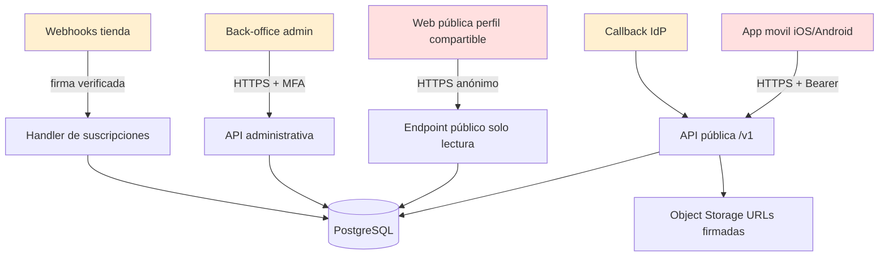

Superficies ordenadas por riesgo: (1) endpoint público anónimo del perfil compartible, (2) subida de multimedia, (3) endpoints de autenticación, (4) back-office administrativo, (5) webhooks de tienda, (6) la app móvil como artefacto distribuible.


## 17.3 Modelo de autenticación

**[DEC-15]** El backend actúa como **autoridad de sesión propia**. Los proveedores externos (Google, Apple) se usan únicamente para **verificar identidad**, no para gestionar la sesión de la aplicación. Tras validar el `id_token` del IdP, el backend emite sus propios tokens.

*Justificación:* permite revocar sesiones de forma centralizada, aplicar políticas propias de caducidad, soportar múltiples proveedores sobre la misma cuenta y no depender de la disponibilidad del IdP para cada petición.

### 17.3.1 OAuth 2.0 / OpenID Connect

| Aspecto | Decisión |
|---|---|
| Flujo en móvil | **Authorization Code con PKCE** (S256). Prohibido el flujo implícito. |
| Validación del `id_token` | En servidor: firma contra JWKS del emisor con caché y rotación, `iss`, `aud` (debe coincidir con el client ID propio), `exp`, `iat`, `nonce` (obligatorio y de un solo uso), y `email_verified` cuando el proveedor lo aporte. |
| Vinculación de cuentas | Si el correo del IdP coincide con una cuenta existente, **no** se vincula automáticamente: se exige autenticación previa con el método original o verificación por correo. Previene el *pre-account takeover*. |
| Almacenamiento | Se guarda el `sub` del proveedor como identificador estable, nunca el correo como clave de vinculación. |

### 17.3.2 Tokens propios

| Token | Formato | Vida | Almacenamiento cliente | Revocación |
|---|---|---|---|---|
| **Access token** | JWT firmado (EdDSA o RS256), *claims* mínimos: `sub`, `sid`, `exp`, `iat`, `scope`, `plan` | ≤ 15 min | Solo en memoria del proceso; **nunca** persistido | Por caducidad corta; lista de revocación solo para incidentes |
| **Refresh token** | Opaco, alta entropía (≥ 256 bits), hasheado en base de datos | Inactividad 30 días / absoluta 60 días | Keychain (iOS) / Keystore-backed EncryptedSharedPreferences (Android) | Inmediata en servidor |

**[REQ] Rotación con detección de reutilización:** cada uso de un refresh token emite uno nuevo e invalida el anterior. Si llega un refresh token ya consumido, se asume compromiso: se revoca **toda la familia de tokens** de esa sesión, se cierra la sesión y se notifica al usuario por correo. Este mecanismo es la principal defensa contra el robo de token de refresco.

**[REQ]** Los *claims* del access token no contienen datos personales (ni correo, ni nombre, ni nombres de mascota). Un JWT no está cifrado: cualquiera que lo capture puede leerlo.

### 17.3.3 Credenciales propias

| Control | Especificación |
|---|---|
| Hash | Argon2id, 19 MiB, 2 iteraciones, paralelismo 1. Alternativa aceptada: bcrypt coste ≥ 12. |
| Política de contraseña | Mínimo 10 caracteres. **Sin** requisitos de composición obligatoria (mayúsculas/símbolos), que empeoran la seguridad real. Contraste contra lista de contraseñas filtradas conocidas. Indicador de robustez. |
| *Pepper* | **[REC]** Además del salt por contraseña, aplicar un *pepper* global almacenado en el gestor de secretos, fuera de la base de datos. |
| Rehash oportunista | Al iniciar sesión correctamente, si los parámetros del hash son inferiores a la política vigente, se rehashea de forma transparente. |

### 17.3.4 Protección contra *account enumeration*

**[REQ]** En registro, login, recuperación de contraseña y reenvío de verificación:

1. La respuesta HTTP es **idéntica** en código, cuerpo y cabeceras, exista o no la cuenta.
2. El **tiempo de respuesta** se normaliza: cuando la cuenta no existe se ejecuta igualmente una operación de hash *dummy* de coste equivalente, para evitar un canal lateral temporal.
3. El mensaje al usuario es neutro: "Si esa dirección está registrada, recibirás un correo".
4. En registro, si el correo ya existe, se envía al titular real un correo de "alguien intentó registrarse con tu dirección" y la app muestra la misma pantalla de "revisa tu correo".
5. Los endpoints de autenticación tienen límites de petición por IP y por identificador reclamado, más estrictos que el resto.


## 17.4 Ciclo de vida de la sesión

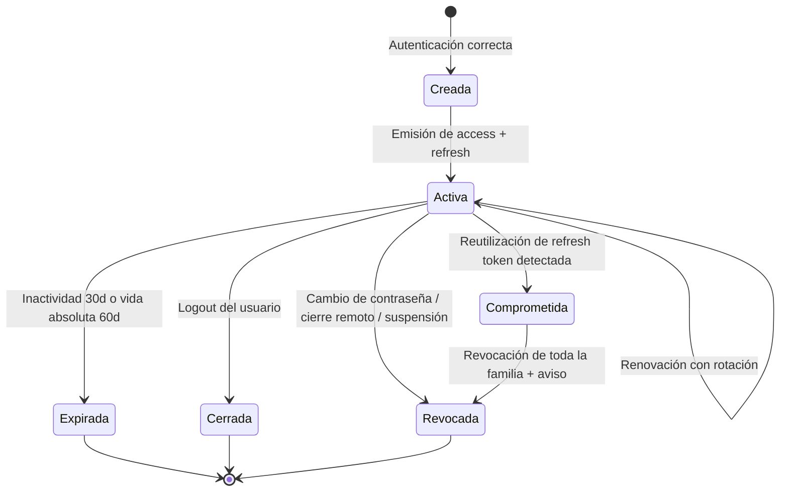

## 17.5 Registro de sesión

Cada sesión persiste: identificador de sesión, usuario, tipo de dispositivo, sistema operativo y versión, versión de la app, fecha de creación, última actividad, **IP truncada** (los dos últimos octetos anonimizados en IPv4; prefijo /48 en IPv6) y país aproximado derivado. **[REQ]** No se almacena la IP completa de forma persistente: no es necesaria para el propósito y aumenta el riesgo.

## 17.6 Múltiples dispositivos, sesiones robadas y dispositivos perdidos

| Escenario | Comportamiento requerido |
|---|---|
| Varios dispositivos simultáneos | Permitido y esperado. Cada dispositivo tiene su propia familia de tokens, revocable de forma independiente. **[DEC-16]** No se limita el número de sesiones en el MVP; se monitoriza como señal de abuso si supera 10 dispositivos activos. |
| Dispositivo perdido o robado | El usuario cierra esa sesión concreta desde otro dispositivo (RF-AUTH-009). Se recomienda además cambiar la contraseña, lo que revoca todo. |
| Sospecha de robo de token | La detección de reutilización de refresh token revoca la familia y notifica. |
| Cambio de contraseña | Revoca todas las sesiones salvo, opcionalmente, la actual. |
| Suspensión administrativa | Revoca todas las sesiones de forma inmediata y despublica los perfiles compartibles. |

## 17.7 Detección de sesiones sospechosas — **[REC]**, alcance proporcionado al MVP

No se propone un motor de riesgo completo, que sería sobreingeniería. Se propone un conjunto mínimo de señales con acción asociada:

| Señal | Acción en MVP |
|---|---|
| Autenticación desde un país nuevo para esa cuenta | Correo informativo al titular con detalle y enlace de "no fui yo" que revoca sesiones |
| Reutilización de refresh token | Revocación de familia + correo (automático, RNF-SEC-005) |
| Más de 10 sesiones activas simultáneas | Evento de auditoría para revisión manual |
| Ráfaga de intentos fallidos seguida de éxito | Correo informativo + exigencia de reautenticación para operaciones sensibles |
| Cambio de correo o contraseña | Correo de confirmación a la dirección anterior y a la nueva |

**[REQ]** Operaciones sensibles (eliminar cuenta, cambiar contraseña, ver sesiones activas, cambiar configuración de privacidad del perfil público) requieren **reautenticación reciente** (< 10 minutos) aunque la sesión sea válida.


## 17.8 Catálogo de amenazas y controles

| # | Amenaza | Vector en este producto | Controles preventivos |
|---|---|---|---|
| 1 | **Fuerza bruta** | Login, recuperación de contraseña | Mitigación progresiva tras 5 fallos (RNF-SEC-003), límites por IP e identidad, retardo creciente, *challenge*, aviso al titular |
| 2 | **Credential stuffing** | Login masivo con credenciales filtradas | Contraste con listas de contraseñas comprometidas en registro y cambio; límites por IP y por rango; detección de ráfagas distribuidas por tasa de fallo global; *challenge* adaptativo |
| 3 | **SQL Injection** | Cualquier entrada que llegue a consulta | Consultas parametrizadas exclusivamente; ORM/consultas preparadas; validación de esquema; usuario de base de datos con permisos mínimos; SAST en CI |
| 4 | **NoSQL Injection** | Campos JSONB y filtros dinámicos | No se construyen filtros a partir de objetos del cliente; lista blanca de campos filtrables; tipado estricto de los operadores de consulta |
| 5 | **XSS** | Perfil público (nombre de mascota, título/descripción de hito, slug) y back-office | Escapado por defecto del motor de plantillas; `Content-Security-Policy` restrictiva sin `unsafe-inline`; sanitización en el punto de salida; prohibición de HTML en campos de usuario; `X-Content-Type-Options: nosniff` |
| 6 | **CSRF** | Back-office y cualquier endpoint basado en cookie | La API móvil usa Bearer en cabecera, no cookies → no aplica. El back-office usa cookie `SameSite=Strict`, `HttpOnly`, `Secure` + token anti-CSRF por formulario |
| 7 | **SSRF** | Cualquier funcionalidad que acepte URL del usuario | **[DEC-17]** El MVP **no acepta URLs proporcionadas por el usuario** para su descarga por el servidor (no hay "importar foto desde URL"). Si en el futuro se añade, será con lista blanca de destinos, resolución DNS validada y bloqueo de rangos privados y de metadatos del proveedor cloud |
| 8 | **IDOR / BOLA** | `GET /pets/{id}`, `/milestones/{id}`, `/reminders/{id}` — **el riesgo número uno de este producto** | Identificadores no adivinables (UUID/ULID); verificación obligatoria de titularidad en cada operación (RNF-SEC-004); pruebas automatizadas de acceso cruzado en CI que fallan la construcción; auditoría de accesos denegados |
| 9 | **Broken Authentication** | Vinculación de proveedores, restablecimiento de contraseña | Tokens de un solo uso y vida corta; no vinculación automática por correo; revocación tras cambios de credencial; validación completa del `id_token` en servidor |
| 10 | **Token theft** | Extracción desde el dispositivo | Access token solo en memoria; refresh token en almacenamiento cifrado del sistema; vida corta; rotación con detección de reutilización |
| 11 | **Replay attacks** | Reenvío de peticiones capturadas o de webhooks | TLS obligatorio; `nonce` en OIDC; verificación de firma y de marca temporal en webhooks de tienda con ventana de tolerancia; idempotencia por identificador de operación en escrituras |
| 12 | **API abuse / scraping** | Enumeración de perfiles públicos, descarga masiva de imágenes | Límite por IP y por *slug*; respuesta 404 uniforme; *slugs* con componente aleatorio (RN-064); URLs de imagen no adivinables; detección de patrones de acceso secuencial; `robots.txt` y `noindex` por defecto |
| 13 | **Rate limit bypass** | Rotación de IP, cabeceras falsificadas | El límite se aplica sobre la IP real determinada por la infraestructura de borde, no por cabeceras del cliente; límite combinado por identidad autenticada y por IP; límites también en el borde/CDN, no solo en la aplicación |
| 14 | **File upload attacks** | Subida de fotos | Ver §17.10 completo |
| 15 | **Malware / imágenes maliciosas** | Ficheros que explotan decodificadores de imagen | Validación de tipo real por *magic bytes*; **reprocesado obligatorio** de toda imagen (decodificar y recodificar), que destruye cargas útiles embebidas; procesamiento en entorno aislado con límites de memoria y tiempo; rechazo de formatos no permitidos |
| 16 | **Escalamiento de privilegios** | Reclamar rol admin, manipular `plan` | El rol y el plan se resuelven **en servidor** desde la base de datos en cada petición sensible, no se confía en el *claim* del token para decisiones críticas; planos administrativo y de usuario separados con emisores distintos |
| 17 | **Bots** | Registro masivo, reportes fraudulentos | *Challenge* en registro ante señales de riesgo; verificación de correo obligatoria para acciones públicas; límites en el formulario de reporte; detección de reportes repetidos desde el mismo origen |
| 18 | **Enumeration attacks** | Correos, *slugs*, identificadores | Respuestas uniformes (§17.3.4); 404 en lugar de 403; identificadores no secuenciales |
| 19 | **Fraude de suscripción** | Recibos falsificados, apps parcheadas | Verificación server-to-server obligatoria con Apple/Google; nunca conceder derecho por afirmación del cliente; reconciliación periódica; detección de un mismo recibo asociado a múltiples cuentas |
| 20 | **Denegación de servicio económica** | Subidas masivas para agotar almacenamiento | Cuota por plan (RN-030); límite de subidas por hora y por cuenta; alertas de coste por cuenta atípica |

## 17.9 Seguridad de API (§25 del encargo)

| Control | Especificación |
|---|---|
| Transporte | HTTPS obligatorio; HTTP redirige; HSTS. TLS 1.2 mínimo, 1.3 preferido. |
| Autenticación | `Authorization: Bearer <access_token>`. Validación de firma, emisor, audiencia y caducidad en cada petición. |
| Autorización | Por recurso y por acción. Deny by default. Verificación de titularidad obligatoria. |
| Límites de petición | Global por identidad; más estricto en `/auth/*` (ej.: 10 intentos de login / 15 min / IP), en subidas (ej.: 60 imágenes/h/cuenta) y en el endpoint público (ej.: 60 req/min/IP). Respuesta 429 con `Retry-After`. |
| Validación de entrada | Esquema explícito por endpoint: tipo, longitud máxima, formato, rango, enumeraciones cerradas. Rechazo de propiedades no declaradas. |
| Sanitización | En el punto de salida según el contexto de renderizado, no solo en la entrada. |
| Tamaño de payload | Cuerpo JSON ≤ 256 KB. Multimedia **nunca** viaja por la API: se sube directamente al almacenamiento con URL firmada. |
| Subida de ficheros | Ver §17.10. |
| Cabeceras | Sin exposición de versión de servidor ni de tecnología. `Cache-Control: no-store` en respuestas con datos personales. |
| Errores | Mensajes genéricos al cliente con código de error estable; el detalle técnico solo en logs del servidor. Nunca trazas de pila al cliente. |
| Idempotencia | Cabecera `Idempotency-Key` en creaciones para evitar duplicados por reintento de red. |
| Auditoría | Registro de todas las operaciones sensibles y de todos los accesos denegados. |
| Versionado | `/v1` desde el primer día. |

**[REQ] Principio no negociable:** *ninguna* validación realizada en la aplicación móvil constituye un control de seguridad. La app es código en manos del atacante. Toda autorización, todo límite de plan y toda regla de negocio con implicaciones de seguridad se evalúan en backend.

## 17.10 Gestión de archivos y multimedia (§27 del encargo)

### Flujo de subida — **[DEC-18]**

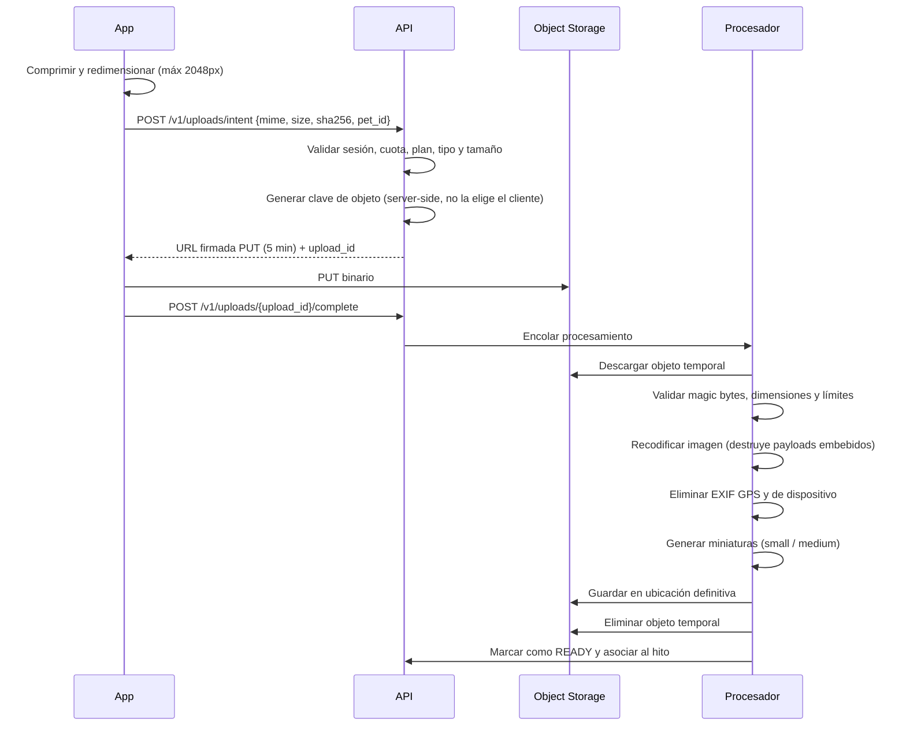

### Controles obligatorios

| # | Control |
|---|---|
| 1 | **[REQ]** La **clave del objeto la genera siempre el servidor** con un componente aleatorio. El cliente nunca propone ni controla la ruta de almacenamiento. Elimina de raíz el *path traversal* y la sobrescritura de objetos ajenos. |
| 2 | **[REQ]** La URL firmada de escritura es de un solo objeto, un solo método (PUT), con caducidad ≤ 5 minutos, y restringida por tipo de contenido y tamaño máximo. |
| 3 | **[REQ]** El objeto se sube a un área temporal. Solo pasa al área definitiva tras validación. Un objeto nunca validado se purga a las 24 h. |
| 4 | **[REQ]** Validación por *magic bytes*. Se rechazan ficheros cuyo contenido real no coincida con un formato permitido, con independencia de la extensión y del `Content-Type`. |
| 5 | **[REQ]** Recodificación obligatoria de toda imagen. Es la defensa más efectiva contra cargas útiles embebidas y contra *polyglot files*. |
| 6 | **[REQ]** Límite de dimensiones (rechazo de imágenes con dimensiones absurdas que provoquen agotamiento de memoria, *decompression bomb*) y límites de memoria y tiempo en el procesador. |
| 7 | **[REQ]** Eliminación de EXIF de geolocalización y de identificación de dispositivo antes de persistir. Se conserva únicamente la fecha de captura. |
| 8 | **[REQ]** Formatos permitidos: JPEG, PNG, HEIC/HEIF, WebP. **Prohibido SVG** (vector de XSS). Vídeo: MP4 con H.264/HEVC. |
| 9 | **[REQ]** Lectura mediante URL firmada de caducidad ≤ 15 min para contenido privado. El contenido público se sirve por CDN con clave no adivinable e invalidación al despublicar. |
| 10 | **[REQ]** El bucket no tiene acceso público de lectura por lista ni por navegación de prefijos. |
| 11 | **[REQ]** La eliminación de un hito o de una mascota encola la eliminación de sus objetos, respetando la ventana de recuperación de 30 días. |
| 12 | **[REC]** Análisis antivirus del fichero en el área temporal si el coste es asumible. La recodificación mitiga la mayor parte del riesgo, pero no cubre contenido malicioso no ejecutable. |
| 13 | **[REQ]** Las miniaturas se generan en servidor. La app nunca descarga la imagen original para mostrar una cuadrícula. |

## 17.11 Seguridad móvil (§26 del encargo)

Referencia conceptual: **OWASP MASVS** (nivel L1 como objetivo del MVP, con controles seleccionados de L2) y **OWASP Mobile Top 10**.

| Área | Decisión para el MVP | Justificación / límite |
|---|---|---|
| **Almacenamiento de tokens** | **[REQ]** Refresh token en **iOS Keychain** (`kSecAttrAccessibleAfterFirstUnlockThisDeviceOnly`, sin sincronización con iCloud) y en **Android Keystore** mediante almacenamiento cifrado respaldado por hardware cuando esté disponible. Access token **solo en memoria**. | Control fundamental y de bajo coste. |
| **Datos locales** | **[REQ]** La caché local no almacena datos sensibles en claro. La base de datos local puede almacenar metadatos de mascotas y hitos; **[REC]** cifrarla si el coste de integración es bajo. Las imágenes cacheadas se guardan en directorios excluidos de la copia de seguridad del sistema. | Proporcionado: el contenido no es información de categoría especial. |
| **Certificate pinning** | **[DEC-19] No en el MVP.** | Análisis honesto: el *pinning* protege frente a un adversario capaz de emitir un certificado de confianza, un escenario poco probable para este producto. A cambio, introduce un **riesgo operativo alto**: una rotación de certificado mal coordinada deja inutilizadas todas las instalaciones hasta una nueva publicación en tienda. **[REC]** Reevaluar en H2, y si se adopta, hacerlo con configuración remota de respaldo, *pins* de reserva y un mecanismo de desactivación de emergencia. |
| **Detección de root/jailbreak** | **[DEC-20] Detección básica, sin bloqueo.** Se detecta y se registra como señal analítica y de riesgo; **no se impide el uso**. | Bloquear genera falsos positivos en usuarios legítimos, es evadible con poco esfuerzo y no protege datos del servidor. El valor real es como señal, no como control. |
| **Protección de capturas de pantalla** | **[REQ]** Ocultar el contenido en el conmutador de aplicaciones en pantallas con datos personales (ajustes de cuenta, sesiones activas, *paywall* con datos de pago). **No** se bloquean capturas del timeline ni del álbum: el usuario **debe** poder capturar y compartir los recuerdos de su mascota; bloquearlo contradice el producto. | Ejemplo de control aplicado con criterio y no por inercia. |
| **Logs** | **[REQ]** Ningún log en compilación de producción contiene tokens, correos, contenido de hitos ni URLs firmadas. Los logs verbosos se eliminan en producción. | |
| **Secretos en la app** | **[REQ]** La app no contiene secretos con valor de servidor. Las claves de SDK de terceros (FCM, analítica) son públicas por naturaleza y se restringen por configuración en la consola del proveedor (huella de firma, *bundle id*). **Ninguna** clave de API con capacidad de escritura en backend reside en la app. | |
| **Reverse engineering** | **[REC]** Ofuscación y minimización de código en las compilaciones de producción (R8/ProGuard en Android; eliminación de símbolos en iOS). Se asume que el binario es inspeccionable: **ninguna** decisión de seguridad depende de que el código sea secreto. | Coste bajo, beneficio marginal pero real (eleva el coste del atacante). |
| **Comunicación** | **[REQ]** Tráfico en claro deshabilitado a nivel de plataforma (App Transport Security en iOS; `cleartextTrafficPermitted=false` en Android). | |
| **Portapapeles y autocompletado** | **[REQ]** Campos de contraseña marcados como seguros; sin autocompletado de contraseña en campos no destinados a ello. | |
| **Enlaces profundos** | **[REQ]** Validación de todo parámetro recibido por *deep link*; un enlace nunca ejecuta una acción destructiva sin confirmación del usuario. | |
| **Biometría** | **[COULD]** Bloqueo opcional de la app por biometría. Fuera del MVP salvo que la investigación de usuario indique demanda. | |
| **Integridad de la app / attestation** | **[DEC-21] Fuera del MVP.** Reevaluar solo si se detecta fraude real de suscripción. | Complejidad alta, beneficio no demostrado a esta escala. |

---

# 18. PRIVACIDAD

## 18.1 Marco aplicable

**[DEC-22]** Se adopta el **GDPR** como estándar base para todos los mercados, incluidos los de LATAM. Razón: es el marco más exigente, evita mantener dos modelos de tratamiento y facilita el cumplimiento posterior de LGPD (Brasil), Ley 1581 (Colombia), LFPDPPP (México) y LPDP (Argentina/Chile), que comparten principios esenciales.

**[SUP-04]** Se asume que la entidad titular actúa como **responsable del tratamiento** y que los proveedores cloud, de correo, de analítica y de notificaciones actúan como **encargados**, con sus correspondientes acuerdos de tratamiento firmados antes del lanzamiento.

## 18.2 Datos tratados y base jurídica

| Categoría de dato | Finalidad | Base jurídica | Notas |
|---|---|---|---|
| Correo electrónico, contraseña hasheada, identificador del IdP | Creación y gestión de la cuenta, autenticación | Ejecución del contrato (art. 6.1.b) | Imprescindible |
| Nombre visible, avatar | Personalización de la cuenta | Ejecución del contrato | Opcional el avatar |
| Idioma, zona horaria, preferencias | Prestación del servicio | Ejecución del contrato | |
| Datos de la mascota (nombre, especie, raza, nacimiento, peso, esterilización, microchip) | Núcleo del servicio, cálculo de edad y recomendaciones | Ejecución del contrato | **No son datos personales del titular en sentido estricto**, pero se tratan con el mismo nivel de protección por ser vinculables a él |
| Hitos, fotografías, descripciones | Núcleo del servicio | Ejecución del contrato | Pueden contener imágenes de personas → ver §18.4 |
| Recordatorios | Núcleo del servicio | Ejecución del contrato | |
| Token de dispositivo para notificaciones | Envío de recordatorios | Ejecución del contrato | Para novedades del producto: consentimiento |
| Eventos de analítica de producto | Mejora del producto y medición | **Consentimiento** (art. 6.1.a) | Revocable; sin consentimiento el producto funciona íntegramente |
| Comunicaciones comerciales | Marketing | **Consentimiento** | Independiente del anterior |
| Datos de sesión (dispositivo, IP truncada, país) | Seguridad de la cuenta | Interés legítimo (art. 6.1.f) | Documentar el juicio de ponderación |
| Registros de auditoría | Seguridad y cumplimiento | Interés legítimo / obligación legal | Retención 12 meses |
| Estado de suscripción y recibos | Gestión del contrato de suscripción | Ejecución del contrato / obligación legal (fiscal) | |

**[REQ]** No se tratan datos de categorías especiales del art. 9. **[RSG-03]** Las fotografías subidas por el usuario pueden contener biometría facial de personas. Mitigación: **no se aplica ningún tratamiento biométrico, reconocimiento facial ni etiquetado automático de personas**. Sin tratamiento biométrico, no hay dato biométrico en sentido del art. 9.

## 18.3 Consentimiento

| Requisito | Implementación |
|---|---|
| Libre | La app es plenamente funcional sin consentir analítica ni marketing. |
| Específico | Consentimientos separados y granulares: analítica, comunicaciones comerciales, indexación pública del perfil. |
| Informado | Texto claro, sin jerga, con acceso a la política completa en el mismo punto. |
| Inequívoco | Acción afirmativa. **Prohibidas** las casillas premarcadas y los patrones oscuros. |
| Revocable | Desde Ajustes, con la misma facilidad con la que se otorgó, y efecto inmediato. |
| Registrado | Se almacena timestamp, versión del texto y canal de obtención. |
| **[REQ] ATT en iOS** | No se solicita el permiso de seguimiento de App Tracking Transparency porque **no se realiza seguimiento entre aplicaciones ni se usan identificadores publicitarios**. Si en el futuro se añadiera publicidad o atribución de terceros, sería obligatorio. |

## 18.4 Contenido que puede afectar a terceros — **[REQ]**

Las fotografías de mascotas contienen con frecuencia personas (familia, menores).

1. Los términos deben establecer que el usuario es responsable de contar con el consentimiento necesario del contenido que sube y publica.
2. En el momento de **activar el perfil compartible**, se advierte explícitamente de que las fotos marcadas como compartidas serán visibles públicamente, con recordatorio sobre imágenes de menores.
3. El valor por defecto `PRIVATE` de todo hito es precisamente la protección principal frente a este riesgo.
4. Existe un canal de reporte accesible sin autenticación para que un tercero solicite la retirada de contenido en el que aparezca (RF-SHARE-006), con tratamiento prioritario.

## 18.5 Derechos del interesado

| Derecho | Implementación en el MVP | Plazo |
|---|---|---|
| **Acceso** (art. 15) | Exportación de datos en la app (RF-AUTH-013) | Objetivo 72 h; máximo legal 30 días |
| **Rectificación** (art. 16) | Edición directa de perfil, mascotas e hitos | Inmediato |
| **Supresión** (art. 17) | Eliminación de cuenta en la app (RF-AUTH-012); eliminación granular de mascotas e hitos | 14 días de gracia + ejecución |
| **Portabilidad** (art. 20) | Exportación en JSON estructurado + ficheros originales | Igual que acceso |
| **Oposición** (art. 21) | Revocación de consentimientos; desactivación de perfil público | Inmediato |
| **Limitación** (art. 18) | Suspensión de la cuenta a petición conservando los datos | Vía soporte |
| **Reclamación** | Información sobre la autoridad de control competente en la política de privacidad | — |
| **No decisiones automatizadas** (art. 22) | El motor de recomendaciones **no produce efectos jurídicos ni significativos**; es informativo y siempre descartable. Se documenta explícitamente su lógica y su carácter no vinculante. | — |

### Qué ocurre exactamente al eliminar la cuenta

| Dato | Acción |
|---|---|
| Cuenta, correo, contraseña, vínculos con IdP | Eliminación irreversible |
| Mascotas, hitos, descripciones, recordatorios | Eliminación irreversible |
| Fotografías y vídeos (originales y miniaturas) | Eliminación de los objetos y de sus versiones en un plazo ≤ 30 días |
| Perfiles compartibles | Despublicación inmediata e invalidación de caché |
| Tokens y sesiones | Revocación inmediata |
| Eventos de analítica | **Anonimización irreversible** (se rompe el vínculo con el identificador de usuario). No se eliminan los agregados históricos, lo que se informa al usuario |
| Registros de auditoría de seguridad | Conservación 12 meses con identificador seudonimizado, por interés legítimo de seguridad |
| Registros de facturación / suscripción | Conservación según obligación fiscal aplicable, con minimización |

**[REQ]** Esta tabla debe reflejarse, en lenguaje accesible, en la pantalla de confirmación de eliminación. El usuario debe saber qué se conserva **antes** de confirmar.

## 18.6 Política de retención

| Dato | Retención |
|---|---|
| Cuenta activa y su contenido | Mientras la cuenta exista |
| Cuenta inactiva sin login | **[REC]** Aviso a los 24 meses de inactividad y eliminación a los 36 meses, con dos avisos previos. Ver DP-011 |
| Hitos y mascotas eliminados (soft delete) | 30 días |
| Cuenta en periodo de gracia | 14 días |
| Objetos multimedia huérfanos o no validados | 24 h |
| Tokens de verificación y restablecimiento | Vida del token + 24 h |
| Sesiones cerradas o expiradas | 90 días (para investigación de seguridad) |
| Logs operativos | 30 días |
| Registros de auditoría | 12 meses |
| Eventos de analítica seudonimizados | 24 meses |
| Copias de seguridad | 30 días |

**[REQ]** La eliminación de datos debe propagarse a las copias de seguridad conforme estas rotan; se documenta que un dato eliminado puede persistir en copias durante un máximo de 30 días, plazo tras el cual desaparece definitivamente.

## 18.7 Minimización — decisiones explícitas de no recoger

| Dato que **no** se recoge | Motivo |
|---|---|
| Ubicación GPS del usuario o de la mascota | No aporta valor a ninguna hipótesis; alto riesgo |
| Número de teléfono | Innecesario; canal de autenticación no usado |
| Dirección postal | Innecesario sin envíos físicos |
| Identificador publicitario (IDFA/GAID) | No hay publicidad ni atribución de terceros |
| Lista de contactos | Innecesario; no hay funcionalidad social |
| Acceso completo al carrete | Se usa el selector del sistema, que otorga acceso solo a lo elegido |
| Datos clínicos estructurados | Fuera de alcance del MVP |

**[REC]** Esta tabla debe publicarse de forma resumida dentro de la app ("Qué NO recogemos"). Es un diferenciador de confianza, especialmente en un producto emocional, y tiene coste cero.

## 18.8 Menores

**[DEC-23]** La edad mínima para crear una cuenta es **16 años** (o la que fije cada Estado miembro, con mínimo de 13 según el art. 8 GDPR). Se solicita confirmación de edad en el registro. El producto no se dirige a menores, no incluye funcionalidades sociales y no realiza *profiling* con fines publicitarios. Se clasificará en las tiendas conforme a este posicionamiento.

**[RSG-04]** Riesgo: menores usando la app para su mascota con la cuenta de un adulto. Mitigación: es un uso supervisado por el titular adulto de la cuenta, coherente con los términos; no se habilitan funcionalidades de contacto entre usuarios, que es donde reside el riesgo real.

---

# 19. FLUJOS FUNCIONALES

**Formato aplicado a cada flujo (§30 del encargo):** ID, nombre, objetivo, actor, disparador, precondiciones, flujo principal, flujos alternativos, errores, postcondiciones, reglas, pantallas, APIs conceptuales y diagrama.

**Nota sobre las APIs:** los endpoints citados son **conceptuales**, para comunicar intención. El contrato definitivo se define en la especificación OpenAPI (RNF-MAINT-005).

---

## FL-001 — Registro con correo electrónico

| Campo | Detalle |
|---|---|
| **Objetivo** | Crear una cuenta nueva con credenciales propias. |
| **Actor** | Propietario |
| **Disparador** | El usuario pulsa "Crear cuenta" tras el onboarding. |
| **Precondiciones** | Sin sesión activa; conectividad disponible. |
| **Postcondiciones** | Cuenta en `PENDING_VERIFICATION`; sesión activa; correo enviado; evento `sign_up`. |
| **Reglas** | RN-001, RN-003, RN-004, RN-005, RN-009 |
| **Pantallas** | Onboarding · Registro · Confirmación de correo enviado · Creación de mascota |
| **APIs** | `POST /v1/auth/register` · `POST /v1/auth/verify-email/resend` |

**Flujo principal:** introducir correo → introducir contraseña con indicador de robustez → confirmar edad mínima y aceptar términos → enviar → cuenta creada y sesión iniciada → pantalla "revisa tu correo" con opción de continuar → onboarding de creación de mascota.

**Alternativos:** (A1) el usuario elige Google o Apple → FL-003. (A2) el usuario omite la verificación y continúa: permitido (RN-003), con recordatorio persistente no bloqueante.

**Errores:** correo con formato inválido (validación en línea); contraseña débil o comprometida (mensaje explicativo, no bloqueo silencioso); correo ya registrado (respuesta indistinguible + correo informativo al titular); sin conexión (mensaje y reintento conservando los datos del formulario); límite de peticiones superado (mensaje con tiempo de espera).

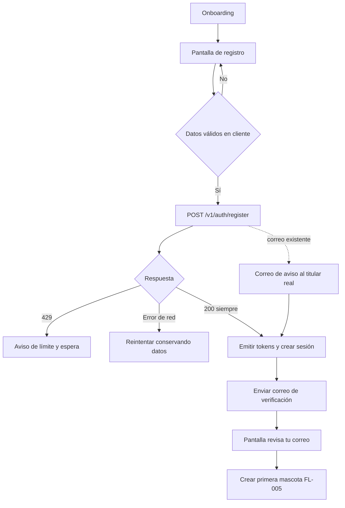

---

## FL-002 — Inicio de sesión con correo y contraseña

| Campo | Detalle |
|---|---|
| **Objetivo** | Autenticar a un usuario existente. |
| **Actor** | Propietario |
| **Disparador** | Apertura de la app sin sesión válida, o pulsación de "Iniciar sesión". |
| **Precondiciones** | Cuenta existente y no suspendida. |
| **Postcondiciones** | Tokens emitidos; sesión registrada; evento `login`. |
| **Reglas** | RN-005, RN-006, RN-008; RNF-SEC-003 |
| **Pantallas** | Login · Home |
| **APIs** | `POST /v1/auth/login` |

**Flujo principal:** introducir credenciales → validación en servidor → emisión de tokens → almacenamiento seguro del refresh token → navegación a Home con la última mascota seleccionada.

**Alternativos:** (A1) autocompletado del gestor de contraseñas del sistema. (A2) el usuario había llegado por un *deep link*: tras autenticar se navega al destino original.

**Errores:** credenciales incorrectas (mensaje genérico); 5 fallos consecutivos (mitigación progresiva y aviso al titular); cuenta suspendida (mensaje con canal de contacto); sin conexión (permitir acceso a contenido cacheado en modo lectura si hay sesión previa vigente).

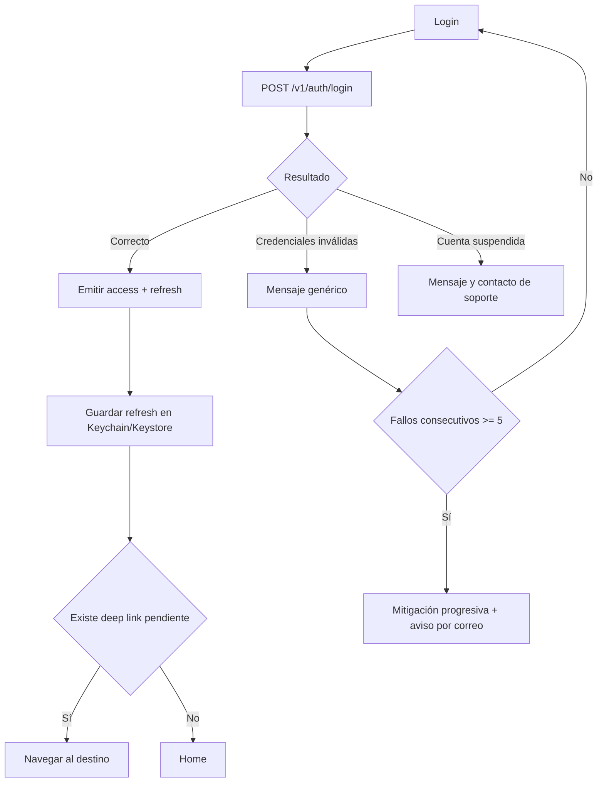

---

## FL-003 — Inicio de sesión con Google (y Apple)

| Campo | Detalle |
|---|---|
| **Objetivo** | Autenticar mediante proveedor de identidad externo. |
| **Actor** | Propietario, IdP |
| **Disparador** | Pulsación de "Continuar con Google" / "Continuar con Apple". |
| **Precondiciones** | Conectividad; cuenta disponible en el proveedor. |
| **Postcondiciones** | Cuenta creada o vinculada; correo verificado si el IdP lo indica; tokens propios emitidos. |
| **Reglas** | RN-001; §17.3.1 |
| **Pantallas** | Login · Vista del proveedor · Confirmación de vinculación (si aplica) · Home |
| **APIs** | `POST /v1/auth/oidc/google` · `POST /v1/auth/oidc/apple` |

**Flujo principal:** inicio del flujo Authorization Code + PKCE con `nonce` → el usuario autoriza → el cliente recibe el código → se intercambia y se envía el `id_token` al backend → el backend valida firma, emisor, audiencia, caducidad y `nonce` → busca por `sub`; si no existe, busca por correo → si no hay coincidencia, crea la cuenta → emite tokens propios.

**Alternativos:** (A1) **el correo coincide con una cuenta de credenciales propias:** no se vincula automáticamente. Se solicita al usuario que inicie sesión con su método original para confirmar la vinculación. (A2) **Apple con correo privado:** se persiste el correo de relay y el nombre recibido en la primera autorización. (A3) el usuario cancela en la pantalla del proveedor: se vuelve al login sin error.

**Errores:** `id_token` inválido o `nonce` no coincidente (se rechaza y se registra como evento de seguridad); IdP no disponible (mensaje y sugerencia de método alternativo); usuario sin correo disponible desde el proveedor (se solicita correo y verificación).

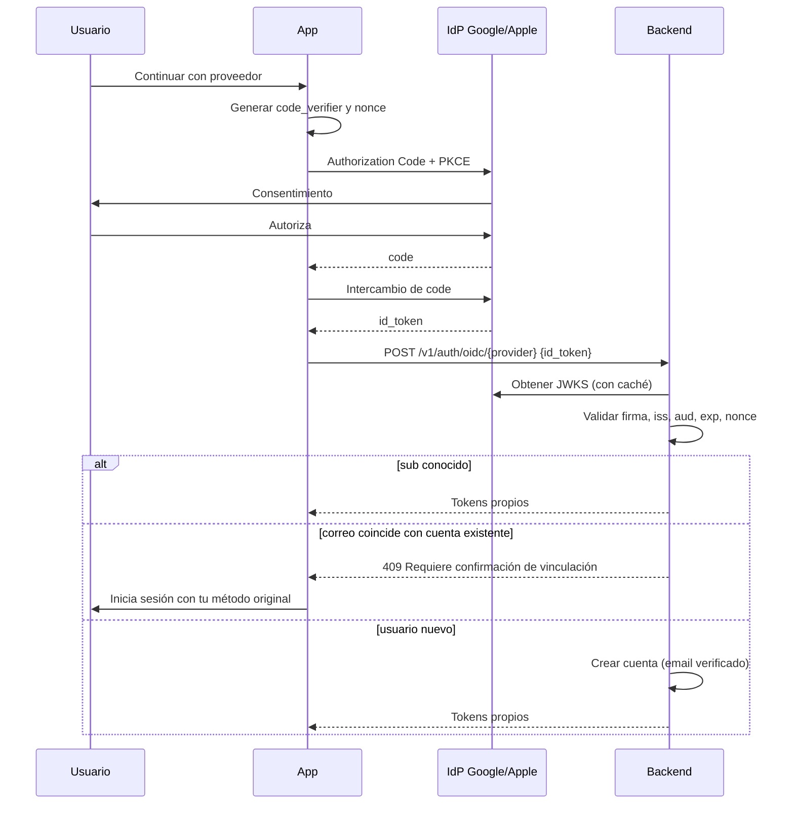

---

## FL-004 — Recuperación de contraseña

| Campo | Detalle |
|---|---|
| **Objetivo** | Permitir restablecer la contraseña sin revelar si la cuenta existe. |
| **Actor** | Propietario |
| **Disparador** | "He olvidado mi contraseña". |
| **Postcondiciones** | Contraseña actualizada; todas las sesiones revocadas; correo de confirmación enviado. |
| **Reglas** | RN-004, RN-005, RN-006 |
| **Pantallas** | Olvidé mi contraseña · Aviso neutro · Nueva contraseña (desde el enlace) · Login |
| **APIs** | `POST /v1/auth/password/forgot` · `POST /v1/auth/password/reset` |

**Flujo principal:** introducir correo → respuesta neutra siempre → si la cuenta existe, se envía un enlace con token de 30 minutos y un solo uso → el usuario abre el enlace (enlace universal que abre la app si está instalada) → establece nueva contraseña → se revocan todas las sesiones → se notifica por correo → login.

**Alternativos:** (A1) la cuenta solo tiene login social: el correo enviado al titular explica cómo acceder con su proveedor, sin exponer nada a terceros. (A2) el enlace se abre en navegador sin la app instalada: se ofrece el restablecimiento vía web y la descarga de la app.

**Errores:** token caducado o ya usado (mensaje neutro con opción de solicitar uno nuevo); nueva contraseña débil o igual a la anterior (rechazo explicado); exceso de solicitudes (límite de 3/hora por correo y por IP).

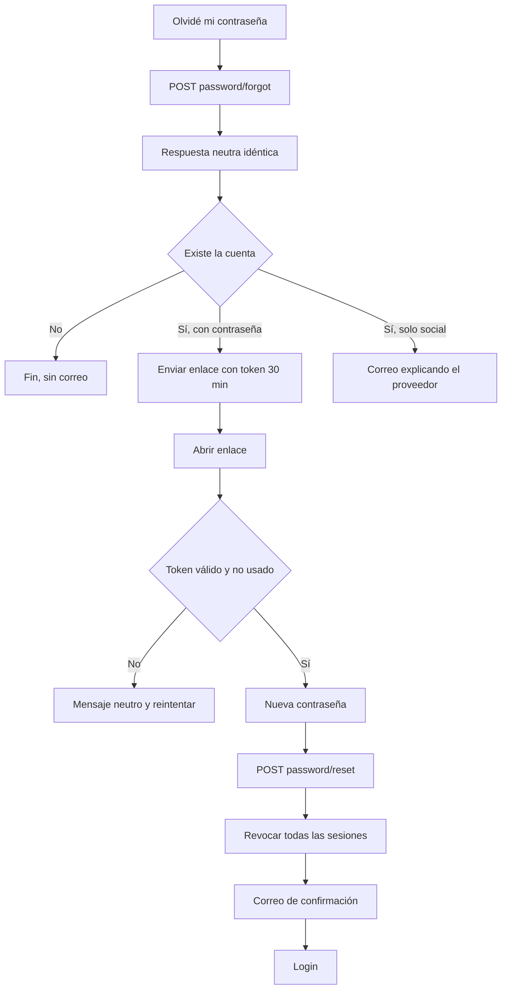

---

## FL-005 — Creación de mascota

| Campo | Detalle |
|---|---|
| **Objetivo** | Registrar una mascota, evento de activación del producto. |
| **Actor** | Propietario |
| **Disparador** | Fin del registro (onboarding) o botón "Añadir mascota". |
| **Precondiciones** | Sesión válida; límite de mascotas del plan no alcanzado. |
| **Postcondiciones** | Mascota creada; XP inicial; recomendaciones generadas; hito sugerido "Llegada a casa" si se indicó `arrival_date`; evento `pet_created`. |
| **Reglas** | RN-002, RN-010 a RN-013, RN-051, RN-080 |
| **Pantallas** | Crear mascota (paso 1 esenciales, paso 2 opcionales) · Perfil de mascota · Paywall (si excede límite) |
| **APIs** | `POST /v1/pets` · `GET /v1/catalog/breeds?species=` · `POST /v1/uploads/intent` |

**Flujo principal:** foto (omitible) → nombre → especie → fecha de nacimiento (exacta o "no la sé exactamente") → guardar → paso opcional con raza, sexo, peso, esterilización, fecha de llegada → perfil de la mascota con la primera recomendación ya visible.

**Alternativos:** (A1) el usuario omite el paso opcional: se guarda igualmente y se ofrece completarlo más tarde con un indicador de progreso de perfil. (A2) fecha de nacimiento desconocida: se pide edad aproximada y se calcula una fecha estimada marcada como tal. (A3) límite del plan alcanzado: se muestra el *paywall* contextual **conservando los datos ya introducidos**.

**Errores:** fecha futura o fuera de rango (validación en línea); fallo en la subida de la foto (la mascota se crea y la foto se reintenta, RN-026); pérdida de conexión al guardar (los datos se conservan localmente y se reintenta).

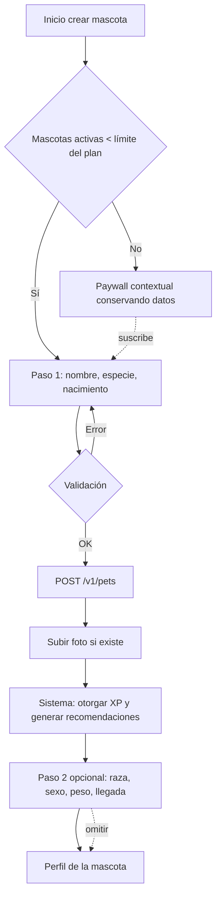

---

## FL-006 — Edición de mascota

| Campo | Detalle |
|---|---|
| **Objetivo** | Actualizar los datos de una mascota. |
| **Actor** | Propietario |
| **Disparador** | "Editar" desde el perfil de la mascota. |
| **Precondiciones** | Sesión válida; la mascota pertenece al usuario. |
| **Postcondiciones** | Datos actualizados; si cambió `birth_date` o el peso, recomendaciones y etapa reevaluadas. |
| **Reglas** | RN-011, RN-012, RN-013, RN-014 |
| **Pantallas** | Editar mascota · Confirmación de impacto · Perfil de mascota |
| **APIs** | `GET /v1/pets/{id}` · `PATCH /v1/pets/{id}` |

**Flujo principal:** cargar datos → modificar → guardar → si cambia la fecha de nacimiento, mostrar aviso de recálculo de edades en los hitos → confirmar → actualización y reevaluación del motor de reglas.

**Alternativos:** (A1) cambio de especie: se advierte de que las recomendaciones y la raza se reinician. (A2) registro de peso desde esta pantalla: crea una medición con fecha.

**Errores:** recurso ajeno (403 con registro de auditoría — nunca revelar si existe); conflicto por edición concurrente desde otro dispositivo (se detecta por versión y se ofrece recargar); validación fallida.

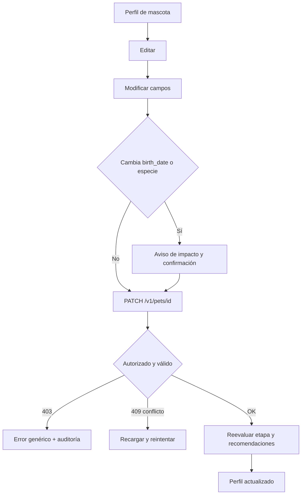

---

## FL-007 — Creación de hito

| Campo | Detalle |
|---|---|
| **Objetivo** | Registrar un acontecimiento en el timeline. Es el flujo más importante del producto. |
| **Actor** | Propietario |
| **Disparador** | Botón principal de acción en el perfil de la mascota o en el timeline. |
| **Precondiciones** | Sesión válida; mascota propia; límites de hitos y almacenamiento no superados. |
| **Postcondiciones** | Hito persistido; foto subida o encolada; XP otorgado; insignias evaluadas; evento `milestone_created`. |
| **Reglas** | RN-020, RN-021, RN-024, RN-026 a RN-030, RN-051, RN-053 |
| **Pantallas** | Crear hito · Selector de categoría · Cámara/galería · Detalle del hito |
| **APIs** | `POST /v1/uploads/intent` · `PUT` (almacenamiento) · `POST /v1/uploads/{id}/complete` · `POST /v1/pets/{petId}/milestones` |

**Flujo principal:** pulsar "Añadir recuerdo" → elegir foto (cámara o galería) u omitirla → se sugiere la categoría según la etapa de vida y la fecha de captura → título autocompletado y editable → fecha precargada → guardar → la foto se comprime y se sube en segundo plano → el hito aparece en el timeline con la foto en estado de subida hasta completarse.

**Alternativos:** (A1) hito sin foto: permitido y no penalizado. (A2) creación desde la finalización de un recordatorio, con categoría y fecha precargadas (RN-049). (A3) usuario Premium con varias fotos.

**Errores:** permiso de cámara o galería denegado (explicación del motivo y acceso a los ajustes del sistema; alternativa de crear el hito sin foto); imagen no válida o corrupta (rechazo con mensaje específico); cuota de almacenamiento agotada (se ofrece crear el hito sin foto y se muestra el *paywall*); fallo de subida (RN-026: el hito se conserva y la foto se reintenta); sin conexión (el hito se encola localmente y se sincroniza al recuperar conectividad, indicándolo con claridad).

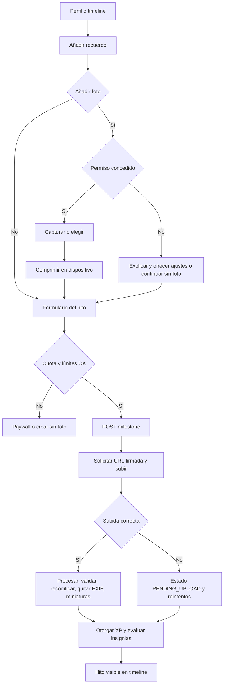

---

## FL-008 — Edición de hito

| Campo | Detalle |
|---|---|
| **Objetivo** | Corregir o completar un hito ya registrado. |
| **Actor** | Propietario |
| **Disparador** | "Editar" en el detalle del hito. |
| **Postcondiciones** | Hito actualizado; timeline y álbum reordenados si cambió la fecha; visibilidad propagada al perfil público en ≤ 60 s. |
| **Reglas** | RN-024, RN-053, RN-061, RN-065 |
| **Pantallas** | Detalle de hito · Editar hito |
| **APIs** | `PATCH /v1/milestones/{id}` · `DELETE /v1/milestones/{id}/photos/{photoId}` |

**Flujo principal:** abrir detalle → editar → modificar campos → guardar → actualización.

**Alternativos:** (A1) cambio de `PRIVATE` a `SHARED`: se advierte de que la foto será visible públicamente y se pide confirmación. (A2) cambio de `SHARED` a `PRIVATE`: se retira del perfil público e invalida la caché de CDN. (A3) sustitución o eliminación de la foto: la anterior se elimina tras confirmar la nueva.

**Errores:** hito ajeno (403 + auditoría); hito eliminado por otro dispositivo (404 con mensaje y regreso al timeline); fecha inválida.

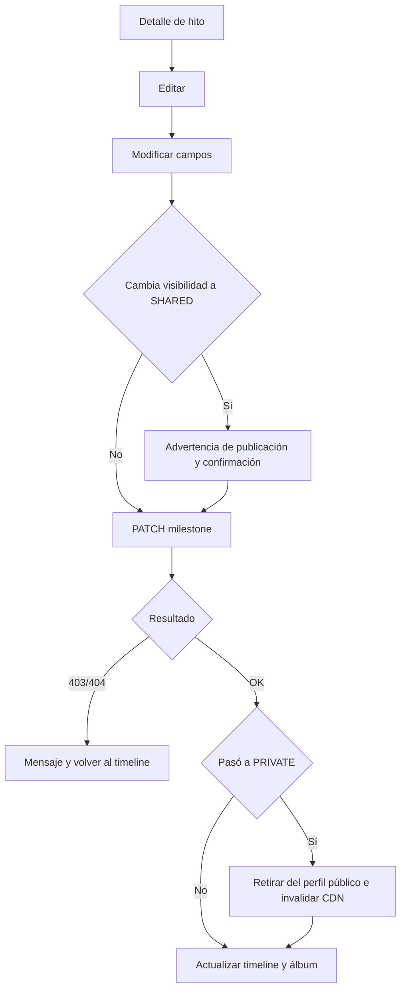

---

## FL-009 — Creación de recordatorio

| Campo | Detalle |
|---|---|
| **Objetivo** | Programar un aviso de cuidado. |
| **Actor** | Propietario |
| **Disparador** | "Nuevo recordatorio", o conversión desde una recomendación (FL-011). |
| **Precondiciones** | Sesión válida; límite de recordatorios del plan no alcanzado. |
| **Postcondiciones** | Recordatorio `SCHEDULED`; notificaciones locales programadas; evento `reminder_created`. |
| **Reglas** | RN-040 a RN-042, RN-047, RN-048 |
| **Pantallas** | Lista de recordatorios · Nuevo recordatorio · Permiso de notificaciones |
| **APIs** | `POST /v1/pets/{petId}/reminders` |

**Flujo principal:** elegir categoría (con plantillas: "Vacuna anual", "Desparasitación trimestral") → título precargado → fecha y hora → recurrencia → antelación del aviso → guardar → si es la primera vez, se solicita el permiso de notificaciones **con una explicación previa del beneficio** (no el diálogo del sistema en frío) → se programan las notificaciones locales y se registra en servidor.

**Alternativos:** (A1) permiso denegado: el recordatorio se crea igualmente y se muestra un aviso persistente en la lista (RN-047). (A2) creación desde una recomendación con datos precargados.

**Errores:** hora en el pasado (se ofrece la siguiente ocurrencia válida); límite del plan alcanzado (*paywall*); sin conexión (se crea localmente y se sincroniza, ya que la notificación local no depende del servidor).

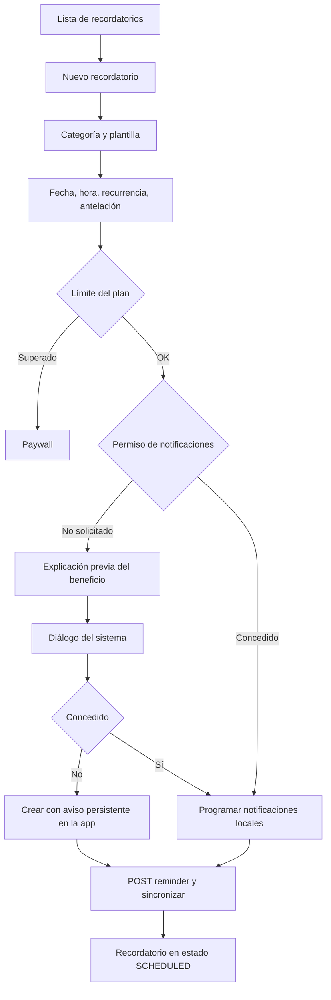

---

## FL-010 — Recepción de notificación

| Campo | Detalle |
|---|---|
| **Objetivo** | Avisar al usuario y permitirle actuar con el mínimo esfuerzo. |
| **Actor** | Sistema, Propietario |
| **Disparador** | Llega la hora de disparo del recordatorio. |
| **Precondiciones** | Recordatorio `SCHEDULED`; permiso concedido. |
| **Postcondiciones** | Recordatorio `NOTIFIED`; eventos `notification_sent` y, si procede, `notification_opened`. |
| **Reglas** | RN-041, RN-043, RN-044, RN-048 |
| **Pantallas** | Notificación del sistema · Detalle del recordatorio |
| **APIs** | `POST /v1/reminders/{id}/complete` · `POST /v1/reminders/{id}/snooze` |

**Flujo principal:** se dispara la notificación local (mecanismo primario) con el nombre de la mascota y acciones rápidas "Hecho" y "Posponer" → el usuario pulsa "Hecho" desde la propia notificación → se marca como completado sin abrir la app → se sincroniza con el servidor.

**Alternativos:** (A1) el usuario pulsa el cuerpo de la notificación → *deep link* al detalle del recordatorio. (A2) "Posponer" → nueva hora según la opción elegida (máximo 5 veces). (A3) el usuario ignora la notificación → a las 72 h pasa a `EXPIRED` y deja de reclamar atención. (A4) varios recordatorios simultáneos → agrupación en un resumen.

**Errores:** sin conexión al actuar desde la notificación (se registra localmente y se sincroniza después); recordatorio ya completado en otro dispositivo (se resuelve por idempotencia, sin error visible); notificaciones desactivadas después de crear el recordatorio (aviso en la app).

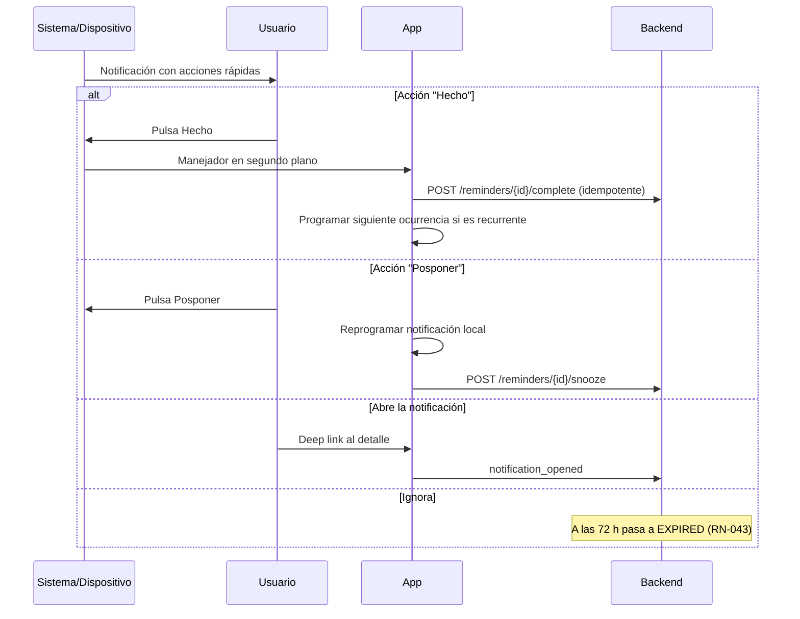

---

## FL-011 — Completar recomendación

| Campo | Detalle |
|---|---|
| **Objetivo** | Registrar que el usuario ha actuado sobre una recomendación (métrica central de H-2). |
| **Actor** | Propietario |
| **Disparador** | Pulsación de "Hecho" en la tarjeta de recomendación. |
| **Postcondiciones** | Estado `COMPLETED`; XP otorgado; evento `recommendation_completed`; se ofrece crear hito o recordatorio. |
| **Reglas** | RN-081, RN-084, RN-051 |
| **Pantallas** | Perfil de mascota · Lista de recomendaciones · Detalle de recomendación |
| **APIs** | `GET /v1/pets/{petId}/recommendations` · `POST /v1/recommendations/{id}/complete` · `POST /v1/recommendations/{id}/dismiss` |

**Flujo principal:** ver la recomendación con el motivo por el que aparece y, si es sanitaria, su aviso → abrir el detalle → pulsar "Hecho" → estado `COMPLETED` → XP → propuesta de crear el hito correspondiente (ej.: al completar "Segunda dosis de la vacuna polivalente", crear el hito `VACUNA`).

**Alternativos:** (A1) "Ahora no" → `SNOOZED`, reaparece en 7 días. (A2) "No aplica a mi mascota" → `NOT_APPLICABLE` permanente. (A3) "Recordármelo" → FL-009 con datos precargados. (A4) la recomendación caduca por edad y pasa a `EXPIRED` sin acción del usuario.

**Errores:** recomendación ya resuelta en otro dispositivo (idempotencia); recomendación ajena (403 + auditoría).

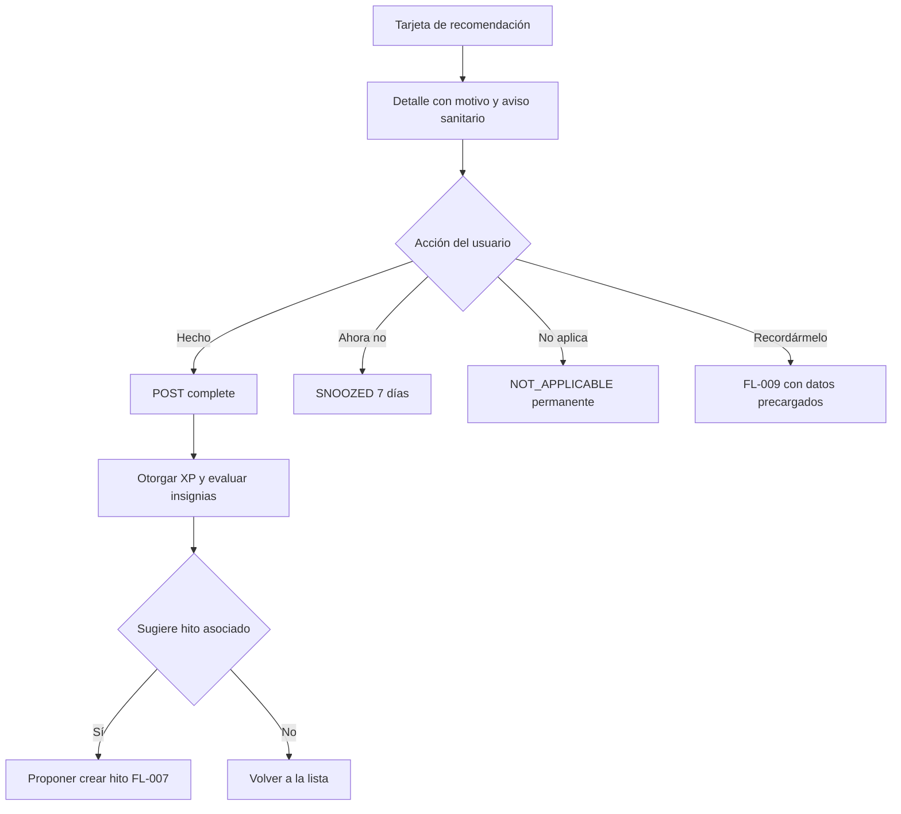

---

## FL-012 — Obtención de XP y subida de nivel

| Campo | Detalle |
|---|---|
| **Objetivo** | Reconocer una acción valiosa del usuario y reforzar el hábito. |
| **Actor** | Sistema |
| **Disparador** | Evento de dominio: hito creado, recomendación completada, recordatorio completado, mascota creada, perfil completado, peso registrado. |
| **Precondiciones** | El evento es válido y no ha sido procesado antes. |
| **Postcondiciones** | XP actualizado; nivel recalculado; insignias evaluadas; eventos `xp_earned` y, si procede, `level_up` y `badge_earned`. |
| **Reglas** | RN-050 a RN-057 |
| **Pantallas** | Cualquier pantalla (indicador no bloqueante) · Logros |
| **APIs** | Interno, disparado por eventos de dominio en backend |

**Flujo principal:** el backend recibe el evento → comprueba idempotencia → comprueba el tope diario (RN-053) → suma XP → recalcula el nivel → evalúa insignias → responde al cliente con el delta → la app muestra un indicador breve y no bloqueante; si hay subida de nivel, una celebración de ≤ 2 segundos, siempre descartable.

**Alternativos:** (A1) tope diario alcanzado: la acción se registra igualmente sin XP y **sin mensaje negativo**; nunca se comunica al usuario que "no ha ganado puntos". (A2) varias insignias simultáneas: notificación agrupada.

**Errores:** el hito se elimina en menos de 24 h → reversión del XP (RN-053); patrón de abuso detectado → suspensión de la acumulación durante 24 h y evento de auditoría.

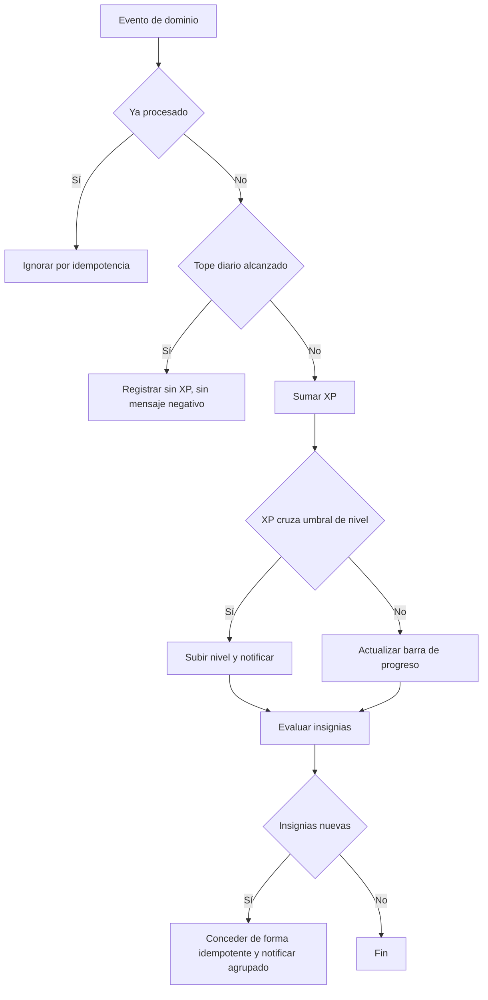

---

## FL-013 — Subida de fotografía

| Campo | Detalle |
|---|---|
| **Objetivo** | Incorporar una imagen de forma segura y eficiente. |
| **Actor** | Propietario, Sistema |
| **Disparador** | Selección de imagen en la creación o edición de un hito, o al cambiar la foto de la mascota o el avatar. |
| **Postcondiciones** | Objeto validado, recodificado, sin EXIF de GPS, con miniaturas y asociado a su entidad. |
| **Reglas** | RN-021, RN-026 a RN-030 |
| **Pantallas** | Selector del sistema · Recorte · Indicador de progreso |
| **APIs** | `POST /v1/uploads/intent` · `PUT` firmado · `POST /v1/uploads/{id}/complete` |

**Flujo principal y errores:** ver el diagrama de secuencia completo en §17.10, que es normativo para este flujo. Adicionalmente, la interfaz debe mostrar el progreso desde el primer segundo, permitir cancelar y no bloquear la navegación durante la subida.

**Alternativos:** (A1) sin conexión: la imagen se guarda en la cola local y se sube al recuperar conectividad. (A2) la app se cierra durante la subida: la cola persiste y se reanuda al abrir. (A3) ahorro de datos activado y sin Wi-Fi: la subida se pospone informando al usuario.

**Errores:** formato no permitido; fichero que no coincide con su extensión; imagen con dimensiones desproporcionadas; cuota agotada; tres reintentos fallidos (se solicita acción manual, conservando el hito).

---

## FL-014 — Compartir perfil de la mascota

| Campo | Detalle |
|---|---|
| **Objetivo** | Permitir la difusión controlada del perfil (mecanismo de crecimiento de H-5). |
| **Actor** | Propietario, Visitante público |
| **Disparador** | "Compartir" desde el perfil de la mascota. |
| **Precondiciones** | Correo verificado; límite de perfiles del plan no alcanzado. |
| **Postcondiciones** | Perfil público accesible; evento `profile_share_enabled` y `profile_shared`. |
| **Reglas** | RN-003, RN-060 a RN-068 |
| **Pantallas** | Compartir perfil · Vista previa pública · Hoja de compartir del sistema · Web pública |
| **APIs** | `POST /v1/pets/{id}/share` · `PATCH /v1/pets/{id}/share` · `DELETE /v1/pets/{id}/share` · `GET /p/{slug}` (público) |

**Flujo principal:** pulsar "Compartir" → elegir nivel de privacidad (Mínimo / Estándar / Completo) → **ver la vista previa exacta de lo que verá un desconocido** → confirmar → se genera el *slug* → hoja de compartir del sistema.

**Alternativos:** (A1) correo sin verificar: se solicita verificar antes, explicando el motivo. (A2) el usuario selecciona qué hitos compartir marcándolos como `SHARED`. (A3) regeneración del enlace: el anterior deja de funcionar de inmediato. (A4) desactivación: inaccesible en ≤ 60 s con invalidación de CDN.

**Errores:** *slug* personalizado ya en uso (se proponen alternativas); límite del plan (*paywall*); perfil despublicado por moderación (mensaje con motivo y vía de apelación).

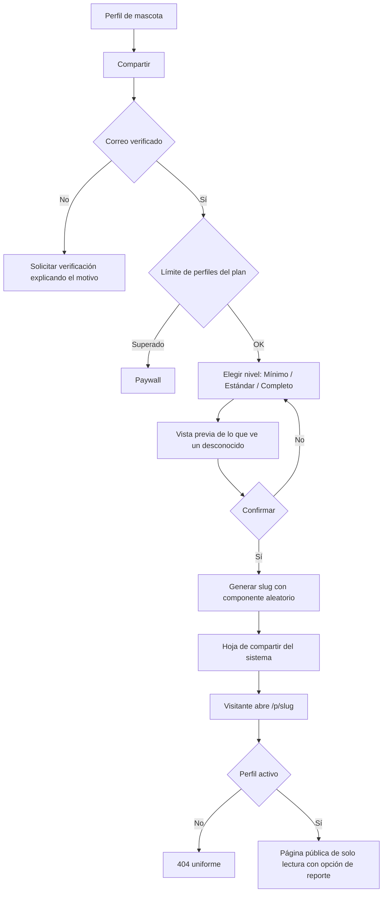

---

## FL-015 — Eliminación de cuenta

| Campo | Detalle |
|---|---|
| **Objetivo** | Ejercer el derecho de supresión de forma clara y reversible durante un plazo. |
| **Actor** | Propietario, Sistema |
| **Disparador** | "Eliminar mi cuenta" en Ajustes. |
| **Precondiciones** | Sesión válida; reautenticación reciente. |
| **Postcondiciones** | Cuenta en `PENDING_DELETION`; sesiones revocadas; perfiles despublicados; eliminación ejecutada a los 14 días. |
| **Reglas** | RN-007, §18.5 |
| **Pantallas** | Ajustes · Información de consecuencias · Exportar antes de eliminar · Reautenticación · Confirmación final |
| **APIs** | `POST /v1/account/deletion` · `DELETE /v1/account/deletion` (cancelar) · `POST /v1/account/export` |

**Flujo principal:** Ajustes → "Eliminar cuenta" → pantalla con la tabla de qué se elimina, qué se conserva y durante cuánto tiempo → oferta destacada de exportar los datos primero → reautenticación → confirmación escribiendo una palabra de seguridad → cuenta en `PENDING_DELETION`, sesiones revocadas, perfiles despublicados → correo de confirmación con instrucciones para cancelar → a los 14 días, ejecución irreversible.

**Alternativos:** (A1) el usuario inicia sesión durante el periodo de gracia → se ofrece cancelar la eliminación. (A2) suscripción activa → se informa de que debe cancelarse en la tienda y que la eliminación no detiene por sí sola la facturación. (A3) el usuario elige exportar → se genera el paquete y se ofrece continuar o posponer.

**Errores:** reautenticación fallida; fallo de exportación (no bloquea la eliminación, pero se advierte); cuenta ya en proceso (mensaje con la fecha de ejecución).

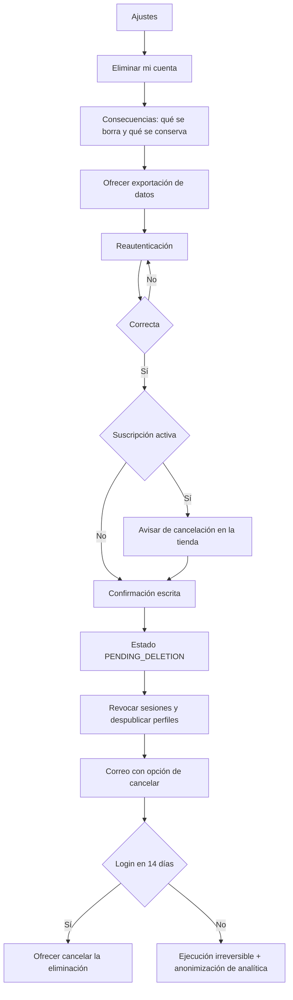

---

## FL-016 — Renovación de sesión

| Campo | Detalle |
|---|---|
| **Objetivo** | Mantener la sesión sin fricción y con seguridad. |
| **Actor** | Sistema |
| **Disparador** | Respuesta 401 por access token caducado, o renovación proactiva antes de su caducidad. |
| **Postcondiciones** | Nuevos tokens emitidos; el anterior refresh token invalidado; la petición original reintentada. |
| **Reglas** | RN-006; RNF-SEC-005 |
| **APIs** | `POST /v1/auth/refresh` |

**Flujo principal:** la petición devuelve 401 → el interceptor pausa las peticiones en curso → se envía el refresh token → se reciben nuevos tokens → se reanudan y reintentan las peticiones pausadas → el usuario no percibe nada.

**Alternativos:** (A1) varias peticiones fallan a la vez: se realiza **una única** renovación y el resto espera a su resultado (evita tormenta de renovaciones y falsos positivos de reutilización). (A2) renovación proactiva cuando quedan menos de 2 minutos de vida.

**Errores:** refresh token caducado → FL-017; **refresh token ya consumido → se considera compromiso: se revoca toda la familia, se cierra la sesión y se notifica al usuario por correo**; fallo de red → reintento con retroceso exponencial manteniendo la sesión.

```mermaid
sequenceDiagram
    participant A as App
    participant B as Backend

    A->>B: GET /v1/pets (access caducado)
    B-->>A: 401
    A->>A: Bloquear cola y comprobar renovación en curso
    A->>B: POST /v1/auth/refresh {refresh_token}
    alt Token válido y no usado
        B->>B: Rotar: invalidar anterior, emitir nuevo par
        B-->>A: Nuevos tokens
        A->>B: Reintentar peticiones pausadas
    else Token ya consumido (posible robo)
        B->>B: Revocar toda la familia
        B-->>A: 401 sesión comprometida
        B->>B: Enviar correo de alerta al usuario
        A->>A: Cerrar sesión y limpiar almacenamiento
    else Token caducado
        B-->>A: 401
        A->>A: Ir a FL-017
    end
```

---

## FL-017 — Sesión expirada

| Campo | Detalle |
|---|---|
| **Objetivo** | Gestionar la caducidad sin pérdida de trabajo ni de contexto. |
| **Actor** | Propietario, Sistema |
| **Disparador** | Refresh token caducado o revocado. |
| **Postcondiciones** | Sesión cerrada localmente; contexto preservado; tras reautenticar, el usuario vuelve donde estaba. |
| **Pantallas** | Aviso de sesión expirada · Login · Pantalla de origen |

**Flujo principal:** se detecta la expiración → se guarda el estado local no enviado (por ejemplo, el borrador de un hito) → se muestra un mensaje explicativo, no un error técnico → login → restauración del contexto y, si procede, reanudación del borrador.

**Alternativos:** (A1) el usuario estaba creando un hito: el borrador y la imagen seleccionada se conservan localmente y se ofrecen al volver. (A2) sin conexión: se permite seguir consultando el contenido cacheado en modo lectura, indicándolo, y se solicita la reautenticación al recuperar la conectividad.

**Errores:** pérdida de credenciales del almacenamiento seguro (p. ej., restauración del dispositivo): se trata como sesión inexistente, con mensaje neutro.

```mermaid
flowchart TD
    A[Refresh inválido o caducado] --> B[Guardar borradores y contexto local]
    B --> C{Hay conectividad}
    C -->|No| D[Modo lectura con datos cacheados + aviso]
    C -->|Sí| E[Mensaje: tu sesión ha caducado]
    D --> E
    E --> F[Login]
    F --> G{Correcto}
    G -->|Sí| H[Restaurar contexto y borradores]
    G -->|No| F
```

---

## FL-018 — Acceso no autorizado

| Campo | Detalle |
|---|---|
| **Objetivo** | Denegar de forma segura y registrar el intento. |
| **Actor** | Sistema |
| **Disparador** | Petición sobre un recurso que no pertenece al sujeto del token, o sobre un endpoint administrativo con token de usuario. |
| **Postcondiciones** | Petición denegada; evento de auditoría registrado; ninguna información filtrada. |
| **Reglas** | §13.1; RNF-SEC-004, RNF-SEC-011 |

**Flujo principal:** llega la petición → se valida el token → se resuelve la titularidad del recurso → no coincide → **se responde 404 en lugar de 403 para recursos de otros usuarios**, de modo que no se confirme su existencia → se registra en auditoría con sujeto, recurso, origen y timestamp.

**Alternativos:** (A1) token inválido o ausente → 401 uniforme. (A2) token de usuario contra endpoint administrativo → 404 y evento de seguridad de severidad alta. (A3) patrón repetido de accesos denegados desde la misma identidad u origen → mitigación de límite de peticiones y alerta.

**Errores de diseño a evitar — [REQ]:** el mensaje de error nunca incluye el identificador solicitado, el nombre del recurso ni ninguna pista sobre su existencia; no se diferencia por tiempo de respuesta entre "no existe" y "no es tuyo".

```mermaid
flowchart TD
    A[Petición a /v1/pets/id] --> B{Token válido}
    B -->|No| C[401 uniforme]
    B -->|Sí| D{Recurso existe}
    D -->|No| E[404 genérico]
    D -->|Sí| F{Pertenece al sujeto del token}
    F -->|Sí| G[Ejecutar operación]
    F -->|No| H[404 genérico + auditoría severidad alta]
    H --> I{Patrón repetido}
    I -->|Sí| J[Aplicar límite y alertar]
    I -->|No| K[Fin]
```

---

## FL-019 — Compra de suscripción Premium *(flujo adicional necesario)*

| Campo | Detalle |
|---|---|
| **Objetivo** | Convertir a un usuario a Premium y concederle el derecho de forma verificada. |
| **Actor** | Propietario, Tienda, Sistema |
| **Disparador** | Pulsación en el *paywall* contextual. |
| **Postcondiciones** | Suscripción activa verificada en servidor; límites del plan actualizados; eventos `trial_started` / `subscription_started`. |
| **Reglas** | RN-100 a RN-105 |
| **APIs** | `POST /v1/subscriptions/verify` · webhooks de App Store y Google Play |

**Flujo principal:** *paywall* con el beneficio contextual → selección de plan → flujo de compra de la tienda → recibo/token → **verificación en servidor** → concesión del derecho asociado al `user_id` → confirmación en la app.

**Alternativos:** (A1) el usuario ya tenía una suscripción en otro dispositivo → restauración. (A2) prueba gratuita → `trial_started` y aviso previo al primer cobro. (A3) cancelación en la tienda → el webhook actualiza el estado y se aplica la degradación no destructiva al expirar (RN-104).

**Errores:** la verificación falla o no está disponible → **no se concede el derecho** (fail securely), se informa de que la compra se está procesando y se reintenta la verificación en segundo plano; compra cancelada por el usuario → se vuelve al *paywall* sin error; recibo ya asociado a otra cuenta → se deniega y se registra como posible fraude.

```mermaid
sequenceDiagram
    participant U as Usuario
    participant A as App
    participant S as Tienda
    participant B as Backend

    U->>A: Pulsa en el paywall
    A->>S: Iniciar compra
    S->>U: Flujo de pago de la tienda
    U->>S: Confirma
    S-->>A: Recibo / token de compra
    A->>B: POST /v1/subscriptions/verify
    B->>S: Verificación servidor a servidor
    alt Verificación correcta
        B->>B: Conceder Premium al user_id
        B-->>A: Estado actualizado
        A->>U: Confirmación y desbloqueo
    else Verificación fallida o no disponible
        B-->>A: Pendiente, sin conceder derecho
        A->>U: Estamos procesando tu compra
        B->>B: Reintentar en segundo plano
    end
    S-->>B: Webhook de cambio de estado (renovación, cancelación)
    B->>B: Actualizar plan de forma idempotente
```

---

## FL-020 — Marcar mascota como fallecida *(flujo adicional necesario)*

| Campo | Detalle |
|---|---|
| **Objetivo** | Gestionar con respeto el final de la vida de la mascota y detener toda comunicación automática. |
| **Actor** | Propietario, Sistema |
| **Disparador** | Opción en la edición de la mascota. |
| **Postcondiciones** | Estado `DECEASED`; recordatorios cancelados; recomendaciones suspendidas; notificaciones detenidas; contenido conservado. |
| **Reglas** | RN-015, §11.3.1 |

**Flujo principal:** el usuario selecciona la opción → pantalla sobria que explica lo que ocurrirá (se detendrán los recordatorios, se conservarán todos los recuerdos) → fecha opcional → confirmación → ejecución en cascada inmediata → se ofrece, sin insistencia, exportar el álbum.

**[REQ]** Prohibido en este flujo: gamificación, celebraciones, sugerencias de crear hitos, promoción de suscripción y cualquier lenguaje comercial. **[REQ]** La exportación del álbum está disponible **también para usuarios Free** en este flujo.

```mermaid
flowchart TD
    A[Editar mascota] --> B[Marcar como fallecida]
    B --> C[Explicación sobria de consecuencias]
    C --> D[Fecha opcional]
    D --> E{Confirmar}
    E -->|No| F[Cancelar sin cambios]
    E -->|Sí| G[Estado DECEASED]
    G --> H[Cancelar recordatorios activos]
    H --> I[Suspender recomendaciones]
    I --> J[Detener notificaciones asociadas]
    J --> K[Conservar timeline y álbum]
    K --> L[Ofrecer exportación del álbum sin paywall]
```

---

# 20. CASOS DE USO

Se documentan los casos de uso de mayor valor o mayor riesgo. Los casos triviales (consultas de lectura simples) se consideran cubiertos por sus requerimientos funcionales.

### UC-001 — Registrar la primera mascota (activación)

| Campo | Detalle |
|---|---|
| **Actor principal** | Propietario |
| **Actores secundarios** | Sistema (motor de reglas, gamificación), Almacenamiento de objetos |
| **Objetivo** | Que el usuario complete el evento de activación del producto. |
| **Precondiciones** | Sesión válida recién creada; sin mascotas registradas. |
| **Flujo principal** | 1. El sistema presenta el formulario mínimo. 2. El usuario introduce nombre y especie. 3. El usuario introduce la fecha de nacimiento, exacta o estimada. 4. El usuario añade una fotografía (opcional). 5. El usuario guarda. 6. El sistema valida, persiste y calcula edad y etapa. 7. El sistema otorga XP inicial y evalúa insignias. 8. El sistema genera las recomendaciones iniciales. 9. El sistema presenta el perfil de la mascota con la primera recomendación visible. |
| **Alternativas** | 4a. Sin foto: se asigna un avatar según especie. 3a. Fecha desconocida: se solicita edad aproximada y se marca como estimada. 5a. Límite del plan alcanzado: se muestra el *paywall* conservando los datos. |
| **Excepciones** | E1. Fallo de red al guardar: los datos se conservan localmente y se reintenta. E2. Fallo de subida de la foto: la mascota se crea y la foto queda pendiente. E3. Validación fallida: se señala el campo concreto sin perder el resto. |
| **Postcondiciones** | Mascota creada; usuario activado; recomendaciones disponibles; evento `pet_created`. |

### UC-002 — Registrar un recuerdo con fotografía

| Campo | Detalle |
|---|---|
| **Actor principal** | Propietario |
| **Actores secundarios** | Sistema operativo (cámara/galería), Almacenamiento, Procesador de imagen, Gamificación |
| **Objetivo** | Añadir un hito con foto al timeline con la mínima fricción posible. |
| **Precondiciones** | Sesión válida; mascota propia; límites no superados. |
| **Flujo principal** | 1. El usuario pulsa la acción principal. 2. Elige foto de cámara o galería. 3. El sistema sugiere categoría y fecha. 4. El usuario ajusta el título. 5. Guarda. 6. El sistema persiste el hito y encola la subida. 7. El procesador valida, recodifica, elimina EXIF de GPS y genera miniaturas. 8. El sistema otorga XP y evalúa insignias. 9. El hito aparece en el timeline. |
| **Alternativas** | 2a. Sin foto. 2b. Varias fotos (Premium). 1a. Iniciado desde la finalización de un recordatorio con datos precargados. |
| **Excepciones** | E1. Permiso denegado: explicación y alternativa sin foto. E2. Cuota agotada: se ofrece guardar sin foto y se muestra el *paywall*. E3. Fichero no válido: rechazo explicado. E4. Sin conexión: cola local y sincronización posterior. |
| **Postcondiciones** | Hito visible; foto procesada; XP otorgado; evento `milestone_created`. |

### UC-003 — Recibir y resolver un recordatorio de vacuna

| Campo | Detalle |
|---|---|
| **Actor principal** | Propietario |
| **Actores secundarios** | Sistema (planificador), Sistema operativo (notificaciones) |
| **Objetivo** | Que el usuario no olvide un cuidado y lo registre. |
| **Precondiciones** | Recordatorio `SCHEDULED`; permiso de notificaciones concedido. |
| **Flujo principal** | 1. Llega la hora local de disparo. 2. Se presenta la notificación con acciones rápidas. 3. El usuario pulsa "Hecho". 4. El sistema marca `COMPLETED` y otorga XP. 5. El sistema genera la siguiente ocurrencia si es recurrente. 6. La app propone crear el hito `VACUNA`. 7. El usuario acepta y el hito se crea con datos precargados. |
| **Alternativas** | 3a. Posponer (máximo 5 veces). 3b. Abrir la notificación y actuar desde el detalle. 6a. El usuario rechaza crear el hito. |
| **Excepciones** | E1. Permiso revocado: aviso persistente en la app. E2. Sin conexión: acción registrada localmente y sincronizada después. E3. Sin acción en 72 h: estado `EXPIRED` sin reenvíos. E4. Ya completado en otro dispositivo: resolución idempotente. |
| **Postcondiciones** | Recordatorio resuelto; posible hito creado; eventos registrados. |

### UC-004 — Publicar el perfil de la mascota

| Campo | Detalle |
|---|---|
| **Actor principal** | Propietario |
| **Actores secundarios** | Visitante público, CDN |
| **Objetivo** | Compartir el perfil sin exponer datos privados. |
| **Precondiciones** | Correo verificado; límite de perfiles no alcanzado. |
| **Flujo principal** | 1. El usuario pulsa "Compartir". 2. Elige nivel de privacidad. 3. El sistema muestra la vista previa exacta pública. 4. El usuario confirma. 5. El sistema genera un *slug* con componente aleatorio y publica. 6. Se abre la hoja de compartir del sistema. 7. Un visitante accede al enlace y ve solo los campos y hitos públicos. |
| **Alternativas** | 2a. *Slug* personalizado disponible. 2b. Permitir indexación (por defecto, no). 4a. El usuario cancela tras la vista previa. |
| **Excepciones** | E1. Correo no verificado: se solicita verificar. E2. *Slug* en uso: se proponen alternativas. E3. Perfil despublicado por moderación: mensaje con motivo y apelación. E4. Perfil desactivado: el visitante recibe 404. |
| **Postcondiciones** | Perfil accesible públicamente con el alcance elegido; eventos registrados. |

### UC-005 — Moderar un perfil público reportado

| Campo | Detalle |
|---|---|
| **Actor principal** | Administrador |
| **Actores secundarios** | Visitante público (reportante), Propietario (afectado), Sistema (auditoría) |
| **Objetivo** | Retirar contenido inadecuado protegiendo a la vez al propietario legítimo. |
| **Precondiciones** | Existe un reporte en cola; el administrador ha iniciado sesión con MFA. |
| **Flujo principal** | 1. El administrador abre la cola priorizada. 2. Selecciona el reporte. 3. Consulta el contenido reportado desde la ficha del reporte (acceso auditado). 4. Decide. 5. Si procede, despublica el perfil o el hito. 6. El sistema notifica al propietario con el motivo y la vía de apelación. 7. Se registra el evento de auditoría. |
| **Alternativas** | 4a. Reporte desestimado: se cierra con motivo. 4b. Riesgo grave: despublicación preventiva inmediata antes del análisis completo. 4c. Reincidencia: suspensión de la cuenta. |
| **Excepciones** | E1. Contenido ya eliminado por el propietario: se cierra el reporte. E2. Reportes masivos coordinados contra una misma cuenta: se detectan y no provocan acción automática. |
| **Postcondiciones** | Reporte resuelto en ≤ 72 h; auditoría registrada; propietario informado. |

### UC-006 — Eliminar la cuenta y sus datos

| Campo | Detalle |
|---|---|
| **Actor principal** | Propietario |
| **Actores secundarios** | Sistema (purga), Almacenamiento, Analítica |
| **Objetivo** | Ejercer el derecho de supresión con información completa y previa. |
| **Precondiciones** | Sesión válida; reautenticación reciente. |
| **Flujo principal** | 1. El usuario solicita la eliminación. 2. El sistema muestra qué se elimina y qué se conserva. 3. Ofrece exportar los datos. 4. Solicita reautenticación. 5. Solicita confirmación escrita. 6. Marca la cuenta como `PENDING_DELETION` y revoca sesiones. 7. Despublica los perfiles compartibles. 8. Envía correo con opción de cancelar. 9. A los 14 días ejecuta la eliminación y anonimiza la analítica. |
| **Alternativas** | 3a. El usuario exporta primero. 8a. El usuario inicia sesión en el plazo y cancela. |
| **Excepciones** | E1. Suscripción activa: se advierte de que debe cancelarse en la tienda. E2. Fallo de la exportación: no bloquea, pero se advierte. E3. Fallo parcial de la purga: reintento y alerta operativa; la cuenta permanece inaccesible entre tanto. |
| **Postcondiciones** | Datos eliminados o anonimizados según §18.5. |

### UC-007 — Consultar datos de la mascota sin conexión en el veterinario

| Campo | Detalle |
|---|---|
| **Actor principal** | Propietario |
| **Objetivo** | Acceder a la ficha y al historial de vacunas sin cobertura. |
| **Precondiciones** | El usuario ha usado la app previamente con conexión (existe caché). |
| **Flujo principal** | 1. El usuario abre la app sin conexión. 2. La app detecta la ausencia de red. 3. Muestra los datos cacheados con un indicador claro de "sin conexión". 4. El usuario consulta la ficha, la edad y los hitos de categoría `VACUNA`. |
| **Alternativas** | 4a. El usuario intenta crear un hito: se permite y se encola localmente. |
| **Excepciones** | E1. Sin caché previa (primera apertura sin red): mensaje explicativo y acción de reintentar. E2. Sesión caducada sin red: se permite lectura del contenido cacheado y se solicita reautenticar al recuperar conexión. |
| **Postcondiciones** | Consulta satisfecha sin red; cambios sincronizados posteriormente. |

---

# 21. HISTORIAS DE USUARIO

Formato: *Como [rol], quiero [acción] para [beneficio].* Los criterios de aceptación completos se desarrollan en §22 para las historias críticas; el resto los incorpora de forma resumida.

## EPIC-01 — Identity & Access

| ID | Historia | Prioridad | RF relacionados | Dependencias |
|---|---|---|---|---|
| **US-AUTH-001** | Como propietario, quiero registrarme con mi correo y una contraseña para crear mi cuenta y empezar a usar la app. | MUST | RF-AUTH-001, RF-AUTH-002 | — |
| **US-AUTH-002** | Como propietario, quiero registrarme o entrar con Google para no tener que recordar otra contraseña. | MUST | RF-AUTH-004 | US-AUTH-001 |
| **US-AUTH-003** | Como propietario de iPhone, quiero entrar con mi ID de Apple para no compartir mi correo real. | MUST | RF-AUTH-005 | US-AUTH-001 |
| **US-AUTH-004** | Como propietario, quiero recuperar mi contraseña si la olvido para no perder el acceso a la historia de mi mascota. | MUST | RF-AUTH-010 | US-AUTH-001 |
| **US-AUTH-005** | Como propietario, quiero que mi sesión se mantenga entre aperturas para no tener que iniciar sesión constantemente. | MUST | RF-AUTH-007, RF-AUTH-008 | US-AUTH-001 |
| **US-AUTH-006** | Como propietario, quiero ver y cerrar las sesiones abiertas en otros dispositivos para proteger mi cuenta si pierdo el móvil. | SHOULD | RF-AUTH-009 | US-AUTH-005 |
| **US-AUTH-007** | Como propietario, quiero cambiar mi contraseña para mantener mi cuenta segura. | MUST | RF-AUTH-011 | US-AUTH-001 |
| **US-AUTH-008** | Como propietario, quiero eliminar mi cuenta y mis datos para ejercer mi derecho a desaparecer del servicio. | MUST | RF-AUTH-012 | US-AUTH-001 |
| **US-AUTH-009** | Como propietario, quiero descargar todos mis datos para conservarlos o llevármelos a otro sitio. | MUST | RF-AUTH-013 | US-AUTH-001 |

## EPIC-02 — User Profile

| ID | Historia | Prioridad | RF | Dependencias |
|---|---|---|---|---|
| **US-USER-001** | Como propietario, quiero editar mi nombre y foto para personalizar mi cuenta. | MUST | RF-USER-001 | US-AUTH-001 |
| **US-USER-002** | Como propietario, quiero elegir el idioma de la app para usarla en el idioma que prefiero. | MUST | RF-USER-002 | — |
| **US-USER-003** | Como propietario que viaja, quiero que mi zona horaria sea correcta para que los recordatorios lleguen a la hora adecuada. | MUST | RF-USER-003 | US-REMINDER-001 |
| **US-USER-004** | Como propietario, quiero decidir qué notificaciones recibo para que la app no me moleste con lo que no me interesa. | MUST | RF-USER-004 | — |
| **US-USER-005** | Como propietario, quiero controlar el uso de mis datos para decidir si comparto información de uso. | MUST | RF-USER-005 | — |
| **US-USER-006** | Como propietario, quiero ver cuánto espacio he consumido para saber si necesito más. | SHOULD | RF-USER-006 | US-SUB-001 |

## EPIC-03 — Pet Management

| ID | Historia | Prioridad | RF | Dependencias |
|---|---|---|---|---|
| **US-PET-001** | Como propietario, quiero registrar a mi mascota con sus datos básicos para empezar su historia. | MUST | RF-PET-001 | US-AUTH-001 |
| **US-PET-002** | Como propietario, quiero ver el perfil de mi mascota con su edad, nivel y próximos cuidados para tener todo a la vista. | MUST | RF-PET-002 | US-PET-001 |
| **US-PET-003** | Como propietario, quiero editar los datos de mi mascota para corregirlos o completarlos. | MUST | RF-PET-003 | US-PET-001 |
| **US-PET-004** | Como propietario con varias mascotas, quiero cambiar rápidamente entre ellas para gestionarlas sin perder tiempo. | MUST | RF-PET-009 | US-PET-001 |
| **US-PET-005** | Como propietario, quiero registrar el peso de mi mascota para seguir su evolución. | SHOULD | RF-PET-005 | US-PET-001 |
| **US-PET-006** | Como propietario que ha perdido a su mascota, quiero marcarla como fallecida para que la app deje de enviarme recordatorios sin borrar sus recuerdos. | SHOULD | RF-PET-007 | US-PET-001, US-REMINDER-001 |
| **US-PET-007** | Como propietario, quiero eliminar una mascota registrada por error para mantener mi cuenta ordenada. | MUST | RF-PET-008 | US-PET-001 |
| **US-PET-008** | Como propietario, quiero buscar la raza de mi mascota en una lista para no tener que escribirla. | MUST | RF-PET-010 | US-PET-001 |

## EPIC-04 — Timeline & Album

| ID | Historia | Prioridad | RF | Dependencias |
|---|---|---|---|---|
| **US-TIMELINE-001** | Como propietario, quiero registrar un momento importante con una foto para conservarlo para siempre. | MUST | RF-TIMELINE-001, RF-TIMELINE-007 | US-PET-001 |
| **US-TIMELINE-002** | Como propietario, quiero ver todos los momentos en orden cronológico para revivir la historia de mi mascota. | MUST | RF-TIMELINE-002 | US-TIMELINE-001 |
| **US-TIMELINE-003** | Como propietario, quiero editar un momento para corregir la fecha o añadir detalles. | MUST | RF-TIMELINE-005 | US-TIMELINE-001 |
| **US-TIMELINE-004** | Como propietario, quiero eliminar un momento que subí por error. | MUST | RF-TIMELINE-006 | US-TIMELINE-001 |
| **US-TIMELINE-005** | Como propietario, quiero filtrar el timeline por categoría o año para encontrar un recuerdo concreto. | SHOULD | RF-TIMELINE-003 | US-TIMELINE-002 |
| **US-TIMELINE-006** | Como propietario nuevo, quiero que la app me sugiera qué momentos registrar para no quedarme en blanco. | SHOULD | RF-TIMELINE-009, RF-TIMELINE-010 | US-PET-001 |
| **US-ALBUM-001** | Como propietario, quiero ver todas las fotos de mi mascota juntas para disfrutarlas de un vistazo. | MUST | RF-ALBUM-001, RF-ALBUM-003 | US-TIMELINE-001 |
| **US-ALBUM-002** | Como propietario, quiero ver las fotos agrupadas por la edad que tenía mi mascota para ver cómo ha cambiado. | SHOULD | RF-ALBUM-002 | US-ALBUM-001 |
| **US-ALBUM-003** | Como propietario, quiero descargar todas las fotos de mi mascota para tenerlas a salvo fuera de la app. | SHOULD | RF-ALBUM-004 | US-ALBUM-001 |

## EPIC-05 — Reminders

| ID | Historia | Prioridad | RF | Dependencias |
|---|---|---|---|---|
| **US-REMINDER-001** | Como propietario, quiero crear un recordatorio de un cuidado para no olvidarlo. | MUST | RF-REMINDER-001 | US-PET-001 |
| **US-REMINDER-002** | Como propietario, quiero recibir una notificación cuando toque un cuidado para actuar a tiempo. | MUST | RF-REMINDER-007 | US-REMINDER-001 |
| **US-REMINDER-003** | Como propietario, quiero marcar un recordatorio como hecho desde la propia notificación para resolverlo en un toque. | MUST | RF-REMINDER-004 | US-REMINDER-002 |
| **US-REMINDER-004** | Como propietario ocupado, quiero posponer un recordatorio para que me avise más tarde. | MUST | RF-REMINDER-005 | US-REMINDER-002 |
| **US-REMINDER-005** | Como propietario, quiero crear recordatorios que se repitan para no tener que crearlos cada vez. | MUST | RF-REMINDER-001, RF-REMINDER-003 | US-REMINDER-001 |
| **US-REMINDER-006** | Como propietario, quiero ver los próximos cuidados y el histórico para saber qué ya hice. | MUST | RF-REMINDER-002 | US-REMINDER-001 |
| **US-REMINDER-007** | Como propietario que ha rechazado las notificaciones, quiero seguir viendo mis recordatorios dentro de la app para no perderlos. | MUST | RF-REMINDER-001 (RN-047) | US-REMINDER-001 |

## EPIC-06 — Recommendations

| ID | Historia | Prioridad | RF | Dependencias |
|---|---|---|---|---|
| **US-REC-001** | Como propietario primerizo, quiero recibir recomendaciones según la edad y la raza de mi mascota para saber qué debo hacer en cada etapa. | MUST | RF-RECOMMENDATION-001, RF-RECOMMENDATION-002 | US-PET-001 |
| **US-REC-002** | Como propietario, quiero marcar una recomendación como hecha para que desaparezca y quede registrada. | MUST | RF-RECOMMENDATION-003 | US-REC-001 |
| **US-REC-003** | Como propietario, quiero descartar una recomendación que no aplica a mi mascota para no volver a verla. | MUST | RF-RECOMMENDATION-004 | US-REC-001 |
| **US-REC-004** | Como propietario, quiero convertir una recomendación en recordatorio para no olvidarme de hacerla. | SHOULD | RF-RECOMMENDATION-005 | US-REC-001, US-REMINDER-001 |
| **US-REC-005** | Como propietario, quiero entender por qué me aparece cada recomendación para confiar en ella. | MUST | RF-RECOMMENDATION-002 | US-REC-001 |
| **US-REC-006** | Como administrador, quiero crear y editar reglas de recomendación sin desplegar código para adaptar el contenido rápidamente. | MUST | RF-RECOMMENDATION-006 | — |

## EPIC-07 — Gamification

| ID | Historia | Prioridad | RF | Dependencias |
|---|---|---|---|---|
| **US-GAME-001** | Como propietario, quiero que mi mascota gane puntos y suba de nivel cuando registro cosas para sentir que progreso. | SHOULD | RF-GAME-001, RF-GAME-002 | US-TIMELINE-001 |
| **US-GAME-002** | Como propietario, quiero ganar insignias por logros concretos para sentirme reconocido. | SHOULD | RF-GAME-003 | US-GAME-001 |
| **US-GAME-003** | Como propietario, quiero ver qué insignias me faltan y cuánto me queda para conseguirlas. | SHOULD | RF-GAME-004 | US-GAME-002 |

## EPIC-08 — Sharing

| ID | Historia | Prioridad | RF | Dependencias |
|---|---|---|---|---|
| **US-SHARE-001** | Como propietario orgulloso, quiero crear un enlace público del perfil de mi mascota para enseñárselo a mis amigos. | SHOULD | RF-SHARE-001, RF-SHARE-003 | US-PET-001, US-AUTH-002 |
| **US-SHARE-002** | Como propietario preocupado por mi privacidad, quiero elegir exactamente qué se ve en el enlace público para no exponer nada que no quiera. | MUST | RF-SHARE-002 | US-SHARE-001 |
| **US-SHARE-003** | Como propietario, quiero desactivar o cambiar el enlace público en cualquier momento para recuperar el control. | MUST | RF-SHARE-005 | US-SHARE-001 |
| **US-SHARE-004** | Como visitante, quiero ver el perfil público de una mascota sin instalar nada para disfrutar de lo que me han compartido. | SHOULD | RF-SHARE-004 | US-SHARE-001 |
| **US-SHARE-005** | Como visitante, quiero reportar contenido inapropiado para que se revise. | MUST | RF-SHARE-006 | US-SHARE-004 |

## EPIC-09 — Administration

| ID | Historia | Prioridad | RF | Dependencias |
|---|---|---|---|---|
| **US-ADMIN-001** | Como administrador, quiero acceder al back-office con doble factor para proteger los datos de los usuarios. | MUST | RF-ADMIN-001 | — |
| **US-ADMIN-002** | Como soporte, quiero consultar el estado de una cuenta sin ver datos personales innecesarios para resolver incidencias sin exponer al usuario. | MUST | RF-ADMIN-002 | US-ADMIN-001 |
| **US-ADMIN-003** | Como administrador, quiero suspender una cuenta abusiva para proteger la plataforma. | MUST | RF-ADMIN-003 | US-ADMIN-001 |
| **US-ADMIN-004** | Como administrador, quiero gestionar los reportes y despublicar contenido para mantener el servicio seguro. | MUST | RF-ADMIN-004, RF-ADMIN-005 | US-SHARE-005 |
| **US-ADMIN-005** | Como administrador, quiero mantener los catálogos de razas, categorías y logros para adaptar el producto sin desplegar. | MUST | RF-ADMIN-006 | US-ADMIN-001 |
| **US-ADMIN-006** | Como administrador, quiero revisar la auditoría para saber quién accedió a qué. | MUST | RF-ADMIN-008 | US-ADMIN-001 |
| **US-ADMIN-007** | Como administrador, quiero configurar los límites de plan y la versión mínima sin desplegar para reaccionar rápido. | SHOULD | RF-ADMIN-009 | US-ADMIN-001 |

## EPIC-10 — Analytics

| ID | Historia | Prioridad | RF | Dependencias |
|---|---|---|---|---|
| **US-ANALYTICS-001** | Como equipo de producto, quiero registrar los eventos clave desde el primer día para poder validar las hipótesis del MVP. | MUST | RF-CORE-001 | — |
| **US-ANALYTICS-002** | Como equipo de producto, quiero medir la activación y la retención por cohortes para saber si el producto funciona. | MUST | RF-CORE-001 | US-ANALYTICS-001 |
| **US-ANALYTICS-003** | Como equipo técnico, quiero detectar los fallos de la app por versión para corregirlos antes de que afecten a más usuarios. | MUST | RF-CORE-006 | — |

## EPIC-11 — Security & Platform

| ID | Historia | Prioridad | RF | Dependencias |
|---|---|---|---|---|
| **US-SEC-001** | Como propietario, quiero que nadie más pueda ver los datos de mi mascota para confiar en la app. | MUST | RNF-SEC-004 | US-PET-001 |
| **US-SEC-002** | Como propietario, quiero que me avisen si alguien entra en mi cuenta desde un lugar nuevo para poder reaccionar. | SHOULD | §17.7 | US-AUTH-005 |
| **US-SEC-003** | Como propietario, quiero que las fotos de mi mascota no revelen dónde vivo para proteger mi privacidad. | MUST | RN-028, RNF-PRIV-004 | US-TIMELINE-001 |
| **US-CORE-001** | Como propietario, quiero poder consultar la ficha de mi mascota sin conexión para tenerla a mano en el veterinario. | SHOULD | RNF-AVAIL-002 | US-PET-002 |
| **US-CORE-002** | Como propietario, quiero que al tocar una notificación se abra directamente lo que me anuncia para no tener que buscarlo. | SHOULD | RF-CORE-005 | US-REMINDER-002 |

## EPIC-12 — Subscriptions

| ID | Historia | Prioridad | RF | Dependencias |
|---|---|---|---|---|
| **US-SUB-001** | Como propietario con varias mascotas, quiero suscribirme a Premium para superar los límites del plan gratuito. | MUST | RF-SUB-001, RF-SUB-002 | US-PET-001 |
| **US-SUB-002** | Como propietario que ha cambiado de móvil, quiero restaurar mi compra para no pagar dos veces. | MUST | RF-SUB-003 | US-SUB-001 |
| **US-SUB-003** | Como propietario, quiero ver claramente qué incluye Premium y cuánto cuesta antes de pagar para decidir con información. | MUST | RF-SUB-001 | — |
| **US-SUB-004** | Como propietario cuya suscripción ha caducado, quiero conservar todos mis recuerdos para no perder nada por dejar de pagar. | MUST | RF-SUB-005 (RN-104) | US-SUB-001 |

---

# 22. CRITERIOS DE ACEPTACIÓN

Se desarrollan en formato Given/When/Then los criterios de las historias críticas, cubriendo camino feliz, errores, validaciones, permisos y casos límite. Las historias no desarrolladas aquí heredan los criterios resumidos de su requerimiento funcional.

## CA de US-AUTH-001 — Registro

| ID | Criterio |
|---|---|
| CA-AUTH-001-01 | **GIVEN** que no tengo cuenta **WHEN** me registro con un correo válido, una contraseña de al menos 10 caracteres y acepto los términos **THEN** el sistema crea la cuenta, inicia mi sesión, envía el correo de verificación y me lleva a crear mi primera mascota. |
| CA-AUTH-001-02 | **GIVEN** que introduzco una contraseña de menos de 10 caracteres **WHEN** intento continuar **THEN** el sistema me indica el requisito concreto sin borrar el resto del formulario. |
| CA-AUTH-001-03 | **GIVEN** que introduzco una contraseña presente en listas de contraseñas filtradas **WHEN** intento continuar **THEN** el sistema me explica el motivo y me pide otra. |
| CA-AUTH-001-04 | **GIVEN** que el correo ya está registrado **WHEN** me registro **THEN** la respuesta y el tiempo de respuesta son indistinguibles del caso de éxito, y el titular real recibe un correo informando del intento. |
| CA-AUTH-001-05 | **GIVEN** que no acepto los términos **WHEN** intento continuar **THEN** el botón permanece deshabilitado y se indica el motivo. La casilla nunca está premarcada. |
| CA-AUTH-001-06 | **GIVEN** que no tengo conexión **WHEN** envío el registro **THEN** el sistema muestra un mensaje de conectividad y conserva los datos introducidos para reintentar. |
| CA-AUTH-001-07 | **GIVEN** que he superado el límite de intentos **WHEN** vuelvo a intentarlo **THEN** el sistema me indica cuánto debo esperar. |
| CA-AUTH-001-08 | **GIVEN** que me he registrado **WHEN** consulto la base de datos **THEN** la contraseña está almacenada con Argon2id y no es recuperable en claro. |

## CA de US-PET-001 — Crear mascota

| ID | Criterio |
|---|---|
| CA-PET-001-01 | **GIVEN** que he iniciado sesión **WHEN** creo una mascota con nombre, especie y fecha de nacimiento **THEN** el sistema la guarda y me muestra su perfil con la edad calculada. |
| CA-PET-001-02 | **GIVEN** que no conozco la fecha exacta de nacimiento **WHEN** indico una edad aproximada **THEN** el sistema calcula una fecha estimada, la marca como estimada y permite guardar. |
| CA-PET-001-03 | **GIVEN** que introduzco una fecha de nacimiento futura **WHEN** intento guardar **THEN** el sistema lo impide señalando el campo. |
| CA-PET-001-04 | **GIVEN** que ya tengo 2 mascotas activas en plan Free **WHEN** intento crear una tercera **THEN** el sistema muestra el *paywall* explicando el límite **AND** conserva los datos que ya había introducido. |
| CA-PET-001-05 | **GIVEN** que creo una mascota con éxito **WHEN** se completa la operación **THEN** la mascota recibe el XP inicial **AND** se generan sus recomendaciones iniciales **AND** se registra el evento `pet_created`. |
| CA-PET-001-06 | **GIVEN** que añado una foto y la subida falla **WHEN** guardo **THEN** la mascota se crea igualmente y la foto queda marcada como pendiente con reintento automático. |
| CA-PET-001-07 | **GIVEN** que otro usuario conoce el identificador de mi mascota **WHEN** solicita sus datos con su propio token **THEN** el sistema responde 404 y registra el intento en auditoría. |

## CA de US-TIMELINE-001 — Crear hito con foto

| ID | Criterio |
|---|---|
| CA-TL-001-01 | **GIVEN** que estoy en el perfil de mi mascota **WHEN** añado un recuerdo con foto, categoría, título y fecha **THEN** el hito se guarda y aparece en el timeline en la posición cronológica correcta, mostrando la edad que tenía la mascota. |
| CA-TL-001-02 | **GIVEN** que selecciono una foto con metadatos de ubicación **WHEN** se procesa **THEN** los metadatos de GPS se eliminan y no son recuperables desde ninguna versión almacenada. |
| CA-TL-001-03 | **GIVEN** que subo un fichero con extensión `.jpg` cuyo contenido real no es una imagen **WHEN** se procesa **THEN** el sistema lo rechaza y me informa del formato admitido. |
| CA-TL-001-04 | **GIVEN** que estoy sin conexión **WHEN** creo un hito **THEN** se guarda localmente, se indica que está pendiente de sincronizar y se envía automáticamente al recuperar la conexión. |
| CA-TL-001-05 | **GIVEN** que he agotado mi cuota de almacenamiento **WHEN** intento añadir una foto **THEN** el sistema me ofrece guardar el hito sin foto y me muestra las opciones de ampliación, sin bloquear la creación del hito. |
| CA-TL-001-06 | **GIVEN** que creo un hito **WHEN** se guarda **THEN** su visibilidad por defecto es privada. |
| CA-TL-001-07 | **GIVEN** que creo mi primer hito **WHEN** se guarda **THEN** la mascota recibe el XP correspondiente y, si procede, se concede la insignia asociada una sola vez. |
| CA-TL-001-08 | **GIVEN** que he denegado el permiso de cámara **WHEN** intento hacer una foto **THEN** el sistema me explica para qué la necesita y me ofrece abrir los ajustes o continuar sin foto. |
| CA-TL-001-09 | **GIVEN** que la fecha del hito es anterior al nacimiento de la mascota **WHEN** intento guardar **THEN** el sistema lo impide con un mensaje claro, salvo en la categoría de llegada a casa con fecha estimada, donde muestra un aviso. |

## CA de US-REMINDER-002/003 — Notificación y resolución

| ID | Criterio |
|---|---|
| CA-REM-002-01 | **GIVEN** que tengo un recordatorio a las 09:00 **WHEN** llegan las 09:00 en mi zona horaria **THEN** recibo la notificación con el nombre de mi mascota y acciones rápidas. |
| CA-REM-002-02 | **GIVEN** que recibo la notificación **WHEN** pulso "Hecho" sin abrir la app **THEN** el recordatorio se marca como completado y se sincroniza con el servidor. |
| CA-REM-002-03 | **GIVEN** que el recordatorio es recurrente **WHEN** lo completo **THEN** se programa automáticamente la siguiente ocurrencia. |
| CA-REM-002-04 | **GIVEN** que completo un recordatorio de vacuna **WHEN** se marca como hecho **THEN** la app me ofrece crear el hito de vacuna con la fecha precargada, sin obligarme. |
| CA-REM-002-05 | **GIVEN** que he pospuesto un recordatorio 5 veces **WHEN** intento posponerlo de nuevo **THEN** solo se me ofrece completarlo o descartarlo. |
| CA-REM-002-06 | **GIVEN** que no actúo sobre un recordatorio **WHEN** pasan 72 horas **THEN** pasa a estado expirado, permanece en el histórico y deja de notificar. |
| CA-REM-002-07 | **GIVEN** que he denegado el permiso de notificaciones **WHEN** creo un recordatorio **THEN** se crea igualmente, aparece en la lista y se muestra un aviso con acceso a los ajustes del sistema. |
| CA-REM-002-08 | **GIVEN** que cambio de país y de zona horaria **WHEN** abro la app **THEN** se me informa del cambio y se me pide confirmación antes de reprogramar mis recordatorios. |
| CA-REM-002-09 | **GIVEN** que completo el mismo recordatorio en dos dispositivos a la vez **WHEN** ambos se sincronizan **THEN** el resultado es único y no se duplica ni el estado ni el XP. |

## CA de US-SHARE-002 — Privacidad del perfil compartible

| ID | Criterio |
|---|---|
| CA-SHR-002-01 | **GIVEN** que activo el perfil compartible **WHEN** elijo un nivel de privacidad **THEN** veo una vista previa exacta de lo que verá un desconocido antes de confirmar. |
| CA-SHR-002-02 | **GIVEN** que un visitante abre mi enlace público **WHEN** carga la página **THEN** no puede ver mi correo, mi nombre real, el microchip, mis recordatorios ni ningún hito marcado como privado. |
| CA-SHR-002-03 | **GIVEN** que desactivo el perfil **WHEN** pasan 60 segundos **THEN** el enlace deja de funcionar y devuelve 404, incluida la caché de CDN. |
| CA-SHR-002-04 | **GIVEN** que regenero el enlace **WHEN** alguien usa el enlace anterior **THEN** obtiene un 404. |
| CA-SHR-002-05 | **GIVEN** que un perfil no existe **WHEN** se solicita su enlace **THEN** la respuesta es un 404 idéntico al de un perfil desactivado, sin permitir distinguir ambos casos. |
| CA-SHR-002-06 | **GIVEN** que no he verificado mi correo **WHEN** intento activar el perfil compartible **THEN** el sistema me pide verificarlo primero explicando el motivo. |
| CA-SHR-002-07 | **GIVEN** que cambio un hito de compartido a privado **WHEN** pasan 60 segundos **THEN** su foto deja de ser accesible desde el perfil público. |

## CA de US-SUB-004 — Degradación no destructiva

| ID | Criterio |
|---|---|
| CA-SUB-004-01 | **GIVEN** que tengo 5 mascotas y mi Premium caduca **WHEN** se aplica la degradación **THEN** ninguna mascota se elimina; las que superan el límite quedan en solo lectura y se me indica con claridad. |
| CA-SUB-004-02 | **GIVEN** que tengo 6 GB almacenados y mi Premium caduca **WHEN** intento subir una foto nueva **THEN** el sistema lo impide, pero puedo seguir viendo, editando textos y exportando todo mi contenido. |
| CA-SUB-004-03 | **GIVEN** que mi Premium va a caducar **WHEN** faltan 7 días **THEN** recibo un aviso explicando exactamente qué cambiará. |
| CA-SUB-004-04 | **GIVEN** que mi Premium ha caducado **WHEN** reviso mis recordatorios de vacunas **THEN** siguen funcionando con normalidad, porque afectan al bienestar del animal. |

## CA transversales de seguridad (aplican a todas las historias)

| ID | Criterio |
|---|---|
| CA-SEC-G-01 | **GIVEN** cualquier endpoint que reciba un identificador de recurso **WHEN** el recurso no pertenece al sujeto del token **THEN** la respuesta es 404 y se registra en auditoría. |
| CA-SEC-G-02 | **GIVEN** cualquier petición sin token o con token caducado **WHEN** llega al servidor **THEN** la respuesta es 401 uniforme, sin detalles. |
| CA-SEC-G-03 | **GIVEN** un token de usuario final **WHEN** se usa contra un endpoint administrativo **THEN** la respuesta es 404 y se genera un evento de seguridad de severidad alta. |
| CA-SEC-G-04 | **GIVEN** cualquier respuesta de error **WHEN** se entrega al cliente **THEN** no contiene trazas de pila, nombres de tabla, versiones de software ni identificadores de otros usuarios. |
| CA-SEC-G-05 | **GIVEN** cualquier registro de log **WHEN** se emite **THEN** no contiene tokens, contraseñas, correos sin seudonimizar ni contenido de hitos. |

---

# 23. NAVEGACIÓN

## 23.1 Arquitectura de navegación

**[DEC-24]** Navegación por **barra inferior de 4 destinos** más una acción central destacada de creación. Razón: el modelo mental del usuario es "mi mascota", no "mis secciones"; la acción central resuelve el requisito de fricción mínima de RF-TIMELINE-001.

```mermaid
graph TD
    ROOT[App] --> ONB[Onboarding]
    ONB --> AUTH[Autenticación]
    AUTH --> FIRSTPET[Crear primera mascota]
    FIRSTPET --> MAIN[Navegación principal]

    MAIN --> T1[1. Mascota - hub]
    MAIN --> T2[2. Timeline]
    MAIN --> ACTION((+ Añadir recuerdo))
    MAIN --> T3[3. Cuidados]
    MAIN --> T4[4. Ajustes]

    T1 --> P1[Editar mascota]
    T1 --> P2[Logros e insignias]
    T1 --> P3[Compartir perfil]
    T1 --> P4[Álbum]
    T1 --> P5[Detalle de recomendación]

    T2 --> P6[Detalle de hito]
    P6 --> P7[Editar hito]
    T2 --> P8[Filtros]

    P4 --> P9[Visor de foto]

    T3 --> P10[Lista de recomendaciones]
    T3 --> P11[Lista de recordatorios]
    P11 --> P12[Crear/editar recordatorio]

    T4 --> P13[Perfil de usuario]
    T4 --> P14[Notificaciones]
    T4 --> P15[Privacidad y consentimientos]
    T4 --> P16[Sesiones activas]
    T4 --> P17[Suscripción]
    T4 --> P18[Exportar datos]
    T4 --> P19[Eliminar cuenta]
    T4 --> P20[Legales y versión]
```

## 23.2 Destinos y su contenido

| Destino | Contenido | Justificación |
|---|---|---|
| **1. Mascota** | Perfil-hub (§11.4) con selector de mascota en la cabecera | Pantalla de aterrizaje por defecto; es el corazón emocional |
| **2. Timeline** | Lista cronológica + acceso al álbum mediante conmutador superior | Timeline y álbum son la misma información en dos vistas; comparten destino |
| **+ Acción central** | Hoja de acción: "Añadir recuerdo" (principal), "Nuevo recordatorio", "Registrar peso" | Cumple el objetivo de ≤ 4 interacciones |
| **3. Cuidados** | Conmutador entre Recomendaciones y Recordatorios | Ambos responden a "qué tengo que hacer"; agruparlos refuerza el valor utilitario |
| **4. Ajustes** | Cuenta, preferencias, privacidad, suscripción, legal | Estándar |

## 23.3 Reglas de navegación — **[REQ]**

1. La pestaña por defecto al abrir es **Mascota**, con la última mascota seleccionada.
2. Ninguna funcionalidad principal está a más de **3 niveles** de profundidad.
3. Un *deep link* de notificación abre directamente el recurso, con una pila de navegación coherente que permita retroceder al destino natural (no cerrar la app).
4. El botón físico o gesto de retroceso de Android nunca cierra la app desde un destino profundo sin retroceder primero.
5. Al perder la sesión, se conserva el destino para restaurarlo tras reautenticar (FL-017).
6. El *paywall* siempre se presenta como hoja modal descartable, nunca como pantalla bloqueante sin salida.

---

# 24. EXPERIENCIA MÓVIL

## 24.1 Diferencias iOS / Android a documentar y respetar

| Área | iOS | Android | Decisión |
|---|---|---|---|
| **Navegación de retroceso** | Gesto de deslizamiento desde el borde y botón de retroceso en la cabecera | Botón/gesto del sistema y cabecera | Ambos soportados de forma nativa; nunca reimplementar el gesto |
| **Permiso de notificaciones** | Se solicita explícitamente; el usuario puede conceder entrega provisional | Obligatorio solicitarlo en API 33+; concedido implícitamente por debajo | **[REQ]** Solicitar siempre en el momento de mayor valor percibido, tras una pantalla previa de explicación |
| **Canales de notificación** | Categorías con acciones | Canales obligatorios por tipo, gestionables por el usuario | **[REQ]** Crear canales separados: Recordatorios, Recomendaciones, Logros, Novedades |
| **Notificaciones en segundo plano** | Limitaciones estrictas de ejecución | Restricciones por optimización de batería según fabricante | **[DEC-25]** Notificaciones **locales** como mecanismo primario; evita depender de ejecución en segundo plano |
| **Selector de multimedia** | Selector del sistema con acceso limitado a lo elegido | Selector de fotos moderno sin permiso de almacenamiento total | **[REQ]** Usar el selector del sistema en ambas plataformas; **nunca** solicitar acceso completo al carrete |
| **Compartir** | Hoja de compartir del sistema | Intent de compartir | Componente nativo en ambos |
| **Compras** | StoreKit 2 | Google Play Billing | Abstracción común en la app; verificación en servidor específica por tienda |
| **Teclado** | Ajuste de la vista al aparecer | Modo de redimensionado configurable | **[REQ]** Los formularios deben desplazarse para que el campo activo y el botón de acción sean siempre visibles |
| **Tipografía y escalado** | Dynamic Type | Escala de fuente del sistema | Ambos respetados hasta el 200 % |
| **Retorno tras ajustes** | Vuelta a la app con estado preservado | Ídem | **[REQ]** Al volver de los ajustes del sistema, reevaluar el permiso sin necesidad de reiniciar |
| **Eliminación de cuenta** | Requisito de App Review | Requisito de Play | Cubierto por RF-AUTH-012 |
| **Sign in with Apple** | Obligatorio si hay login social | No aplica | §11.1.1 |

## 24.2 Permisos solicitados

| Permiso | Cuándo se solicita | Explicación previa | Si se deniega |
|---|---|---|---|
| Cámara | Al elegir "Hacer foto" por primera vez | "Para capturar los momentos de {nombre}" | Se ofrece galería o crear el hito sin foto |
| Fotos/galería | Al elegir "Elegir de la galería" | Selector del sistema; acceso limitado a lo elegido | Se ofrece cámara o crear sin foto |
| Notificaciones | Al crear el primer recordatorio, no al abrir la app | "Para avisarte cuando toque un cuidado de {nombre}" | RN-047: recordatorios visibles en la app y aviso persistente |

**[REQ]** Nunca se solicita un permiso en el arranque de la app. Siempre se precede de una pantalla propia que explica el beneficio, para no "quemar" el diálogo del sistema, que solo puede mostrarse una vez.

## 24.3 Modo offline — alcance del MVP

**[DEC-26]** Offline **parcial**, con este alcance exacto:

| Capacidad | En MVP |
|---|---|
| Lectura de mascotas, últimos hitos y próximos recordatorios desde caché | **Sí** |
| Lectura del álbum con miniaturas ya cacheadas | **Sí** |
| Disparo de notificaciones locales de recordatorio | **Sí** |
| Creación de un hito sin conexión con sincronización posterior | **Sí**, cola simple |
| Subida de foto en cola con reintentos | **Sí** |
| Completar/posponer un recordatorio sin conexión | **Sí**, con sincronización idempotente |
| Edición offline de contenido ya existente | **No** — requiere resolución de conflictos |
| Sincronización bidireccional con resolución de conflictos | **No** (§10.1 #20) |

**[REQ]** El estado de sincronización debe ser siempre visible y comprensible: un elemento pendiente se muestra con un indicador claro, nunca desaparece ni aparenta estar guardado en el servidor cuando no lo está.

## 24.4 Multimedia

| Aspecto | Requisito |
|---|---|
| Compresión | En dispositivo antes de subir; objetivo ≤ 1 MB por imagen (RNF-RES-002) |
| Orientación | Corregida según EXIF antes de recortar y subir |
| HEIC | Aceptado; convertido a un formato ampliamente compatible en el procesado del servidor |
| Miniaturas | Generadas en servidor en dos tamaños; la app nunca descarga originales para cuadrículas |
| Caché | Límite configurado con expulsión por antigüedad de uso y vaciado manual disponible |
| Ahorro de datos | Opción para descargar multimedia solo por Wi-Fi |

## 24.5 Otros comportamientos requeridos

| Situación | Comportamiento |
|---|---|
| **Cierre inesperado de la app** | Los borradores de formularios de mascota y de hito se persisten localmente y se ofrecen al reabrir |
| **Llamada entrante o cambio de app durante una subida** | La subida continúa o se reanuda; no se pierde el hito |
| **Deep links** | Enlaces universales validados por dominio; parámetros verificados; ninguna acción destructiva sin confirmación |
| **Rotación de pantalla** | Estado preservado; el MVP se bloquea a orientación vertical salvo en el visor de fotos |
| **Accesibilidad** | Conforme a RNF-A11Y-001 a 005; flujos críticos operables con lector de pantalla |
| **Modo oscuro** | Soportado y respetuoso con el ajuste del sistema |

## 24.6 Matriz mínima de dispositivos de prueba

| Nivel | iOS | Android |
|---|---|---|
| **Bajo (referencia de rendimiento)** | iPhone SE 2ª gen (iOS 15) | Dispositivo con 3 GB de RAM, Android 8/9 |
| **Medio** | iPhone 12/13 | Dispositivo de gama media reciente, Android 12/13 |
| **Alto / pantalla grande** | iPhone 15 Pro Max | Dispositivo de gama alta, Android 14/15 |

**[REQ]** Los objetivos de RNF-PERF se miden en el dispositivo de nivel bajo, no en el de gama alta.

---

# 25. ESTADOS Y ERRORES DE LA APLICACIÓN

**Principio rector [REQ]:** todo estado de error debe responder a tres preguntas para el usuario: *qué ha pasado*, *qué puede hacer ahora* y *si ha perdido algo*. Nunca se muestran códigos técnicos como mensaje principal.

| # | Estado | Comportamiento requerido | Acción del usuario | Se pierde trabajo |
|---|---|---|---|---|
| 1 | **Sin internet** | Indicador persistente y discreto; contenido cacheado accesible en modo lectura; las acciones de escritura se encolan | Reintentar; seguir usando lo cacheado | No |
| 2 | **Internet lento** | Estados de carga con esqueletos, no pantallas en blanco; tiempo de espera de 20 s en operaciones de red; si se supera, se ofrece reintentar sin perder el contexto | Esperar o reintentar | No |
| 3 | **API no disponible (5xx)** | Mensaje de servicio no disponible temporalmente; reintento con retroceso exponencial y *jitter*; contenido cacheado accesible | Reintentar | No |
| 4 | **Sesión expirada** | FL-017: borradores preservados, mensaje explicativo, restauración del contexto tras reautenticar | Iniciar sesión | No |
| 5 | **Archivo demasiado grande** | Rechazo previo a la subida, en el cliente, indicando el tamaño máximo y ofreciendo comprimir más | Elegir otra imagen | No (el hito se conserva) |
| 6 | **Formato no admitido** | Mensaje con la lista de formatos válidos | Elegir otra imagen | No |
| 7 | **Permiso de cámara denegado** | Explicación del uso y acceso directo a los ajustes; alternativa de galería o de crear sin foto | Conceder o continuar sin foto | No |
| 8 | **Permiso de notificaciones denegado** | RN-047: recordatorios visibles en la app; aviso persistente pero no bloqueante con acceso a ajustes | Conceder o continuar | No |
| 9 | **Cuota de almacenamiento agotada** | Aviso al 90 %; al 100 %, bloqueo únicamente de la subida de nueva multimedia; el resto de la app sigue operativa | Liberar espacio, exportar o ampliar plan | No |
| 10 | **Error de almacenamiento local** | Mensaje y limpieza de la caché de imágenes; el contenido del servidor no se ve afectado | Vaciar caché desde ajustes | No |
| 11 | **Actualización obligatoria** | Pantalla bloqueante con motivo y acceso a la tienda; solo por incompatibilidad real o vulnerabilidad (RF-CORE-003) | Actualizar | No |
| 12 | **Mantenimiento programado** | Mensaje con la ventana estimada; contenido cacheado legible | Esperar | No |
| 13 | **Cuenta suspendida** | Mensaje con el motivo genérico y el canal de contacto; sin acceso al contenido | Contactar con soporte | No (los datos se conservan) |
| 14 | **Cuenta en eliminación pendiente** | Al iniciar sesión se ofrece cancelar la eliminación, indicando la fecha de ejecución | Cancelar o confirmar | No hasta la ejecución |
| 15 | **Conflicto de edición entre dispositivos** | Detección por versión; se informa y se ofrece recargar; nunca se sobrescribe en silencio | Recargar y reaplicar | Solo el cambio no guardado, avisado |
| 16 | **Subida pendiente tras 3 reintentos** | El hito se conserva y la foto queda marcada como fallida con acción manual de reintentar o descartar | Reintentar o descartar la foto | Solo la foto, avisado |
| 17 | **Límite de peticiones alcanzado (429)** | Mensaje con el tiempo de espera indicado por el servidor | Esperar | No |
| 18 | **Error de pago o de verificación de compra** | No se concede el derecho; mensaje de "procesando" con reintento en segundo plano; no se cobra dos veces | Esperar o restaurar compras | No |
| 19 | **Mascota o hito no encontrado** | Mensaje neutro y regreso al destino anterior; puede deberse a eliminación en otro dispositivo | Volver | No |
| 20 | **Estado vacío (sin mascotas / sin hitos / sin recordatorios)** | Estado vacío específico, ilustrado, con una única acción principal y copy personalizado | Acción principal | No aplica |

---

# 26. GAMIFICACIÓN

## 26.1 Filosofía

**[DEC-27]** La gamificación del MVP es **deliberadamente sencilla y no coercitiva**. Su objetivo es reforzar un comportamiento que ya aporta valor al usuario (registrar la historia de su mascota), no fabricar una obligación artificial.

Reglas de diseño autoimpuestas:

- **Sin rachas obligatorias.** Una racha rota genera culpa; la culpa asociada a una mascota es especialmente dañina. **[REQ]** No se implementan rachas que se pierdan en el MVP.
- **Sin competición entre usuarios.** No hay clasificaciones ni comparativas. Conduciría al producto hacia la red social, explícitamente descartada.
- **Sin economía virtual.** Sin monedas, sin canjes, sin pay-to-win (RN-054).
- **Sin desbloqueo de funcionalidad por nivel** (RN-057).
- **Sin mensajes negativos.** Nunca "has perdido", "llevas X días sin", "tu mascota te echa de menos". El tono es siempre de celebración o neutro.

## 26.2 Modelo de XP

| Acción | XP | Límite |
|---|---|---|
| Registrar una mascota | +50 | Una vez por mascota |
| Completar el perfil de la mascota al 100 % | +50 | Una vez por mascota |
| Registrar el primer hito | +30 | Una vez por mascota |
| Registrar un hito adicional | +10 | Sujeto al tope diario |
| Añadir fotografía a un hito | +5 | Sujeto al tope diario |
| Completar una recomendación | +20 | Una vez por instancia |
| Completar un recordatorio | +5 | Una vez por ocurrencia |
| Registrar una vacuna (hito de categoría `VACUNA`) | +25 | Sujeto al tope diario |
| Registrar un peso | +5 | Máximo 1 vez por semana |
| Activar el perfil compartible | +15 | Una vez por mascota |

**Tope diario:** 100 XP por mascota y día natural procedente de la creación de hitos (RN-053).

## 26.3 Niveles

Fórmula: XP acumulado necesario para alcanzar el nivel *n* = **100 × n × (n+1) / 2**

| Nivel | XP acumulado | Alcanzable aproximadamente en |
|---|---|---|
| 1 | 100 | Onboarding (crear mascota + primer hito) |
| 2 | 300 | Primera semana de uso activo |
| 3 | 600 | Primer mes |
| 4 | 1.000 | 2–3 meses |
| 5 | 1.500 | 4–6 meses |
| 8 | 3.600 | ~1,5 años |
| 10 | 5.500 | ~2,5 años |

**Justificación de la desaceleración:** el producto aspira a acompañar una vida entera. Una progresión rápida agotaría los niveles en meses y el indicador perdería significado. La curva cuadrática mantiene el nivel como señal de longevidad de la relación.

## 26.4 Catálogo inicial de insignias

| Insignia | Condición | Categoría |
|---|---|---|
| Bienvenido a casa | Registrar la primera mascota | Inicio |
| Ficha completa | Completar todos los campos del perfil de la mascota | Inicio |
| Primer recuerdo | Registrar el primer hito | Timeline |
| Cronista | Registrar 5 hitos | Timeline |
| Biógrafo | Registrar 25 hitos | Timeline |
| Archivista | Registrar 100 hitos | Timeline |
| Fotógrafo | 10 hitos con fotografía | Timeline |
| Al día | Registrar la primera vacuna | Salud |
| Guardián | Completar 5 recomendaciones | Salud |
| Metódico | Completar 10 recordatorios | Cuidados |
| Explorador | Hitos de 5 categorías distintas | Timeline |
| Orgulloso | Activar el perfil compartible | Social |
| Primer año juntos | 365 días desde la creación de la mascota con al menos 1 hito en el último trimestre | Longevidad |
| Constante | Al menos un hito en 6 meses distintos | Longevidad |

**[REQ]** Las insignias se conceden de forma idempotente (RN-055) y su definición es administrable (RF-GAME-006).

## 26.5 Prevención de abuso

| Vector | Control |
|---|---|
| Crear y borrar hitos repetidamente | Reversión del XP si se elimina en < 24 h (RN-053); suspensión de acumulación tras 20 ciclos en 24 h (RN-056) |
| Editar un hito para volver a puntuar | La edición no otorga XP (RN-053) |
| Completar y descompletar un recordatorio | XP limitado a 1 vez por ocurrencia |
| Manipulación desde el cliente | El XP se calcula exclusivamente en backend a partir de eventos de dominio; el cliente nunca envía cantidades (RF-GAME-001) |
| Creación masiva de mascotas | Límite de mascotas por plan (RN-002) |

## 26.6 Cómo se medirá si funciona

La gamificación se evalúa mediante el test A/B de H-4 (§5). **[REC]** Si el resultado no es significativo, la recomendación es **mantenerla pero no invertir más en ella** en H2, y reasignar el esfuerzo a las recomendaciones y al recap, que tienen señal de valor más directa.

---

# 27. RECOMENDACIONES — DISEÑO DEL MOTOR

## 27.1 Arquitectura conceptual

**[DEC-14]** Motor **determinista basado en reglas**, evaluado en backend, con reglas almacenadas como datos administrables y versionadas (RN-085). Sin aprendizaje automático.

**Por qué no IA en el MVP:** (a) no hay datos propios para entrenar nada; (b) un modelo generativo introduce riesgo de afirmaciones incorrectas sobre salud animal, que es precisamente el área de mayor responsabilidad; (c) el valor percibido de "esta app me conoce" se consigue igual con reglas bien diseñadas; (d) el coste y la latencia son órdenes de magnitud menores. Las reglas, además, son **explicables**, lo que permite cumplir el requisito de mostrar el motivo (US-REC-005) y la transparencia del art. 22 GDPR.

## 27.2 Estructura de una regla

| Campo | Descripción |
|---|---|
| `rule_id`, `version`, `status` | Identificación y ciclo de vida (`DRAFT`, `ACTIVE`, `DEPRECATED`) |
| `category` | `SALUD`, `VACUNACION`, `PARASITOS`, `NUTRICION`, `DENTAL`, `ENTRENAMIENTO`, `SOCIALIZACION`, `ACTIVIDAD`, `BIENESTAR`, `ADMINISTRATIVO` |
| `priority` | 1 (crítica) a 5 (informativa) |
| `conditions` | Conjunto de predicados sobre especie, tamaño de raza, edad en días (rango), sexo, esterilización, peso, presencia o ausencia de hitos por categoría en una ventana temporal, existencia de recordatorios, país |
| `exclusions` | Predicados que impiden mostrarla |
| `content` | Título, cuerpo, motivo mostrado al usuario, aviso sanitario si procede, acción sugerida — todo multiidioma |
| `suggested_action` | `NONE`, `CREATE_MILESTONE(category)`, `CREATE_REMINDER(category, offset)` |
| `repeat_interval` | Periodo tras el cual puede reaparecer una vez completada (ej.: desparasitación trimestral) |
| `valid_from`, `valid_to` | Vigencia |
| `country_scope` | Ámbito geográfico (RN-086) |

## 27.3 Tabla de etapas de vida (RN-012)

| Especie / tamaño | Cachorro | Junior | Adulto | Maduro | Senior |
|---|---|---|---|---|---|
| **Gato** | 0–6 meses | 6–12 meses | 1–7 años | 7–11 años | 11+ años |
| **Perro pequeño** (< 10 kg) | 0–6 meses | 6–12 meses | 1–8 años | 8–11 años | 11+ años |
| **Perro mediano** (10–25 kg) | 0–8 meses | 8–15 meses | 15 meses–7 años | 7–10 años | 10+ años |
| **Perro grande** (25–45 kg) | 0–12 meses | 12–20 meses | 20 meses–6 años | 6–8 años | 8+ años |
| **Perro gigante** (> 45 kg) | 0–15 meses | 15–24 meses | 2–5 años | 5–7 años | 7+ años |

**[SUP-05]** Estos rangos son una simplificación operativa razonable y ampliamente aceptada. **[REQ]** Antes del lanzamiento deben ser **revisados y validados por un veterinario colegiado**, cuya revisión debe quedar documentada. El equipo de producto no es competente para fijar criterios sanitarios.

## 27.4 Ejemplos de reglas (ilustrativas, pendientes de validación veterinaria)

| Regla | Condiciones | Prioridad | Contenido resumido | Acción |
|---|---|---|---|---|
| R-VAC-PUPPY-02 | Perro, edad 56–84 días, sin hito `VACUNA` en los últimos 21 días | 1 | Orientación sobre la pauta de vacunación en cachorros y sobre consultar el calendario concreto con el veterinario | `CREATE_REMINDER(VACUNA)` |
| R-SOC-PUPPY-01 | Perro, edad 60–120 días | 2 | La etapa de socialización y su importancia; ideas de experiencias nuevas | `CREATE_MILESTONE(ENTRENAMIENTO)` |
| R-DENT-ALL-01 | Perro o gato, edad > 12 meses, sin hito `VETERINARIO` ni `DENTAL` en 12 meses | 3 | Cuidado dental y señales a comentar con el veterinario | `CREATE_REMINDER(DENTAL)` |
| R-PAR-SEASON-01 | Perro o gato, edad > 2 meses, sin hito `DESPARASITACION` en 90 días | 2 | Desparasitación periódica; la pauta la define el veterinario | `CREATE_REMINDER(DESPARASITACION)` |
| R-WEIGHT-VAR-01 | Variación de peso > 15 % en < 30 días | 1 | Sugerencia informativa de comentar el cambio con el veterinario. **Nunca** sugiere causa ni diagnóstico | `NONE` |
| R-STER-01 | Edad 6–12 meses, `is_sterilized = NO` | 3 | Información general sobre la esterilización, con enfoque neutral y remisión al criterio veterinario | `NONE` |
| R-SENIOR-01 | Transición a etapa Senior | 2 | Qué cambia en esta etapa; revisiones más frecuentes | `CREATE_REMINDER(VETERINARIO)` |
| R-PROFILE-01 | Perfil de la mascota incompleto tras 3 días | 5 | Invitación a completar el perfil para recibir mejores recomendaciones | `NONE` |
| R-FIRST-MILESTONE-01 | Mascota creada hace > 2 días y sin hitos | 4 | Invitación a registrar el primer recuerdo, con 3 sugerencias por etapa | `CREATE_MILESTONE` |

## 27.5 Priorización y presentación

1. Se evalúan todas las reglas activas aplicables a la mascota.
2. Se descartan las que tengan estado `COMPLETED` vigente, `DISMISSED` en los últimos 90 días o `NOT_APPLICABLE`.
3. Se ordenan por prioridad ascendente y, a igualdad, por proximidad de la ventana temporal.
4. Se muestran como máximo **3** (RN-083). La de mayor prioridad se destaca en el perfil de la mascota.

## 27.6 Responsabilidad sanitaria — **[REQ]**

| Control | Especificación |
|---|---|
| Aviso obligatorio | Toda recomendación sanitaria muestra el aviso de no sustitución del criterio veterinario, visible sin interacción adicional en la primera visualización |
| Lenguaje | Prohibido el modo imperativo diagnóstico. Permitido: "suele recomendarse", "a esta edad es habitual", "consulta con tu veterinario sobre". Prohibido: "tu mascota tiene", "debes administrar", "el tratamiento es" |
| Sin dosis ni fármacos | El MVP **no** indica medicamentos, principios activos, dosis ni posologías bajo ninguna circunstancia |
| Revisión profesional | El catálogo completo de reglas debe ser revisado por un veterinario colegiado antes del lanzamiento y su revisión documentada |
| Trazabilidad | Cada instancia registra la versión de la regla que la generó (RN-085), lo que permite auditar qué se mostró exactamente a cada usuario |
| Localización | Las pautas que difieren por país se localizan; si no hay variante, se usa una redacción genérica que siga siendo correcta (RN-086) |

**[RSG-05]** Riesgo: un usuario actúa u omite actuar basándose en una recomendación y su mascota sufre un daño. Impacto alto (reputacional y potencialmente legal). Mitigaciones: revisión veterinaria del catálogo, lenguaje no diagnóstico, aviso obligatorio, ausencia de indicaciones farmacológicas, términos de uso que delimitan la naturaleza informativa del servicio, y trazabilidad completa de lo mostrado.

---

# 28. RECORDATORIOS — DISEÑO DETALLADO

## 28.1 Arquitectura de notificación — **[DEC-25]**

**Estrategia híbrida con primacía local:**

| Mecanismo | Papel | Motivo |
|---|---|---|
| **Notificación local programada en el dispositivo** | **Primario** | Funciona sin conexión y sin depender del servidor; sin coste por envío; no sufre restricciones de ejecución en segundo plano; latencia nula |
| **Notificación remota (FCM/APNs)** | **Respaldo y sincronización** | Cubre recordatorios creados en otro dispositivo, cambios de estado y el caso de un dispositivo que lleva tiempo sin abrir la app |

**[REQ]** Debe existir **deduplicación**: si una ocurrencia ya fue notificada localmente, la notificación remota correspondiente no se muestra. Se identifica cada ocurrencia con una clave estable (`reminder_id` + `occurrence_date`).

**[REQ]** Al abrir la app se reconcilian las notificaciones locales programadas con el estado del servidor, reprogramando lo que corresponda. Los sistemas operativos limitan el número de notificaciones locales pendientes; se programan como máximo las **próximas 30 días o 60 ocurrencias**, lo que ocurra antes, y se reprograma en cada apertura.

## 28.2 Máquina de estados

```mermaid
stateDiagram-v2
    [*] --> SCHEDULED: Creado
    SCHEDULED --> NOTIFIED: Llega la hora de disparo
    SCHEDULED --> CANCELLED: Usuario cancela
    NOTIFIED --> COMPLETED: Usuario marca hecho
    NOTIFIED --> SNOOZED: Usuario pospone (máx. 5)
    NOTIFIED --> SKIPPED: Usuario descarta
    NOTIFIED --> EXPIRED: 72 h sin acción
    SNOOZED --> NOTIFIED: Llega la nueva hora
    COMPLETED --> SCHEDULED: Siguiente ocurrencia (recurrente)
    SKIPPED --> SCHEDULED: Siguiente ocurrencia (recurrente)
    EXPIRED --> SCHEDULED: Siguiente ocurrencia (recurrente)
    CANCELLED --> [*]
    COMPLETED --> [*]: No recurrente
```

## 28.3 Recurrencia

| Tipo | Configuración | Ejemplo de uso |
|---|---|---|
| `NONE` | Ocurrencia única | Cita veterinaria concreta |
| `DAILY` | Cada N días | Medicación diaria |
| `WEEKLY` | Días de la semana seleccionables | Cepillado los domingos |
| `MONTHLY` | Día del mes, con ajuste al último día si no existe (ej.: 31 en febrero) | Antiparasitario externo |
| `YEARLY` | Fecha anual | Revisión y vacuna anual |
| `CUSTOM_DAYS` | Cada N días desde la última finalización | Desparasitación cada 90 días |

**[REQ]** `CUSTOM_DAYS` se calcula desde la **finalización real**, no desde la fecha programada. Si el usuario desparasita 10 días tarde, la siguiente se programa 90 días después de la fecha real, no de la teórica.

**Fin de la recurrencia:** por fecha, por número de repeticiones, o indefinida. **[REC]** Ofrecer siempre la opción "indefinido" como valor por defecto en categorías de salud recurrentes.

## 28.4 Casos límite que deben resolverse explícitamente

| Caso | Comportamiento requerido |
|---|---|
| Cambio de zona horaria | RN-042: se conserva la hora local nominal, con aviso y confirmación previa |
| Cambio de hora estacional | La hora local nominal se mantiene; no se produce desplazamiento |
| Recordatorio mensual el día 31 | Se ajusta al último día del mes cuando no exista el 31 |
| Dispositivo apagado a la hora de disparo | La notificación local se entrega al encender; si han pasado más de 72 h, la ocurrencia figura como expirada |
| Usuario con varios dispositivos | Deduplicación por clave de ocurrencia; el estado se sincroniza en servidor |
| Mascota marcada como fallecida | RN-015: cancelación inmediata de todos sus recordatorios |
| Mascota eliminada | Cancelación en cascada de sus recordatorios y de sus notificaciones programadas |
| Suscripción caducada con más recordatorios que el límite Free | Los excedentes se conservan y siguen notificando; solo se impide **crear** nuevos (coherente con RN-104 y RN-105) |
| Notificaciones desactivadas después de crear recordatorios | RN-047: aviso persistente en la app; los recordatorios siguen visibles |
| Franja nocturna | RN-048: sin envíos entre 22:00 y 08:00 salvo programación explícita del usuario |

---

# 29. ADMINISTRACIÓN

## 29.1 Alcance deliberadamente pequeño

**[DEC-28]** El back-office del MVP es una herramienta operativa mínima, no un producto. **No** incluye: gestión de contenidos editorial, CRM, panel de facturación, informes de negocio (eso vive en la herramienta de analítica), gestión de campañas, ni flujos de aprobación complejos.

## 29.2 Funcionalidades

| Módulo | Funcionalidades | Prioridad |
|---|---|---|
| **Acceso** | Login con MFA obligatorio, sesión independiente, registro de accesos | MUST |
| **Usuarios** | Búsqueda por identificador o correo seudonimizado; ficha con estado, plan, fecha de registro, verificación, número de mascotas, última actividad; suspender y reactivar; consultar sesiones activas | MUST |
| **Mascotas** | Búsqueda; ficha con metadatos (sin contenido privado); estado del perfil compartible | MUST |
| **Moderación** | Cola de reportes priorizada; visualización del contenido reportado (auditada); despublicar perfil o hito; notificar al propietario; cerrar reporte con motivo | MUST |
| **Catálogos** | Razas (por especie, con atributos de tamaño y longevidad), categorías de hito, categorías de recordatorio, definiciones de insignias. Con soporte multiidioma y desactivación en lugar de borrado | MUST |
| **Reglas de recomendación** | Alta, edición, versionado, activación/desactivación, vista previa del segmento afectado, vigencia y ámbito por país | MUST |
| **Auditoría** | Consulta filtrable por actor, acción, recurso y fecha. Solo lectura | MUST |
| **Configuración** | Límites por plan, versión mínima de la app, modo mantenimiento con mensaje | SHOULD |
| **Operación de cuentas** | Ejecutar o cancelar una eliminación de cuenta a petición del usuario vía soporte; regenerar un enlace de verificación | SHOULD |

## 29.3 Qué NO puede hacer el administrador — **[REQ]**

- No puede crear, editar ni eliminar hitos, recordatorios o mascotas de un usuario. Solo puede **despublicar** contenido público.
- No puede ver contenido privado salvo desde la ficha de un reporte activo y con auditoría.
- No puede exportar datos personales de forma masiva.
- No puede modificar el XP salvo para revertir un abuso detectado, con justificación registrada.
- No puede eliminar registros de auditoría.
- No puede suplantar la identidad de un usuario (ver DP-010).

## 29.4 Indicadores operativos del panel

Volumen de reportes abiertos y su antigüedad, registros y activaciones del día, tasa de error de la API, tasa de entrega de notificaciones, subidas fallidas, suscripciones activas y pendientes de verificación, y cuentas en periodo de gracia de eliminación.

---

# 30. ANALÍTICA DE PRODUCTO

## 30.1 Principios

**[REQ]** La analítica se implementa desde el día 1 (RF-CORE-001); un MVP sin medición no valida nada. **[REQ]** No se envía contenido del usuario: ni nombres de mascota, ni títulos o descripciones de hitos, ni fotografías, ni correos. Solo identificadores seudonimizados y metadatos de comportamiento. **[REQ]** La analítica está sujeta a consentimiento y la app funciona íntegramente sin él.

## 30.2 Propiedades comunes a todos los eventos

| Propiedad | Descripción |
|---|---|
| `user_pseudo_id` | Identificador seudonimizado estable |
| `session_id` | Identificador de sesión de uso |
| `platform` | `ios` / `android` / `web_public` |
| `app_version`, `os_version`, `device_tier` | Contexto técnico (`low`/`mid`/`high`) |
| `timestamp` (UTC) y `local_hour` | Momento del evento y hora local, para analizar patrones de uso |
| `locale`, `country` | Idioma y país |
| `plan` | `free` / `premium` / `trial` |
| `experiment_variants` | Variantes de test A/B asignadas |

## 30.3 Propiedades de usuario y de mascota

| Ámbito | Propiedades |
|---|---|
| **Usuario** | Fecha de registro, método de autenticación, número de mascotas activas, estado de verificación de correo, estado de permiso de notificaciones, plan, almacenamiento consumido en tramos, consentimiento de analítica |
| **Mascota** (seudonimizada con `pet_pseudo_id`) | Especie, grupo de tamaño de raza, etapa de vida, edad en tramos (no fecha exacta), número de hitos en tramos, nivel, número de recordatorios activos, perfil compartible activo o no |

**[REQ]** La edad y el número de hitos se envían **en tramos**, no como valores exactos, para reducir el riesgo de reidentificación.

## 30.4 Catálogo de eventos

| Evento | Propiedades específicas | Hipótesis / KPI |
|---|---|---|
| `app_opened` | `source` (icono, notificación, deep link) | DAU/WAU/MAU |
| `onboarding_step_viewed` / `onboarding_completed` | `step`, `skipped` | Activación |
| `sign_up` | `method` (email/google/apple) | KPI-01 |
| `login` | `method`, `is_returning` | — |
| `email_verified` | `hours_since_signup` | — |
| `pet_created` | `species`, `has_photo`, `has_breed`, `birth_date_estimated`, `pet_index` | KPI-02, activación |
| `pet_profile_completed` | `completion_pct` | — |
| `milestone_created` | `category`, `has_photo`, `photo_count`, `days_since_pet_created`, `source` (manual / desde recordatorio / desde recomendación), `is_first` | **H-1**, KPI-04 |
| `milestone_edited` / `milestone_deleted` | `category`, `age_of_milestone_hours` | Antiabuso, H-1 |
| `timeline_viewed` | `milestone_count_bucket`, `filter_used` | H-1 |
| `album_viewed` | `grouping_mode` | H-1 |
| `photo_upload_started` / `photo_upload_succeeded` / `photo_upload_failed` | `size_bucket`, `duration_ms`, `error_code`, `retry_count` | Fiabilidad |
| `reminder_created` | `category`, `recurrence`, `source` | **H-3**, KPI-05 |
| `reminder_completed` | `category`, `from_notification` (bool), `delay_hours` | H-3 |
| `reminder_snoozed` / `reminder_expired` | `category`, `snooze_count` | H-3 |
| `notification_permission_requested` / `_granted` / `_denied` | `context` | H-3 |
| `notification_sent` | `type`, `category` | H-3 |
| `notification_opened` | `type`, `category`, `minutes_since_sent` | **H-3**, KPI-11 |
| `recommendation_viewed` | `rule_id`, `rule_version`, `category`, `priority` | **H-2** |
| `recommendation_completed` | `rule_id`, `category`, `hours_since_viewed` | **H-2**, KPI-06 |
| `recommendation_dismissed` | `rule_id`, `reason` | **H-2** |
| `recommendation_converted_to_reminder` | `rule_id`, `category` | H-2 + H-3 |
| `xp_earned` | `source_action`, `amount` | H-4 |
| `level_up` | `new_level`, `days_since_pet_created` | H-4 |
| `badge_earned` | `badge_id` | H-4 |
| `achievements_viewed` | `badges_earned_count` | H-4 |
| `profile_share_enabled` | `privacy_level`, `indexable` | **H-5**, KPI-12 |
| `profile_shared` | `channel` (si el sistema lo aporta) | H-5 |
| `share_link_visit` | `slug_hash`, `referrer_type` | H-5, K-factor |
| `share_link_app_install_attributed` | — | H-5 |
| `paywall_viewed` | `trigger` (límite de mascotas / almacenamiento / vídeo / álbum / manual) | **H-6**, KPI-13 |
| `trial_started` | `plan`, `trigger` | H-6 |
| `subscription_started` | `plan`, `price_tier`, `days_since_signup` | **H-6**, KPI-13 |
| `subscription_renewed` / `subscription_cancelled` / `subscription_expired` | `plan`, `reason`, `tenure_days` | KPI-14 |
| `restore_purchase` | `result` | — |
| `account_export_requested` | — | Confianza |
| `account_deletion_requested` / `_cancelled` / `_completed` | `days_since_signup`, `reason` (si se aporta) | Churn |
| `pet_marked_deceased` | `pet_age_bucket` | Sensible: usar solo agregado |
| `error_shown` | `error_code`, `screen` | Calidad |
| `offline_mode_entered` | `duration_bucket` | Calidad |

**[REQ]** Ningún evento incluye `pet_name`, `milestone_title`, `milestone_description`, `email`, URL de imagen ni `slug` en claro (se envía un hash).

## 30.5 Gobernanza

**[REQ]** Existe un documento de seguimiento (*tracking plan*) que es la fuente de verdad del catálogo. Un evento nuevo requiere su definición previa. **[REQ]** Se implementa validación de esquema de eventos en CI para evitar la degradación silenciosa de los datos, que es la forma más habitual de perder la capacidad de medir un MVP.

---

# 31. KPIs DEL MVP

## 31.1 Métricas de vanidad frente a métricas accionables

| Métrica de vanidad | Por qué lo es | Métrica accionable que la sustituye |
|---|---|---|
| Descargas totales | No implica uso ni valor | Tasa de activación (KPI-02) |
| Usuarios registrados acumulados | Crece siempre, nunca baja | Usuarios activos y retención por cohorte |
| Total de hitos creados | Se concentra en el onboarding | Hitos por mascota **después** del día 7 (KPI-04) |
| Descargas de la app desde perfiles compartidos | Puede ser curiosidad puntual | K-factor y activación de usuarios atribuidos |
| Valoración media en la tienda | Útil, pero fácil de sesgar | Sesiones sin fallo + tasa de churn |
| Tiempo total en la app | Más tiempo no es mejor en un producto de registro rápido | Frecuencia de sesiones con acción de valor |

## 31.2 Cuadro de mandos del MVP

| ID | KPI | Definición | Objetivo MVP | Hipótesis |
|---|---|---|---|---|
| **KPI-01** | Registros | Usuarios que completan `sign_up` | ≥ 1.000 en 8 semanas | Base |
| **KPI-02** | **Tasa de activación** | % de registros que crean su primera mascota **y** registran al menos 1 hito en 48 h | **≥ 60 %** | H-1 |
| **KPI-03** | Tiempo hasta activación | Mediana desde `sign_up` hasta el primer hito | ≤ 10 minutos | H-1 |
| **KPI-04** | **Hitos por mascota activa a D30** | Mediana, con al menos 1 hito posterior al día 7 | **≥ 4** | H-1 |
| **KPI-05** | Recordatorios creados por usuario activado | Media a 30 días | ≥ 1,5 | H-3 |
| **KPI-06** | **Tasa de acción sobre recomendaciones** | (completadas + convertidas en recordatorio) / vistas | **≥ 15 %** | H-2 |
| **KPI-07** | Tasa de descarte de recomendaciones | descartadas / vistas | < 40 % | H-2 |
| **KPI-08** | **Retención D1** | % de la cohorte que vuelve al día siguiente | ≥ 40 % | Transversal |
| **KPI-09** | **Retención D7** | | **≥ 25 %** | Transversal |
| **KPI-10** | **Retención D30** | | **≥ 12 %** | Transversal |
| **KPI-11** | Tasa de apertura de notificaciones | abiertas / enviadas | ≥ 12 % | H-3 |
| **KPI-12** | % de usuarios que comparten | activan el perfil compartible / activados, a 30 días | ≥ 15 % | H-5 |
| **KPI-13** | **Conversión a Premium** | suscripciones de pago / usuarios activados, a 60 días | **≥ 2 %** | H-6 |
| **KPI-14** | Churn mensual de suscripción | cancelaciones / suscripciones activas | < 15 % | H-6 |
| **KPI-15** | DAU / WAU / MAU y ratio DAU/MAU | Uso recurrente. El ratio indica hábito | DAU/MAU ≥ 0,15 | Transversal |
| **KPI-16** | Sesiones sin fallo | 1 − (sesiones con fallo / sesiones) | ≥ 99,5 % | Calidad |
| **KPI-17** | Tasa de éxito de subida de fotos | subidas correctas / iniciadas | ≥ 97 % | Calidad |
| **KPI-18** | Coste de infraestructura multimedia por MAU gratuito | Coste / MAU | < 0,15 € | H-0 |

**[REC] Sobre el ratio DAU/MAU:** un objetivo de 0,15 es deliberadamente modesto. Este no es un producto de uso diario; forzar la diariedad mediante notificaciones agresivas produciría desinstalaciones. La métrica de hábito relevante aquí es **la recurrencia semanal y la supervivencia a 30 días**, no la diariedad.

---

# 32. MONETIZACIÓN

## 32.1 Modelo

**[DEC-29]** Freemium con **una única suscripción Premium**, mensual o anual, con prueba gratuita de 7 días en el plan anual. Una sola referencia evita la parálisis de elección y simplifica la medición en la fase de validación.

**[SUP-03]** Precio de referencia: **3,99 €/mes** o **29,99 €/año** (equivalente a 2,50 €/mes, con un descuento del 37 % que empuja al anual). Precio a validar — ver DP-007.

## 32.2 Free frente a Premium

| Funcionalidad | Free | Premium |
|---|---|---|
| Mascotas activas | 2 | 10 |
| Hitos por mascota | 500 | 2.000 |
| Fotos por hito | 1 | 5 |
| Almacenamiento | 500 MB | 10 GB |
| Vídeo en hitos | — | Sí (≤ 30 s) |
| Perfiles compartibles activos | 1 | Todos |
| Álbum por años y categorías | Sí | Sí |
| Álbum por edad y vistas avanzadas | Básico | Completo |
| Exportación del álbum | En fallecimiento y eliminación de cuenta | Siempre |
| Personalización (temas, marcos, portada del perfil público) | — | Sí |
| Recap anual generado | — | Sí (H2) |
| **Recordatorios de salud (vacuna, desparasitación, medicación)** | **Completo** | **Completo** |
| **Recomendaciones de salud y bienestar** | **Completo** | **Completo** |
| **Timeline, álbum básico, perfil de mascota** | **Completo** | **Completo** |
| **Exportación de datos personales (GDPR)** | **Completo** | **Completo** |

## 32.3 Línea roja ética y de producto — **[REQ]**

**Ninguna funcionalidad relacionada con el bienestar del animal se sitúa tras el *paywall*** (RN-105). La monetización se apoya exclusivamente en **capacidad** (más mascotas, más espacio, más fotos), **conveniencia** (exportación, recap) y **expresión** (personalización).

Razones, en orden de peso: (1) es lo correcto; (2) es un riesgo reputacional severo — "la app que te cobra por recordarte la vacuna de tu perro" es un titular que destruye el producto; (3) las tiendas y la prensa especializada penalizan estos patrones; (4) las funcionalidades de salud son precisamente las que generan la recurrencia que sostiene la conversión.

## 32.4 Estrategia de *paywall*

**[REQ]** El *paywall* es **contextual**, nunca interstitial aleatorio. Se muestra en el momento exacto del límite, explicando el beneficio concreto:

| Disparador | Mensaje |
|---|---|
| Intento de crear la 3.ª mascota | "Añade a toda tu familia animal" |
| Almacenamiento al 90 % | "Te queda poco espacio para los recuerdos de {nombre}" |
| Intento de añadir una segunda foto a un hito | "Guarda hasta 5 fotos por recuerdo" |
| Intento de añadir vídeo | "Guarda también los momentos en movimiento" |
| Intento de activar un segundo perfil compartible | "Comparte el perfil de todas tus mascotas" |
| Acceso a exportación del álbum (fuera de los casos gratuitos) | "Llévate todos los recuerdos en calidad original" |

**[REQ] Prohibido:** mostrar el *paywall* en el onboarding antes de que el usuario haya experimentado valor; mostrarlo en el flujo de fallecimiento de una mascota (§11.3.1); interrumpir la creación de un hito con un *paywall* no relacionado; usar patrones oscuros en la cancelación.

## 32.5 Cumplimiento de las tiendas

| Requisito | Cumplimiento |
|---|---|
| Pago de contenido digital mediante el sistema de la tienda | RN-101 |
| Restauración de compras accesible | RF-SUB-003 |
| Divulgación clara de precio, periodicidad y renovación automática antes de la compra | RF-SUB-001 |
| Enlaces a términos y política de privacidad en el *paywall* | RF-SUB-001 |
| Eliminación de cuenta disponible en la app | RF-AUTH-012 |
| Sign in with Apple si hay login social en iOS | §11.1.1 |
| Etiquetas de privacidad de la ficha de la tienda coherentes con el tratamiento real | Obligatorio antes de publicar |
| Gestión y cancelación de la suscripción en la tienda | RF-SUB-006 |

## 32.6 Unidad económica preliminar

**[SUP-06]** Estimación de referencia, a validar con datos reales:

| Concepto | Estimación |
|---|---|
| Ingreso medio por usuario suscrito (tras comisión de tienda del 15–30 %) | ~2,20 €/mes |
| Coste de infraestructura por usuario gratuito activo | 0,05–0,15 €/mes |
| Ratio de sostenibilidad | Con una conversión del 2 %, cada suscriptor debe cubrir a ~50 usuarios gratuitos → margen de ~2,20 € frente a un coste de ~2,50–7,50 € |

**[RSG-06]** La estimación anterior indica que **con una conversión del 2 % la unidad económica es ajustada o negativa** según el consumo real de almacenamiento. Mitigaciones obligatorias: límite de 500 MB en Free (RN-030), compresión en cliente (RNF-RES-002), miniaturas servidas por CDN, y monitorización de KPI-18 desde la primera semana. **[REC]** Si KPI-18 supera 0,15 €, la palanca a accionar es reducir el límite de almacenamiento del plan Free para nuevos usuarios (respetando a los existentes), no degradar la experiencia.

---

# 33. PRIORIZACIÓN (MoSCoW)

| Funcionalidad | MoSCoW | Justificación |
|---|---|---|
| Registro y login con correo | **MUST** | Sin cuenta no hay producto |
| Verificación de correo | **MUST** | Seguridad y requisito para compartir |
| Login con Google | **MUST** | Reduce fricción de registro de forma sustancial |
| Sign in with Apple | **MUST** | Requisito de publicación en iOS |
| Recuperación y cambio de contraseña | **MUST** | Higiene básica |
| Renovación y expiración de sesión | **MUST** | Seguridad |
| Eliminación de cuenta | **MUST** | Requisito legal y de tienda |
| Exportación de datos | **MUST** | Requisito legal |
| Perfil de usuario y preferencias | **MUST** | Idioma, zona horaria y notificaciones son necesarios |
| Gestión de consentimientos | **MUST** | Requisito legal |
| Crear, ver y editar mascota | **MUST** | Entidad raíz |
| Catálogo de razas | **MUST** | Alimenta el motor de reglas |
| Eliminar mascota | **MUST** | Control del usuario |
| Crear, ver, editar y eliminar hitos | **MUST** | Núcleo del producto (H-1) |
| Subida de fotos con procesado seguro | **MUST** | Núcleo + seguridad |
| Álbum básico (cuadrícula y visor) | **MUST** | Valor emocional inmediato |
| Motor de recomendaciones por reglas | **MUST** | H-2 |
| Recordatorios con notificaciones locales | **MUST** | H-3 |
| Analítica de producto y crash reporting | **MUST** | Sin medición no hay validación |
| Back-office mínimo (usuarios, moderación, catálogos, reglas) | **MUST** | Operación y cumplimiento |
| Reporte de contenido público | **MUST** | Obligación de moderación |
| Suscripción Premium y *paywall* | **MUST** | H-6 |
| Degradación no destructiva | **MUST** | Confianza y ética |
| Gamificación (XP, niveles, insignias) | **SHOULD** | H-4; el producto funciona sin ella, pero es una hipótesis a validar |
| Perfil compartible con privacidad | **SHOULD** | H-5; es la palanca de crecimiento, pero no bloquea el lanzamiento |
| Filtros del timeline | **SHOULD** | Mejora la usabilidad con volumen |
| Álbum por edad y por categoría | **SHOULD** | Diferenciador; se puede lanzar con cuadrícula y añadir después |
| Sugerencias de hitos por etapa | **SHOULD** | Reduce el bloqueo del folio en blanco |
| Registro de peso | **SHOULD** | Alimenta reglas y aporta valor |
| Marcar mascota como fallecida | **SHOULD** | Imprescindible si se lanza con usuarios de mascotas mayores; se eleva a MUST si el segmento inicial lo incluye |
| Sesiones activas y cierre remoto | **SHOULD** | Seguridad percibida |
| Exportación del álbum | **SHOULD** | Palanca de conversión y de confianza |
| Conversión de recomendación en recordatorio | **SHOULD** | Une H-2 con H-3 |
| Lectura offline con caché | **SHOULD** | Caso de uso del veterinario |
| Etiquetas en hitos | **COULD** | Utilidad marginal en el MVP |
| Archivar mascota | **COULD** | Poco frecuente |
| Vídeo en hitos | **COULD** | Ver DP-006 |
| Personalización visual Premium | **COULD** | Palanca de conversión secundaria |
| Vinculación de proveedores adicionales | **COULD** | Caso poco frecuente |
| Bloqueo biométrico de la app | **COULD** | Sin demanda demostrada |
| Cuentas familiares / cuidador secundario | **WON'T** | §10.1 #16 |
| Red social, feed, seguidores, comentarios | **WON'T** | §10.1 #7 |
| Marketplace, veterinarias, servicios | **WON'T** | §10.1 #1–6 |
| Telemedicina, seguros, wearables, GPS | **WON'T** | §10.1 #10–13 |
| IA diagnóstica o de reconocimiento | **WON'T** | §10.1 #14–15 |
| Sincronización offline bidireccional | **WON'T** | §10.1 #20 |
| Publicidad | **WON'T** | §10.1 #19 |
| Certificate pinning, *attestation*, MFA de usuario final | **WON'T** | DEC-19, DEC-21; desproporcionados para el MVP |

---

# 34. BACKLOG DE ALTO NIVEL

**[REC]** Este backlog agrupa por épicas y expresa dependencias. **No** es un plan de sprints: fijarlo rígidamente antes de las primeras estimaciones del equipo generaría compromisos artificiales.

| Épica | Objetivo | Historias | Prioridad | Dependencias |
|---|---|---|---|---|
| **EPIC-01 · Identity & Access** | Que un usuario pueda crear una cuenta segura y mantenerla | US-AUTH-001..009 | P0 | Ninguna. **Es la primera épica** |
| **EPIC-02 · User Profile** | Preferencias necesarias para el resto del producto | US-USER-001..006 | P1 | EPIC-01 |
| **EPIC-03 · Pet Management** | Entidad raíz y activación | US-PET-001..008 | P0 | EPIC-01 |
| **EPIC-04 · Timeline & Album** | Núcleo del valor emocional | US-TIMELINE-001..006, US-ALBUM-001..003 | P0 | EPIC-03 · **Ruta crítica** |
| **EPIC-05 · Reminders** | Recurrencia y valor utilitario | US-REMINDER-001..007 | P0 | EPIC-03, EPIC-02 (zona horaria) |
| **EPIC-06 · Recommendations** | Personalización percibida | US-REC-001..006 | P0 | EPIC-03, EPIC-04 (señales de hitos) |
| **EPIC-07 · Gamification** | Motivación al registro | US-GAME-001..003 | P1 | EPIC-04, EPIC-05, EPIC-06 |
| **EPIC-08 · Sharing** | Crecimiento orgánico | US-SHARE-001..005 | P1 | EPIC-03, EPIC-04, verificación de correo |
| **EPIC-09 · Administration** | Operación y cumplimiento | US-ADMIN-001..007 | P1 | EPIC-01; necesaria antes de EPIC-08 en producción |
| **EPIC-10 · Analytics** | Capacidad de validar el MVP | US-ANALYTICS-001..003 | P0 | Transversal. **Debe implementarse en paralelo, no al final** |
| **EPIC-11 · Security & Platform** | Seguridad, offline, deep links, estados | US-SEC-001..003, US-CORE-001..002 | P0 | Transversal |
| **EPIC-12 · Subscriptions** | Validar disposición a pagar | US-SUB-001..004 | P1 | EPIC-01, EPIC-03; requiere fichas de tienda configuradas con antelación |

## 34.1 Secuencia recomendada de construcción

```mermaid
graph LR
    E1[EPIC-01 Identity] --> E3[EPIC-03 Pets]
    E1 --> E2[EPIC-02 Profile]
    E3 --> E4[EPIC-04 Timeline + Album]
    E3 --> E5[EPIC-05 Reminders]
    E2 --> E5
    E4 --> E6[EPIC-06 Recommendations]
    E3 --> E6
    E4 --> E7[EPIC-07 Gamification]
    E5 --> E7
    E6 --> E7
    E4 --> E8[EPIC-08 Sharing]
    E1 --> E9[EPIC-09 Admin]
    E9 --> E8
    E1 --> E12[EPIC-12 Subscriptions]
    E3 --> E12
    E10[EPIC-10 Analytics] -.transversal.-> E4
    E11[EPIC-11 Security] -.transversal.-> E4
```

**Observaciones críticas [REC]:**

1. **EPIC-10 y EPIC-11 son transversales.** Implementarlas "al final" es el error más común y más caro. La instrumentación analítica debe acompañar a cada historia; la seguridad debe estar en el diseño de cada endpoint.
2. **EPIC-09 debe preceder al lanzamiento de EPIC-08.** Publicar perfiles compartibles sin capacidad de moderación es una exposición inaceptable.
3. **EPIC-12 requiere lead time externo.** Las fichas de producto, los contratos de pago y la configuración fiscal en App Store Connect y Google Play Console tardan días o semanas. Debe iniciarse muy pronto aunque la implementación sea tardía.
4. **EPIC-04 es la ruta crítica.** Cualquier retraso aquí desplaza EPIC-06, EPIC-07 y EPIC-08.

---

# 35. PRUEBAS

## 35.1 Estrategia general

**[DEC-30]** Pirámide de pruebas con base ancha: muchas pruebas unitarias rápidas, un conjunto medio de integración y API, y un número reducido pero muy estable de pruebas E2E sobre los flujos críticos. **[REQ]** Una prueba E2E inestable se corrige o se elimina; una suite en la que el equipo deja de confiar es peor que no tener suite.

## 35.2 Cobertura por módulo

| Módulo | Unitarias | Integración | API | E2E | Seguridad | Móvil / dispositivo |
|---|---|---|---|---|---|---|
| **Identidad** | Validación de contraseña, generación y caducidad de tokens, normalización de correo | Persistencia de sesiones, revocación, rotación | Registro, login, refresh, logout, recuperación, respuestas uniformes | Registro → verificación → login → logout | Fuerza bruta, enumeración, rotación con reutilización, validación de `id_token` | Almacenamiento de token en Keychain/Keystore, login social real |
| **Perfil de usuario** | Validación de campos, resolución de idioma | Persistencia de preferencias | CRUD de perfil y consentimientos | Cambio de idioma y de zona horaria | Acceso cruzado a perfiles ajenos | Cambio de idioma en caliente |
| **Mascotas** | Cálculo de edad (incluye años bisiestos y cambios de mes), derivación de etapa, validación de fechas | Cascadas de borrado | CRUD y límites de plan | Crear mascota → ver perfil | BOLA sobre `pet_id` | Formulario con teclado, selector de fecha |
| **Timeline** | Validación de fecha frente a nacimiento, orden, cálculo de edad en el hito | Borrado lógico y purga, relación con álbum | CRUD, filtros, paginación | Crear hito con foto → verlo en timeline y álbum | BOLA, subida de fichero malicioso, XSS en título | Cámara, galería, permisos, cola offline |
| **Álbum** | Derivación desde hitos, agrupaciones | Coherencia con borrados | Consulta y agrupaciones | Ver álbum por edad | Fuga de fotos privadas por el endpoint público | Desplazamiento con 500 imágenes |
| **Recomendaciones** | Evaluación de reglas, transiciones de estado, exclusiones | Reevaluación por eventos, versionado | Consulta, completar, descartar | Ver → completar → crear recordatorio | Manipulación de estado de recomendaciones ajenas | Presentación del aviso sanitario |
| **Recordatorios** | Cálculo de recurrencia, zonas horarias, cambios de hora estacional, día 31 | Planificador, expiración, cancelación en cascada | CRUD, completar, posponer, idempotencia | Crear → notificar → completar desde la notificación | Manipulación de recordatorios ajenos | Notificaciones locales reales, deduplicación, permiso denegado, cambio de zona horaria |
| **Gamificación** | Fórmula de nivel, tope diario, reversión de XP | Idempotencia de eventos, concesión de insignias | Consulta de logros | Crear hito → subir de nivel → obtener insignia | Envío de XP desde el cliente (debe rechazarse) | Animación no bloqueante |
| **Compartir** | Generación y unicidad de *slug*, proyección de campos públicos | Invalidación de caché al despublicar | Endpoint público, 404 uniforme | Activar → visitar → desactivar → 404 | **Fuga de campos privados, enumeración, XSS en la página pública** | Hoja de compartir nativa |
| **Administración** | Reglas de permisos por rol | Auditoría, moderación | CRUD de catálogos y reglas | Reportar → moderar → notificar | Escalado de privilegios, token de usuario en endpoint admin, CSRF | — |
| **Suscripciones** | Máquina de estados del plan, degradación | Webhooks idempotentes, reconciliación | Verificación y consulta de estado | Comprar → verificar → desbloquear → expirar | Recibo falsificado, recibo reutilizado en otra cuenta | Compras en entorno *sandbox* de ambas tiendas |
| **Analítica** | Esquema de eventos | Envío y reintento | — | — | **Ausencia de contenido personal en los eventos** | Consentimiento denegado y app plenamente funcional |

## 35.3 Flujos críticos con automatización obligatoria — **[REQ]**

Estos flujos **deben** tener pruebas automatizadas estables que se ejecuten en cada integración. Un fallo en cualquiera de ellos bloquea el despliegue.

| # | Flujo | Motivo |
|---|---|---|
| 1 | Registro completo y verificación de correo | Sin esto no hay producto |
| 2 | Login (correo, Google, Apple) | Ídem |
| 3 | Renovación de token con rotación y detección de reutilización | Un fallo cierra la sesión de todos los usuarios |
| 4 | Creación de mascota | Evento de activación |
| 5 | Creación de hito con fotografía, extremo a extremo | Núcleo del producto y del coste |
| 6 | Eliminación de EXIF de GPS | Compromiso de privacidad explícito |
| 7 | Autorización a nivel de objeto en todos los endpoints de recurso | Riesgo de seguridad número uno |
| 8 | Proyección de campos públicos en el perfil compartible | Riesgo de fuga de datos |
| 9 | Creación de recordatorio y disparo de notificación | Hipótesis H-3 y confianza del usuario |
| 10 | Compra y verificación de suscripción | Riesgo de ingresos y de fraude |
| 11 | Degradación no destructiva al expirar el plan | Riesgo de pérdida de datos del usuario |
| 12 | Eliminación de cuenta y purga de datos | Requisito legal |
| 13 | Cancelación en cascada al marcar mascota como fallecida | Riesgo de daño emocional grave |

## 35.4 Tipos de prueba adicionales

| Tipo | Alcance |
|---|---|
| **Pruebas de contrato** | Entre la app y la API, generadas desde la especificación OpenAPI, para detectar roturas antes del despliegue |
| **Pruebas de regresión visual** | En las pantallas de timeline, álbum y perfil de mascota, donde la calidad visual es el producto |
| **Pruebas de accesibilidad** | Automatizadas (contraste, etiquetas, áreas táctiles) más verificación manual con lector de pantalla en los flujos críticos |
| **Pruebas de rendimiento** | Sobre los objetivos de RNF-PERF, medidas en el dispositivo de referencia bajo y con 500 hitos cargados |
| **Pruebas de carga** | Sobre los endpoints de lectura del timeline y de subida, dimensionadas para el objetivo de RNF-SCAL-001 |
| **Pruebas de seguridad automatizadas** | SAST, SCA, escaneo de secretos y suite de autorización cruzada en cada integración |
| **Prueba de penetración** | Manual, antes del lanzamiento (RNF-SEC-013) |
| **Pruebas de restauración de copias** | Antes del lanzamiento y trimestralmente (RNF-BKP-003) |
| **Pruebas exploratorias** | Sesiones dirigidas sobre los flujos emocionales (fallecimiento, eliminación de cuenta, degradación de plan), donde el fallo no es técnico sino de tono |

## 35.5 Datos de prueba

**[REQ]** Prohibido usar datos de producción en entornos de prueba. Se genera un conjunto sintético que incluya obligatoriamente: mascota con fecha de nacimiento estimada, mascota con 500 hitos, mascota fallecida, usuario con cuota agotada, usuario con Premium expirado excediendo límites, usuario en periodo de gracia de eliminación, imágenes con EXIF GPS, ficheros con extensión falsificada, y nombres con caracteres Unicode y emoji.

---

# 36. DEFINITION OF DONE

Una funcionalidad se considera terminada cuando **todas** estas condiciones se cumplen. No es una lista orientativa.

| # | Criterio | Verificación |
|---|---|---|
| 1 | **Implementación completa** conforme al requerimiento funcional, sin código muerto ni banderas temporales sin documentar | Revisión |
| 2 | **Revisión de código** aprobada por al menos una persona distinta del autor | Proceso de integración |
| 3 | **Criterios de aceptación** de la historia verificados uno a uno | QA |
| 4 | **Pruebas automatizadas** añadidas: unitarias del dominio, integración o API según corresponda, y E2E si es un flujo crítico de §35.3 | CI |
| 5 | **Sin regresiones**: la suite completa pasa en verde | CI |
| 6 | **Instrumentación analítica** implementada, con eventos definidos en el *tracking plan* y verificados en el entorno de depuración | Verificación de eventos |
| 7 | **Seguridad**: autorización a nivel de objeto verificada, entradas validadas en servidor, sin secretos en el código, sin datos sensibles en logs | Revisión + suite de seguridad |
| 8 | **Privacidad**: se ha comprobado que no se recoge ni se expone ningún dato más allá de lo documentado | Revisión |
| 9 | **Estados gestionados**: carga, vacío, error, sin conexión y sin permisos, todos implementados y verificados | QA |
| 10 | **Internacionalización**: sin literales en el código; textos en español e inglés | Revisión |
| 11 | **Accesibilidad básica**: etiquetas, contraste, áreas táctiles y escalado de tipografía verificados | Herramienta + revisión |
| 12 | **Validado en iOS** en al menos un dispositivo de nivel bajo y uno de nivel alto | QA |
| 13 | **Validado en Android** en al menos un dispositivo de nivel bajo y uno de nivel alto | QA |
| 14 | **Logging y observabilidad**: los errores relevantes se registran de forma estructurada y las métricas necesarias se emiten | Revisión |
| 15 | **Documentación actualizada**: especificación OpenAPI, notas de decisiones relevantes y cambios en catálogos o reglas | Revisión |
| 16 | **Migraciones** versionadas, reversibles y probadas sobre una copia representativa | CI |
| 17 | **Sin deuda técnica no registrada**: cualquier atajo deliberado queda documentado con su motivo y su plan de resolución | Registro de deuda |

**[REC]** Añadir un punto 18 solo para las funcionalidades de tono sensible (fallecimiento, eliminación de cuenta, degradación de plan): **revisión de copy y de tono** por alguien distinto del implementador.

---

# 37. RECOMENDACIÓN TECNOLÓGICA PRELIMINAR

> Este apartado **no sustituye al Documento de Arquitectura de Software**. Establece la dirección técnica y su justificación para que el SAD parta de una base acordada.

## 37.1 Criterios de decisión, en orden de prioridad

**simplicidad → seguridad → velocidad → coste → capacidad de evolución**

Esta ordenación es la establecida en el encargo y se respeta en cada decisión.

## 37.2 Tecnología móvil

| Opción | Ventajas | Inconvenientes | Ajuste a este caso |
|---|---|---|---|
| **Flutter** | Una base de código para ambas plataformas; renderizado propio que garantiza paridad visual exacta; rendimiento alto y predecible en listas e imágenes; herramientas de prueba integradas (unitarias, de widget y de integración); ecosistema maduro para cámara, notificaciones locales, compras y almacenamiento seguro; recarga en caliente que acelera la iteración de interfaz | Lenguaje adicional (Dart) si el equipo no lo conoce; tamaño de binario algo mayor; integraciones muy específicas de plataforma requieren canales nativos | **Muy alto** |
| **React Native** | Reutiliza conocimiento de JavaScript/TypeScript, que probablemente ya existe en el equipo por el backend; ecosistema enorme; buena experiencia de desarrollo con las herramientas actuales | Mayor dependencia de bibliotecas de terceros de calidad desigual para cámara y multimedia; diferencias visuales entre plataformas que exigen ajustes; historial de migraciones de arquitectura interna que han generado trabajo de mantenimiento | Alto |
| **Nativo (Swift + Kotlin)** | Máxima calidad de integración y rendimiento; acceso inmediato a novedades de cada plataforma | **Dos bases de código, dos suites de pruebas, dos ciclos de revisión**. Con un equipo de 2 personas móviles, duplica el esfuerzo o reduce a la mitad el alcance | Bajo para el MVP |

### **[DEC-01] Decisión: Flutter**

**Justificación:** con un equipo de 4–6 personas y una ventana de 14–18 semanas, el factor determinante es el **coste de duplicación**. Flutter elimina esa duplicación con menos concesiones que React Native en los dos puntos donde este producto sufre más: **listas con muchas imágenes** (timeline y álbum) y **paridad visual**, que en un producto cuyo valor es emocional y estético no es un detalle. La disponibilidad de bibliotecas maduras para notificaciones locales, almacenamiento seguro y compras in-app cubre los requisitos del MVP sin desarrollo nativo significativo.

**[REC] Condición que invalidaría esta decisión:** si el equipo móvil disponible tiene experiencia sólida en React Native y ninguna en Flutter, la ventaja técnica de Flutter no compensa la curva de aprendizaje en una ventana de 14 semanas. En ese caso, **React Native es la elección correcta**. La decisión debe confirmarse conociendo el equipo real.

**[SUP-07]** Se asume que el equipo móvil puede adoptar Flutter con una curva de aprendizaje de 1–2 semanas.

## 37.3 Backend

| Aspecto | Recomendación | Justificación |
|---|---|---|
| **Arquitectura** | **[DEC-02] Monolito modular** con fronteras claras por módulo (identidad, mascotas, timeline, recordatorios, recomendaciones, gamificación, suscripciones, administración) | Un solo despliegue, una sola base de datos, transacciones simples, depuración directa. Los microservicios resolverían problemas que este producto no tiene y añadirían latencia, complejidad operativa y coste. **Los módulos bien delimitados permiten extraer un servicio más adelante si aparece una necesidad real** |
| **Lenguaje y marco** | NestJS sobre TypeScript | Estructura modular explícita, inyección de dependencias, validación de esquema integrada, generación de OpenAPI. Mismo lenguaje en el back-office. **[REC]** Alternativas igualmente válidas: Spring Boot (Java/Kotlin) o Django/FastAPI (Python), si es lo que el equipo domina. **La familiaridad del equipo pesa más que la elección concreta** |
| **Base de datos** | **[DEC-03] PostgreSQL gestionado** | Relacional, transaccional, con JSONB para los metadatos variables por categoría de hito y para las condiciones de las reglas. Índices adecuados para consultas por mascota y fecha. Copias y PITR gestionados por el proveedor |
| **Trabajos asíncronos** | Cola respaldada por Redis, o mecanismo de cola sobre la propia base de datos | Procesado de imágenes, planificación de notificaciones, evaluación de reglas, purgas. **[REC]** Si el volumen del MVP lo permite, una cola sobre PostgreSQL evita un componente de infraestructura adicional |
| **Almacenamiento multimedia** | **[DEC-04]** Object storage compatible con S3 + CDN, con URLs firmadas | Nunca se sirve binario a través de la API |
| **Notificaciones** | **[DEC-05]** FCM (que cubre también APNs) como respaldo; notificaciones locales como mecanismo primario | §28.1 |
| **Correo transaccional** | Proveedor gestionado con dominio propio autenticado (SPF, DKIM, DMARC) | Entregabilidad. **[REQ]** Registrar el dominio de envío ante Apple para el correo de relay privado |
| **Analítica** | Herramienta de analítica de producto con soporte de cohortes y embudos, alojada en la UE o con garantías adecuadas | KPI de §31 |
| **Crash reporting** | Herramienta de informes de fallo integrada con el ciclo de publicación | RNF-OBS-005 |
| **Autenticación** | **Implementación propia** de la sesión, con OIDC contra Google y Apple | §17.3. **[REC]** Un proveedor de identidad gestionado es una alternativa razonable si el equipo carece de experiencia en seguridad; a cambio, se pierde control sobre la revocación y se añade una dependencia crítica y un coste por usuario activo. Ver DP-012 |
| **Infraestructura** | **[DEC-06]** Contenedor gestionado o PaaS en región UE, con 2 réplicas de aplicación y base de datos gestionada | **Sin Kubernetes. Sin microservicios. Sin malla de servicios.** Nada de ello se justifica a esta escala |
| **Entornos** | Desarrollo, *staging* (con datos sintéticos) y producción | Mínimo imprescindible |
| **CI/CD** | Integración continua con pruebas, análisis estático, análisis de dependencias, escaneo de secretos y despliegue automatizado a *staging*; despliegue a producción con aprobación | §36 |

## 37.4 Lo que explícitamente NO se va a construir

| Elemento descartado | Motivo |
|---|---|
| Kubernetes | Coste operativo desproporcionado para 2 servicios |
| Microservicios | No hay equipos independientes ni necesidades de escalado divergentes |
| GraphQL | REST con OpenAPI cubre las necesidades del MVP con menos complejidad de caché y autorización |
| Event sourcing / CQRS | Complejidad sin beneficio a esta escala |
| Búsqueda con motor dedicado | Las búsquedas del MVP son filtros simples que PostgreSQL resuelve |
| Cachés distribuidas complejas | La caché de CDN y la caché local del cliente son suficientes |
| Almacén de datos y canalizaciones propias | La herramienta de analítica cubre el MVP |
| *Feature flags* de plataforma completa | Una configuración remota simple basta |
| Servicio propio de notificaciones | FCM cubre el caso |

## 37.5 Diagrama de arquitectura preliminar

```mermaid
graph TB
    subgraph Clientes
        IOS[App iOS - Flutter]
        AND[App Android - Flutter]
        WEBP[Web pública perfil]
        ADM[Back-office web]
    end

    subgraph Plataforma región UE
        API[API monolito modular /v1]
        WRK[Workers: imágenes, notificaciones, reglas, purgas]
        DB[(PostgreSQL gestionado)]
        Q[Cola de trabajos]
    end

    subgraph Servicios gestionados
        OBJ[Object Storage]
        CDN[CDN]
        FCM[FCM / APNs]
        MAIL[Correo transaccional]
        ANL[Analítica de producto]
        CRASH[Crash reporting]
        SEC[Gestor de secretos]
    end

    IOS --> API
    AND --> API
    WEBP --> API
    ADM --> API
    IOS -.URL firmada.-> OBJ
    AND -.URL firmada.-> OBJ
    WEBP --> CDN
    CDN --> OBJ
    API --> DB
    API --> Q
    Q --> WRK
    WRK --> DB
    WRK --> OBJ
    WRK --> FCM
    API --> MAIL
    API --> SEC
    IOS --> ANL
    AND --> ANL
    IOS --> CRASH
    AND --> CRASH
```

---

# 38. RIESGOS

| ID | Riesgo | Prob. | Impacto | Mitigación | Indicador de alerta temprana |
|---|---|---|---|---|---|
| **R-01** | **El usuario no registra hitos tras el onboarding** (H-1 falla): el producto se convierte en un formulario de alta | Media | **Crítico** | Fricción mínima (≤ 4 toques), sugerencias por etapa, recordatorios que generan hitos, notificaciones de "momentos" no intrusivas | KPI-04 por debajo de 2 hitos a D30 en las primeras cohortes |
| **R-02** | **Las notificaciones no llegan de forma fiable** (Android con optimizaciones agresivas de fabricante) | **Alta** | Alto | Notificaciones locales como mecanismo primario (DEC-25); pruebas en dispositivos de fabricantes con restricciones conocidas; aviso guiado al usuario para excluir la app de la optimización de batería | KPI-11 por debajo del 8 % o discrepancia entre enviadas y abiertas por fabricante |
| **R-03** | **Coste de almacenamiento desbordado** | Media | Alto | Compresión en cliente, cuotas por plan, miniaturas, monitorización de KPI-18 semanal | KPI-18 > 0,12 € |
| **R-04** | **Fuga de datos por el perfil compartible** | Baja | **Crítico** | Endpoint segregado con proyección explícita de campos, pruebas automatizadas de fuga, valor por defecto privado, *pentest* previo al lanzamiento | Cualquier hallazgo en la suite de fuga |
| **R-05** | **Rechazo en App Review** (Sign in with Apple, eliminación de cuenta, etiquetas de privacidad, texto del *paywall*) | Media | Alto | Cumplimiento explícito documentado en §32.5; revisión de la lista antes de enviar; enviar a revisión con margen de 2 semanas sobre la fecha de lanzamiento | — |
| **R-06** | **Recomendación sanitaria incorrecta con daño al animal** | Baja | **Crítico** | Revisión veterinaria del catálogo, lenguaje no diagnóstico, sin fármacos ni dosis, aviso obligatorio, trazabilidad por versión de regla | Cualquier reporte de usuario sobre contenido sanitario |
| **R-07** | **Conversión a Premium por debajo del umbral** (H-6 falla) | **Alta** | Alto | *Paywall* contextual, prueba gratuita, medir `paywall_viewed` frente a conversión para distinguir "no lo ven" de "no lo quieren"; tener preparadas palancas de precio y de empaquetado | KPI-13 < 1 % a las 6 semanas |
| **R-08** | **Retraso por subestimar el módulo de subida y procesado de imágenes** | **Alta** | Medio | Es la funcionalidad más subestimada de este tipo de producto (compresión, orientación, HEIC, reintentos, cola offline, miniaturas). Abordarla en la primera mitad del proyecto y con tiempo explícito | Retraso de EPIC-04 |
| **R-09** | **Deriva del alcance hacia funcionalidades de §10** | **Alta** | Alto | Regla de gobierno del alcance (§10.2): toda inclusión exige sacrificar un MUST y aprobación escrita | Aparición de historias de marketplace o social en el refinamiento |
| **R-10** | **La analítica se implementa al final y no permite validar nada** | Media | **Crítico** | EPIC-10 transversal; punto 6 de la Definition of Done; validación de esquema en CI | Historias marcadas como terminadas sin eventos verificados |
| **R-11** | **Curva de aprendizaje de Flutter mayor de lo previsto** | Media | Medio | Confirmar la decisión con el equipo real (DEC-01); prototipo de la pantalla de timeline en la primera semana como prueba de concepto | Velocidad del equipo en el primer sprint |
| **R-12** | **Dependencia de un único proveedor de nube** | Baja | Medio | Uso de servicios estándar (PostgreSQL, almacenamiento compatible con S3) que facilitan la portabilidad; evitar servicios propietarios sin equivalente | — |
| **R-13** | **Contenido inapropiado en perfiles públicos sin capacidad de moderación** | Media | Alto | EPIC-09 antes del lanzamiento de EPIC-08; reporte accesible; despublicación preventiva | Volumen de reportes superior a la capacidad de tratamiento |
| **R-14** | **Abandono por notificaciones excesivas** | Media | Alto | Preferencias granulares, franja nocturna protegida, sin rachas, sin notificaciones de marketing por defecto | Tasa de revocación del permiso de notificaciones > 20 % |
| **R-15** | **El equipo trata el documento como especificación cerrada** y no lo actualiza al aprender | Media | Medio | Revisión del documento al final de cada iteración; registro de decisiones vivo | Divergencia entre documento e implementación |

---

# 39. CRITERIOS DE LANZAMIENTO

Condiciones que deben cumplirse **antes** de publicar en las tiendas. La lista es de cumplimiento obligatorio; no admite excepciones sin aprobación explícita y registrada.

## 39.1 Producto

- Todas las funcionalidades **MUST** de §33 implementadas y aceptadas.
- Los flujos críticos de §35.3 con pruebas automatizadas en verde.
- Estados vacíos, de error y sin conexión implementados en todas las pantallas.
- Textos completos en español e inglés, revisados.
- Onboarding verificado con al menos 5 usuarios reales externos al equipo.

## 39.2 Calidad

- Cero defectos de severidad crítica o alta abiertos.
- Objetivos de RNF-PERF verificados en el dispositivo de referencia bajo.
- Sesiones sin fallo ≥ 99,5 % en la fase de pruebas cerradas.
- Verificación completa en la matriz de dispositivos de §24.6.
- Accesibilidad verificada en los flujos críticos con lector de pantalla.

## 39.3 Seguridad y privacidad

- Prueba de penetración realizada; hallazgos críticos y altos resueltos.
- Suite de autorización cruzada en verde.
- Sin secretos en el repositorio ni en los binarios.
- Política de privacidad y términos publicados, revisados legalmente y accesibles desde la app y desde la ficha de la tienda.
- Registro de actividades de tratamiento elaborado; necesidad de DPIA evaluada y documentada.
- Acuerdos de encargado de tratamiento firmados con todos los proveedores.
- Flujos de exportación y eliminación de cuenta verificados extremo a extremo.
- Etiquetas de privacidad de las fichas de tienda coherentes con el tratamiento real.

## 39.4 Contenido

- Catálogo de reglas de recomendación **revisado y aprobado por un veterinario colegiado**, con la revisión documentada.
- Catálogo de razas cargado para perro y gato.
- Avisos sanitarios presentes en todas las recomendaciones de salud.

## 39.5 Operación

- Copias de seguridad configuradas y **restauración probada**.
- Alertas de §16.5 configuradas y con destinatario asignado.
- Back-office operativo con al menos dos administradores dados de alta con MFA.
- Procedimiento de respuesta a incidentes documentado, incluyendo notificación de brechas en 72 h.
- Canal de soporte al usuario operativo y publicado.
- Panel de analítica con los KPI de §31 configurado y validado con datos de prueba.

## 39.6 Negocio

- Fichas de tienda completas en ambas plataformas, con capturas y textos.
- Productos de suscripción configurados, aprobados y probados en entorno *sandbox*.
- Información fiscal y bancaria completada en ambas consolas.
- Plan de adquisición inicial definido para alcanzar la cohorte mínima de 1.000 usuarios.

## 39.7 Estrategia de lanzamiento — **[REC]**

Lanzamiento escalonado: (1) prueba interna con el equipo y allegados, 1 semana; (2) prueba cerrada con 50–100 usuarios reales, 2 semanas, con entrevistas cualitativas; (3) publicación con despliegue progresivo (20 % → 50 % → 100 %) durante 1 semana, vigilando los indicadores de fallo; (4) apertura completa y comienzo de la adquisición.

---

# 40. CRITERIOS DE VALIDACIÓN DEL MVP

## 40.1 Principio

**[REQ]** No se declara Product-Market Fit por número de descargas, ni por menciones en prensa, ni por valoraciones en la tienda. Se declara por **comportamiento repetido y disposición a pagar**.

## 40.2 Condiciones de validación

**Base de evaluación:** cohorte mínima de **1.000 usuarios registrados** procedentes de canales sostenibles (orgánico, referido o adquisición pagada con coste medible), observados durante **60 días**.

| Condición | Umbral | Naturaleza |
|---|---|---|
| Activación (KPI-02) | ≥ 60 % | **Obligatoria** |
| Retención D7 (KPI-09) | ≥ 25 % | **Obligatoria** |
| Retención D30 (KPI-10) | ≥ 12 % | **Obligatoria** |
| Hitos por mascota a D30 con actividad posterior al día 7 (KPI-04) | ≥ 4 | **Obligatoria** (valida H-1, el núcleo) |
| Tasa de acción sobre recomendaciones (KPI-06) | ≥ 15 % | **Obligatoria** (valida H-2) |
| Diferencial de retención por recordatorios (H-3) | ≥ +10 pp | Deseable |
| Usuarios que comparten (KPI-12) | ≥ 15 % | Deseable |
| Conversión a Premium (KPI-13) | ≥ 2 % | **Obligatoria** (valida H-6) |
| Churn mensual de suscripción (KPI-14) | < 15 % | Deseable |
| Señal cualitativa | ≥ 20 entrevistas con usuarios activos; al menos el 50 % expresa que perdería algo valioso si la app desapareciera | **Obligatoria** |

## 40.3 Interpretación de los resultados

| Escenario | Lectura | Acción recomendada |
|---|---|---|
| **Todas las obligatorias cumplidas** | MVP validado | Invertir en crecimiento y abordar H2 |
| **Retención y hitos bien, conversión baja** | El valor existe; el problema es el empaquetado o el precio | Iterar en precio, en los límites del plan y en el *paywall*, sin tocar el núcleo |
| **Activación bien, retención D30 mal** | El producto engancha pero no genera hábito | Reforzar recordatorios y recap; revisar la cadencia de notificaciones |
| **Activación mal** | El onboarding o la propuesta de valor no conectan | Investigación cualitativa urgente antes de cualquier cambio de producto |
| **Hitos concentrados en el día 1 y ausentes después** | **H-1 invalidada.** El usuario rellena un formulario, no construye una historia | **Replanteamiento profundo.** El producto no tiene su núcleo validado; ninguna otra métrica lo compensa |
| **Todo bien salvo conversión, y el coste por usuario supera el ingreso** | Producto querido, negocio inviable | Explorar modelos alternativos (partnerships, B2B2C con clínicas o seguros) antes de abandonar |

**[REQ]** Si las condiciones obligatorias no se cumplen, el equipo **no debe añadir funcionalidades de §10** con la esperanza de que resuelvan el problema. Añadir un marketplace a un producto cuyo núcleo no retiene multiplica el coste sin corregir la causa.

---

# 41. EVOLUCIÓN POST-MVP

## 41.1 Horizonte 2 (6–18 meses), condicionado a la validación

| Prioridad | Funcionalidad | Hipótesis previa que debe cumplirse |
|---|---|---|
| 1 | **Cuidador secundario / cuenta familiar** | Alta demanda esperada; requiere H-1 validada |
| 2 | **Recap anual generado** ("El año de Toby") | Palanca fuerte de recurrencia y de conversión; requiere KPI-04 sólido |
| 3 | **Cartilla de vacunación estructurada** con exportación en PDF | Requiere validación de H-2 y H-3 |
| 4 | **Gráfica de evolución de peso y crecimiento** | Requiere uso consistente de RF-PET-005 |
| 5 | **Vídeo en hitos** (si no entró en el MVP) | Requiere que KPI-18 esté bajo control |
| 6 | **Contenido editorial por etapa** | Requiere H-2 validada |
| 7 | **Exportación a libro físico** vía socio | Requiere H-6 validada |
| 8 | **Edición offline con sincronización** | Requiere señal de uso en contextos sin cobertura |
| 9 | **Mejora del motor de recomendaciones con señales de uso** (aún sin ML) | Requiere volumen de datos |
| 10 | **Widgets de pantalla de inicio** y recordatorios más ricos | Bajo coste, alta visibilidad |

## 41.2 Decisiones del MVP que mantienen abierta la evolución — **[REQ]**

Estas decisiones se toman ahora precisamente para no hipotecar el futuro:

| Decisión presente | Puerta que mantiene abierta |
|---|---|
| Modelo de propiedad de la mascota mediante una relación `pet_owner` y no un campo `owner_id` embebido | Permite añadir cuidadores secundarios sin migrar el modelo |
| Hitos con `metadata` en JSONB | Permite enriquecer categorías (vacunas con lote, pesos con unidad) sin cambios de esquema |
| Reglas de recomendación como datos versionados | Permite evolucionar el contenido sin desplegar y, más adelante, sustituir el motor sin cambiar el contrato |
| Catálogos administrables | Permite ampliar especies, razas, categorías y logros sin publicar en tienda |
| Límites de plan configurables en servidor | Permite ajustar el empaquetado durante la validación |
| API versionada desde el día 1 | Permite evolucionar sin romper versiones antiguas de la app |
| Backend modular con fronteras explícitas | Permite extraer un servicio si alguna vez se justifica |
| Analítica seudonimizada con esquema gobernado | Permite construir análisis longitudinales sin reinstrumentar |
| Endpoint público segregado | Permite ampliar lo compartible sin riesgo de fuga en los endpoints privados |

## 41.3 Horizonte 3 (18+ meses), solo con tracción demostrada

Ecosistema de proveedores (veterinarias, peluquerías, paseadores) con un modelo de dos lados; marketplace; seguros vía socio licenciado; telemedicina vía socio licenciado; funcionalidades de apoyo basadas en IA **no diagnósticas** y con revisión legal; expansión a más especies y mercados.

**[REQ]** Ninguna de estas líneas se inicia sin: (a) el MVP validado según §40, (b) un análisis legal específico del vertical, y (c) una hipótesis de negocio propia con sus métricas.

---

# 42. MATRIZ DE TRAZABILIDAD

**Propósito:** permitir responder en todo momento a la pregunta *"¿por qué existe esta funcionalidad?"* y *"¿cómo sé que funciona?"*.

**Cadena:** Necesidad de negocio → Hipótesis → Funcionalidad → Requerimiento funcional → Historia de usuario → Criterios de aceptación → Pruebas → KPI.

| Necesidad de negocio | Hipótesis | Funcionalidad | RF | US | CA | Pruebas | KPI |
|---|---|---|---|---|---|---|---|
| Tener usuarios identificados y seguros | Base | Registro y autenticación | RF-AUTH-001..005 | US-AUTH-001..003 | CA-AUTH-001-01..08 | Flujo crítico 1 y 2; seguridad de enumeración y fuerza bruta | KPI-01 |
| No perder usuarios por olvido de contraseña | Base | Recuperación de contraseña | RF-AUTH-010 | US-AUTH-004 | CA de RF-AUTH-010 | API + E2E | — |
| Cumplir la normativa y las políticas de tienda | Base | Eliminación y exportación de cuenta | RF-AUTH-012, RF-AUTH-013 | US-AUTH-008, US-AUTH-009 | CA de §18.5 | Flujo crítico 12 | — |
| Que el usuario complete la activación | H-1 | Creación de mascota | RF-PET-001 | US-PET-001 | CA-PET-001-01..07 | Flujo crítico 4; UC-001 | **KPI-02, KPI-03** |
| Conservar la historia de la mascota | **H-1** | Timeline de hitos con foto | RF-TIMELINE-001..007 | US-TIMELINE-001..004 | CA-TL-001-01..09 | Flujo crítico 5 y 6; UC-002 | **KPI-04** |
| Dar valor emocional inmediato | H-1 | Álbum derivado del timeline | RF-ALBUM-001..003 | US-ALBUM-001, 002 | CA derivados de DEC-13 | Integración de coherencia con borrados | KPI-04 |
| Que el usuario sienta que la app le conoce | **H-2** | Motor de recomendaciones | RF-RECOMMENDATION-001..005 | US-REC-001..005 | CA de RF-RECOMMENDATION | Unitarias de reglas; E2E ver → completar | **KPI-06, KPI-07** |
| Generar recurrencia y proteger al animal | **H-3** | Recordatorios y notificaciones | RF-REMINDER-001..009 | US-REMINDER-001..007 | CA-REM-002-01..09 | Flujo crítico 9; UC-003 | **KPI-05, KPI-11** |
| Motivar el registro constante | **H-4** | Gamificación | RF-GAME-001..005 | US-GAME-001..003 | CA de RN-050..057 | Unitarias de nivel y antiabuso; test A/B | Hitos por usuario (KPI-04, test A/B) |
| Crecer orgánicamente sin exponer datos | **H-5** | Perfil compartible con privacidad | RF-SHARE-001..006 | US-SHARE-001..005 | CA-SHR-002-01..07 | Flujo crítico 8; UC-004; pruebas de fuga | **KPI-12**, K-factor |
| Validar la disposición a pagar | **H-6** | Suscripción Premium | RF-SUB-001..006 | US-SUB-001..004 | CA-SUB-004-01..04 | Flujo crítico 10 y 11 | **KPI-13, KPI-14** |
| Operar y moderar el servicio | Base | Back-office | RF-ADMIN-001..009 | US-ADMIN-001..007 | CA de §12.5 y RN-070..073 | Permisos por rol; escalado de privilegios; UC-005 | Reportes tratados en ≤ 72 h |
| Poder validar el MVP | Todas | Analítica de producto | RF-CORE-001 | US-ANALYTICS-001..003 | CA de §30 | Validación de esquema en CI | Todos |
| Que el usuario confíe en el producto | Base | Seguridad y privacidad | RNF-SEC-*, RNF-PRIV-* | US-SEC-001..003 | CA-SEC-G-01..05 | Flujo crítico 7; *pentest* | KPI-16 |
| Que la app sea usable en el mundo real | Base | Offline, estados y errores | RNF-AVAIL-002, §25 | US-CORE-001, US-CORE-002 | CA de §25 | E2E sin conexión; UC-007 | KPI-16, KPI-17 |

**[REQ]** Toda historia de usuario nueva debe poder situarse en esta cadena. Si una historia no conecta con una necesidad de negocio y con una hipótesis, **es candidata a ser eliminada del alcance**, no a ser priorizada.

---

# 43. CONCLUSIONES

## 43.1 Qué define este MVP

Un producto que hace **una cosa bien y la rodea de dos apoyos**:

1. **Lo esencial:** un timeline de vida con fotografías, hermoso, rápido y sin fricción, que ningún carrete de fotos puede replicar porque cada recuerdo conoce la edad que tenía la mascota.
2. **El apoyo utilitario:** recomendaciones por etapa y recordatorios de cuidados, que generan la recurrencia que el álbum por sí solo no produce.
3. **El apoyo motivacional:** una gamificación ligera, sin culpa ni competición, ligada a la mascota y no al ego del propietario.

Todo lo demás — marketplace, red social, veterinarias, telemedicina, IA diagnóstica — está deliberadamente fuera, documentado, justificado y con condiciones explícitas para reconsiderarlo.

## 43.2 Las tres decisiones que más condicionan el resultado

1. **El álbum es una proyección del timeline, no un módulo propio** (DEC-13). Evita duplicidad de datos, de privacidad y de borrado, y hace que el producto sea coherente.
2. **Las notificaciones locales son el mecanismo primario** (DEC-25). Es la diferencia entre un recordatorio que funciona y uno que el usuario deja de creer, y de ello depende la validación de H-3.
3. **Nada relacionado con el bienestar del animal se pone tras el *paywall*** (RN-105). Es lo correcto, y además es lo que sostiene la recurrencia que hace posible la conversión.

## 43.3 Lo que más probablemente saldrá mal

Por orden de probabilidad estimada: (1) la entrega de notificaciones en Android (R-02); (2) la subestimación del módulo de imágenes (R-08); (3) la conversión a Premium por debajo del umbral (R-07); (4) la deriva del alcance (R-09). Las cuatro tienen mitigación asignada y un indicador de alerta temprana.

## 43.4 Cómo usar este documento

- **El arquitecto de software** parte de §37, §11, §16 y §17 para redactar el SAD y el modelo de datos.
- **El diseñador UX/UI** parte de §11, §23, §24, §25 y §26 para el flujo y el sistema de diseño; §9.3 fija el listón de calidad.
- **El desarrollador móvil** parte de §15, §22, §24, §25 y §35.
- **El desarrollador backend** parte de §15, §16, §17, §27, §28 y §30.
- **QA** parte de §22, §35 y §36.
- **Una herramienta de desarrollo asistida por IA** puede tomar cada requerimiento funcional de §15 junto con sus criterios de aceptación de §22 y sus reglas de negocio de §14 como unidad de trabajo autocontenida.
- **Producto y negocio** parten de §5, §31, §32 y §40.

## 43.5 Qué significa que el MVP está listo para salir al mercado

No que esté completo. Significa que: cumple los criterios de lanzamiento de §39; los flujos críticos de §35.3 están automatizados y en verde; la analítica permite medir todas las hipótesis; nadie puede ver los datos de otro usuario; ningún dato del usuario se pierde por dejar de pagar; y el equipo ha acordado de antemano, y por escrito, qué resultados harían declarar el MVP validado y qué resultados obligarían a replantearlo.

**[REQ] Última advertencia de gobernanza:** este documento es una herramienta de trabajo, no un contrato cerrado. Debe revisarse al final de cada iteración y actualizarse con lo aprendido. Un documento maestro que no cambia durante la construcción de un MVP es señal de que nadie lo está usando.

---

# ANEXO A — DECISIONES PENDIENTES

Elementos que requieren una decisión de negocio antes o durante la construcción. **No se han inventado silenciosamente.**

### DP-001 — Nombre, marca y dominio del producto
- **Qué falta decidir:** nombre comercial definitivo, disponibilidad de marca y de dominio, y disponibilidad del nombre en ambas tiendas.
- **Alternativas:** nombre descriptivo (más fácil de encontrar, más difícil de registrar) frente a nombre evocador (más defendible, requiere más inversión en marca).
- **Recomendación:** iniciar la búsqueda de disponibilidad de inmediato; es un cuello de botella con plazos externos.
- **Impacto:** bloquea el diseño visual, las fichas de tienda y la configuración de dominios para enlaces universales. **Alto y temprano.**

### DP-002 — Especies soportadas en el lanzamiento
- **Qué falta:** confirmar si `OTHER` (conejo, hurón, ave, reptil) se ofrece en el MVP.
- **Alternativas:** (a) solo perro y gato: reglas de calidad y catálogo manejable; (b) incluir `OTHER` sin recomendaciones específicas: mayor alcance pero experiencia desigual.
- **Recomendación:** **(b)**, permitiendo el registro pero mostrando solo recomendaciones genéricas, con un mensaje honesto ("por ahora nuestras recomendaciones están pensadas para perros y gatos"). No excluir usuarios tiene más valor que la pureza del catálogo.
- **Impacto:** medio, sobre el catálogo de razas y el motor de reglas.

### DP-003 — Límite de mascotas del plan gratuito
- **Qué falta:** confirmar el límite de 2.
- **Alternativas:** 1 (máxima presión de conversión, pero excluye al hogar con dos mascotas, que es muy común), 2 (equilibrio), 3 (menor conversión).
- **Recomendación:** **2**, y tratarlo como parámetro configurable en servidor para ajustarlo durante la validación sin publicar una nueva versión.
- **Impacto:** directo sobre KPI-13.

### DP-004 — Idiomas del lanzamiento
- **Qué falta:** confirmar si el inglés entra en el MVP o se pospone.
- **Alternativas:** solo español (menor coste, limita mercados y algunos canales de prensa) frente a español e inglés.
- **Recomendación:** **ambos**, porque el coste marginal es bajo si la externalización de textos se hace desde el principio, y muy alto si se añade después.
- **Impacto:** medio sobre el catálogo de recomendaciones, que debe redactarse en dos idiomas.

### DP-005 — Mercados del lanzamiento inicial
- **Qué falta:** confirmar España + LATAM frente a solo España.
- **Recomendación:** lanzar en España y abrir LATAM 2–4 semanas después, para aislar las señales de validación de las diferencias culturales y de poder adquisitivo.
- **Impacto:** sobre el precio (DP-007) y sobre el análisis de cohortes.

### DP-006 — Vídeo en hitos dentro del MVP
- **Qué falta:** decidir si el vídeo (Premium, ≤ 30 s) entra en el lanzamiento.
- **Alternativas:** (a) incluirlo: palanca de conversión clara, pero multiplica el coste de almacenamiento y de CDN, añade transcodificación y aumenta el riesgo de R-03; (b) posponerlo a H2.
- **Recomendación:** **(b) posponerlo**, y usar el espacio y las fotos por hito como palancas de conversión iniciales. Reintroducirlo cuando KPI-18 esté medido y bajo control.
- **Impacto:** afecta al mensaje del *paywall* y a la estimación del alcance.

### DP-007 — Precio y estructura de la suscripción
- **Qué falta:** precio definitivo, existencia y duración de la prueba gratuita, y precios locales por mercado.
- **Alternativas:** 2,99 / 3,99 / 4,99 € mensuales; anual con descuento del 30–40 %; prueba de 7 o 14 días.
- **Recomendación:** **3,99 €/mes y 29,99 €/año con prueba de 7 días en el anual**; ajustar precios locales en LATAM conforme a la paridad de poder adquisitivo. Validar con una prueba de precio si el volumen lo permite.
- **Impacto:** directo sobre H-6 y sobre la unidad económica (§32.6).

### DP-008 — Modelo de generación del *slug* público
- **Qué falta:** decidir si se permiten *slugs* totalmente personalizados.
- **Alternativas:** (a) solo aleatorio: máxima protección frente a enumeración, menos atractivo; (b) personalizado con sufijo aleatorio (`toby-7f2a`): equilibrio; (c) totalmente personalizado: riesgo de enumeración y de ocupación de nombres.
- **Recomendación:** **(b)**.
- **Impacto:** sobre RN-064 y sobre el atractivo de compartir.

### DP-009 — Cambio de dirección de correo electrónico
- **Qué falta:** decidir si se permite en el MVP.
- **Alternativas:** permitirlo (requiere doble verificación en la dirección antigua y en la nueva, y tratamiento del caso de cuentas vinculadas a un IdP) o posponerlo a soporte manual.
- **Recomendación:** **posponerlo** al MVP y atenderlo por soporte; la frecuencia esperada es baja y la complejidad de seguridad, alta.
- **Impacto:** bajo, con carga operativa menor.

### DP-010 — Suplantación de usuario por soporte (*impersonation*)
- **Qué falta:** decidir si el administrador puede ver la app como el usuario para diagnosticar incidencias.
- **Alternativas:** (a) no permitirlo: máxima privacidad, soporte más difícil; (b) permitirlo en modo solo lectura, con consentimiento explícito del usuario, duración limitada y auditoría completa.
- **Recomendación:** **(a) no en el MVP.** Si el volumen de incidencias lo exige, implementar (b) con las tres condiciones, nunca sin consentimiento.
- **Impacto:** sobre la eficiencia del soporte.

### DP-011 — Política de cuentas inactivas
- **Qué falta:** confirmar el plazo de eliminación por inactividad.
- **Alternativas:** no eliminar nunca (coste creciente, menor minimización) frente a eliminar a los 36 meses con dos avisos previos.
- **Recomendación:** **eliminar a los 36 meses con avisos a los 24 y a los 33**, y **exportación automática ofrecida en el aviso**. Nota: en un producto de recuerdos emocionales, borrar la historia de una mascota fallecida por inactividad sería percibido como una traición grave. **[REC]** Considerar un estado de "archivo permanente" gratuito para mascotas fallecidas, exento de la purga.
- **Impacto:** reputacional alto si se resuelve mal.

### DP-012 — Autenticación propia frente a proveedor de identidad gestionado
- **Qué falta:** confirmar DEC-15.
- **Alternativas:** (a) implementación propia: control total sobre revocación y sesiones, sin coste por usuario, requiere competencia en seguridad; (b) proveedor gestionado: menor riesgo de implementación, coste por usuario activo, dependencia crítica, menor control sobre la revocación.
- **Recomendación:** **(a) implementación propia**, dado que los requisitos de §17.3 son estándar y están completamente especificados en este documento. Cambiar a (b) si el equipo carece de experiencia en seguridad y no puede contar con revisión externa.
- **Impacto:** alto sobre el coste, la arquitectura y el calendario.

### DP-013 — Revisión veterinaria del catálogo de recomendaciones
- **Qué falta:** identificar y contratar al profesional colegiado que revisará y firmará el catálogo.
- **Recomendación:** **es un requisito de lanzamiento (§39.4), no una mejora.** Iniciar la búsqueda en paralelo al desarrollo, porque es una dependencia externa con plazo propio.
- **Impacto:** **bloquea el lanzamiento.** Riesgo R-06.

### DP-014 — Asignación del rol de Delegado de Protección de Datos y asesoría legal
- **Qué falta:** determinar si se requiere DPO (probablemente no en el MVP por volumen y naturaleza del tratamiento) y quién revisa los textos legales.
- **Recomendación:** asesoría legal externa para la política de privacidad, los términos de uso y el registro de tratamiento antes del lanzamiento; reevaluar la necesidad de DPO al superar la escala del MVP.
- **Impacto:** requisito de lanzamiento (§39.3).

### DP-015 — Presupuesto y canal de adquisición de la cohorte de validación
- **Qué falta:** cómo se consiguen los 1.000 usuarios necesarios para evaluar §40.
- **Alternativas:** orgánico y redes sociales propias (lento, sesgado hacia entusiastas), adquisición pagada (más rápido, con coste, y permite medir el coste de adquisición), colaboraciones con creadores de contenido del sector.
- **Recomendación:** mezcla, **midiendo la retención por canal de forma separada**. Un MVP validado únicamente con amigos y familiares no está validado.
- **Impacto:** condiciona por completo la fiabilidad de las conclusiones de §40.
